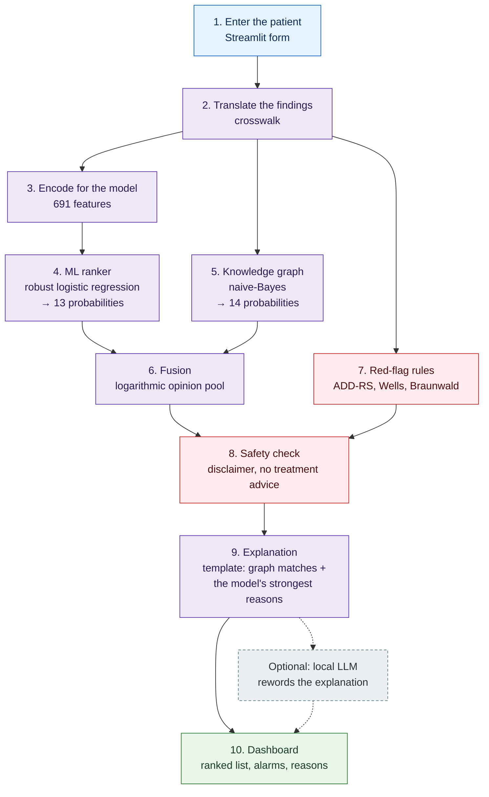
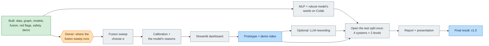
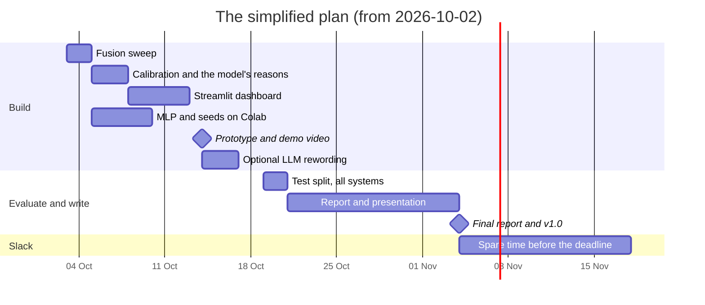

# 13 — The simplified project: what changes, and how it works

**Status:** a proposal for the owner to review **before any code changes** (2026-10-02). The
matching change to the evaluation protocol (`docs/05` amendment 4) is drafted but not committed.
Nothing is deleted: code and results that leave the plan stay in the repository, marked as
deferred.

---

## 1. The project in one paragraph

**Nightingale helps a clinician think through acute chest pain.** You enter a patient's age, sex
and findings (for example *tearing pain going to the back, sudden onset*). Nightingale returns the
14 possible causes in order of likelihood. It says why each one is there, raises an alarm for the
conditions that are dangerous to miss, and always reminds the user that it is decision support,
not a diagnosis.

It does this by combining two different kinds of knowledge. A **machine-learning model** learned
from 255,900 synthetic patients. A **medical knowledge graph** stores which findings belong to
which condition, including one condition the data never contains (aortic dissection).

---

## 2. What changes

### 2.1 Before and after

| Area | Before (the full plan) | After (simplified) | Why |
|---|---|---|---|
| **ML models** | Six variants of logistic regression and XGBoost, each with five random seeds | **Two logistic regressions**: one trained on full histories, one on full **and** partial histories (the "robust" one, used by the system). XGBoost stays only as an already-measured finding | The robust logistic regression is already the best safe model; XGBoost's failure on short histories is a finding, not something to keep tuning |
| **Deep learning** | A deep ranker with its own hypothesis, seeds and comparisons | **One small neural network (MLP)**, trained like the robust model and compared with it | Keeps the supervisor's request, in a form that takes days, not weeks |
| **Knowledge graph** | DDXPlus + BODHI-S + hand-written dissection, in Neo4j and NetworkX | **Unchanged** (already built) | It is done and it is the project's distinctive part |
| **Fusion and red flags** | Built | **Unchanged** | Done |
| **Explanations** | Retrieval from PubMed, a local LLM, claim-checking, SHAP | **A template**: the graph's matched findings + the model's strongest reasons. A local LLM may reword it (optional) | A template is fully explainable and needs no extra data or GPU |
| **Patient knowledge graph + Synthea** | Planned (1d) | **Cut** | No result depended on it |
| **FastAPI service** | Planned (1e) | **Cut** | The Streamlit dashboard calls the pipeline directly |
| **"What to ask next"** | Planned (3d) | **Cut** | Optional extra |
| **Evidence levels** | Every system at 100%, 50% and 25% of each history | **100% and 25%** judged; 50% in an appendix | Two levels tell the story: full history and a short one |
| **Research questions** | Six hypotheses plus reduced-evidence versions, targets and stretches | **Three questions** (§4) | Each answers one plain question; the old set could not support any claim (E-2) |
| **Ablations** | A0–A7 and A1b | **Four rows**: model only, graph only, fusion, fusion + red flags | Each row removes one idea |
| **Paperwork** | Many open decision IDs and errata | **One amendment** (`docs/05` amendment 4) that resolves E-2 | Fewer moving parts to explain |

### 2.2 What is not lost

Every result so far stays and becomes part of the story, from EXP-003 to EXP-019:

- XGBoost collapsing on short histories;
- the robust model fixing it;
- the graph's circularity;
- the red-flag rules.

All 734 tests and the four golden clinical cases stay. The evaluation still opens the test split
once, at the end.

### 2.3 What it costs

- **Fewer comparisons.** Questions such as "is XGBoost with masked training better than logistic
  regression with it?" are no longer asked.
- **No literature retrieval.** Explanations cite the knowledge graph, not papers.
- **Decided after results were known.** The simplification comes after the validation results,
  and the protocol must say so. One of the three hypotheses (RQ1) confirms on the test split what
  validation already showed.

---

## 3. How the finished system works: a walk-through

Each step below says what happens, what is used, and what happens to **GC-003**: a 64-year-old
man with tearing chest pain going to the back, sudden onset, and a difference in blood pressure
between the arms. That is the classic picture of an **aortic dissection**, the one condition the
training data does not contain.

### Step 1 — Enter the patient
- **What happens:** the user enters age, sex and findings. A finding can be present or explicitly
  denied ("no pain on exertion"). In the evaluation, DDXPlus's synthetic patients go through the
  same steps.
- **What is used:** the Streamlit dashboard (2e, to build). The case is a `PatientCase` from
  `src/contracts.py`; findings use readable ids such as `SYM:pain_character_tearing`.
- **GC-003:** chest pain, tearing pain, radiation to the back, sudden onset, inter-arm blood-pressure
  difference.

### Step 2 — Translate the findings
- **What happens:** the knowledge graph and the model speak DDXPlus's language: questions coded
  `E_nn` with coded answers. The **crosswalk** maps each readable finding to its DDXPlus question
  and answer. Each mapping records how exact it is (exact, close, broader, narrower), so only sound
  conclusions are drawn.
- **What is used:** `src/medical_kg/crosswalk.py`; `src/ml/case_tokens.py` picks one representative
  DDXPlus answer per finding for the model.
- **Subject:** ontology mapping (knowledge representation).

### Step 3 — Encode for the model
- **What happens:** the findings become 691 numbers. There is one column per possible answer, an
  ordered value for scales such as pain intensity, and an **"asked" column per question**. The
  "asked" columns let the model tell "the patient said no" apart from "nobody asked".
- **What is used:** `EvidenceEncoder` in `src/ml/features.py` (feature fingerprint
  `ddd14019c66eff10`).
- **Subject:** feature engineering (machine learning).

### Step 4 — The ML ranker scores 13 conditions
- **What happens:** a **logistic regression** gives a probability to each of the 13 conditions it
  was trained on. It was trained on every training patient **plus a copy of each with part of the
  history hidden**. That is why it stays reliable when a history is short, where XGBoost collapses
  (EXP-017, EXP-019).
- **What is used:** scikit-learn logistic regression, trained once on Colab and saved as JSON in
  `models/nightingale_b1_asked/b1_asked_aug` (the configured "B1-LR′+aug").
- **GC-003:** the model has never seen aortic dissection, so it cannot name it. It spreads its
  belief over what it knows: unstable angina 0.65, stable angina 0.09, MI 0.07.
- **Subject:** supervised machine learning.

### Step 5 — The knowledge graph scores 14 conditions
- **What happens:** the graph links each condition to the findings it causes, with how often it
  causes them. A **naive-Bayes** score asks: *if the patient had this condition, how likely are
  these findings?* Findings that are not mentioned count for nothing; denied findings count
  against the conditions that expect them.
- **What is used:** the graph built from three sources (DDXPlus, BODHI-S, and the hand-written
  dissection with published frequencies), 129 nodes and 321 edges. It is stored in **Neo4j
  AuraDB** and scored in memory with **NetworkX** (`src/medical_kg/scoring.py`).
- **GC-003:** the graph knows dissection. Its score is −4.57, against −6.84 for unstable angina.
- **Subject:** knowledge graphs; Bayesian probability.

### Step 6 — Fusion combines the two opinions
- **What happens:** a **logarithmic opinion pool** multiplies the two opinions, each raised to its
  weight, and re-normalises. Three rules keep it safe:
  1. A condition the model cannot score (dissection) takes the graph's probability.
  2. No model probability below 1% is taken at face value, so an over-confident model cannot veto
     the graph.
  3. If either side fails, the other ranks alone, and the screen says so.
- **What is used:** `src/fusion/pool.py`. The one tuned number, the graph's weight α, is chosen on
  validation patients by a pre-registered rule (EXP-006). Until then it is 0.5.
- **GC-003:** dissection comes **first even without the red flags**. Before the fusion was
  redesigned it came 3rd.
- **Subject:** decision theory, ensemble methods.

### Step 7 — Red-flag rules
- **What happens:** hand-written rules after published clinical scores watch for the
  conditions that must not be missed:
  - **ADD-RS** for aortic dissection;
  - **Wells** for pulmonary embolism;
  - **Braunwald** for unstable angina;
  - and rules for MI, pneumothorax, Boerhaave, myocarditis and pulmonary edema.

  A flagged condition is moved to the top, whatever its score, and the reason is shown.
- **What is used:** `src/reasoning/red_flags.py`.
- **GC-003:** the dissection flag fires: *"tearing character … inter-arm blood-pressure
  difference — aortic dissection must be excluded."*
- **Subject:** clinical prediction rules (evidence-based medicine), safety engineering.

### Step 8 — Safety check
- **What happens:** before anything is shown, a final check enforces the safety requirements and
  repairs a result that breaks them:
  - the disclaimer is always present, word for word;
  - flagged conditions always come first;
  - a sentence that recommends a treatment or names a drug is removed, and the removal is shown.

  Separately, the pipeline lists any component that failed (`degraded_components`), so a failure
  is never silent.
- **What is used:** `src/reasoning/safety.py`; `src/pipeline.py`.

### Step 9 — Explanation
- **What happens:** a template writes why the top conditions are there, from two sources:
  - the graph's **matched findings** (✓ present, ? not recorded but would help);
  - the **logistic regression's strongest contributions**: the features that raised or lowered
    the score most, which a linear model shows directly.

  Optionally, a local language model running on the laptop (Ollama) rewords the template into
  smoother prose. It may add nothing the template did not contain.
- **What is used:** `TemplateExplainer` (`src/stubs.py`, already working for the graph part). The
  model's contributions are added in 2b. The optional LLM needs the owner's go-ahead (D-5, D-9).
- **GC-003:** *"Supporting findings: chest pain, inter-arm BP difference, tearing pain, radiation to
  back, sudden onset, hypertension. Not recorded, and would help: loss of consciousness, new aortic
  regurgitation murmur, focal neurological deficit…"*
- **Subject:** explainable AI.

### Step 10 — The dashboard
- **What happens:** the user sees:
  - the ranked list, with each condition's scores;
  - the alarms, at the top and in red;
  - the explanation;
  - which components (if any) failed;
  - the disclaimer.
- **What is used:** Streamlit (2e, to build). `scripts/demo.py` already prints the same thing in
  the terminal.

---

## 4. How the project is judged

Everything is measured on DDXPlus patients at **two evidence levels**:

- **100%:** the whole history;
- **25%:** a quarter of the questions, chosen at random but reproducibly, with the patient's first
  complaint always kept.

The test split is opened **once**, at the end. Every figure carries a 95% confidence interval.

### The three questions

| # | Plain question | Compared | Measured by | Validation already shows |
|---|---|---|---|---|
| **RQ1** | Does training on incomplete histories make the model safe when a history is incomplete? | Robust logistic regression vs. the ordinary one, at 25% | Must-not-miss recall in the top 3; top-3 accuracy (McNemar's test) | Yes: 0.997 vs 0.925 must-not-miss recall (EXP-019). The test split confirms it |
| **RQ2** | Does adding the knowledge graph improve the ranking? | Fusion vs. the model alone and vs. the graph alone, at 25% | MRR (how high the right answer sits), paired bootstrap test | **Unknown**: no fused result exists yet. Model alone 0.971, graph alone 0.854 |
| **RQ3** | Is the full system safe? | Fusion + red flags, at 100% and 25% | Must-not-miss recall ≥ 0.95 and dangerous misses (outside the top 5) ≤ 2% | The model alone already meets both on validation |

**Also reported:**
- the small neural network against the robust logistic regression at 25%;
- XGBoost, as the model that fails on short histories;
- calibration (do the percentages mean what they say?);
- the red-flag rules' own hit rate;
- the four golden clinical cases.

**Success:** the Target is RQ1 and RQ3 supported. The Stretch is RQ2 supported, plus calibration
error under 0.10. Missing the Target while running end to end is still a passing outcome, if the
report explains why.

### The honest limits, stated with every result
- **Synthetic data.** DDXPlus patients are generated, not real.
- **Circularity.** The graph is built from the same source the model learns from, so the graph's
  accuracy on DDXPlus is not evidence of skill. The hand-written golden cases are.
- **Closed world.** Anything outside the 14 conditions is forced into one of them.
- **Saturation.** With full histories the model is nearly perfect, so there is little room to
  improve on there.

---

## 5. What is left to build

| Step | Who | Effort |
|---|---|---|
| Choose where the fusion sweep runs (laptop CPU suggested; about 5 min) | the owner | a reply |
| Fusion sweep and its log entry | Claude | ½ day |
| Calibration of the fused scores; the logistic regression's reasons in the explanation | Claude | 2–3 days |
| Streamlit dashboard | Claude, the team reviews | 3–4 days |
| MLP and the robust model's five seeds: a Colab notebook | Claude writes it, the owner runs it (about 1 h) | 2 days + the run |
| Prototype tag and demo video | the team | 1 day |
| Optional LLM rewording | Claude, with the owner's GPU go-ahead | 2–3 days |
| Open the test split; score the 4 systems + the MLP + XGBoost at 100% and 25% | Claude | 2 days |
| Report and presentation | the team, with Claude's drafts | 1½–2 weeks |
| Still open with the team, not blocking: the clinical review of the 17 representative answers (A-8), a fifth golden case (GC-005) | the team | — |

---

## 6. How long

**About 4½ weeks of work to the final report, around 4 November, against the planned
18 November.** That leaves about two weeks of slack.

Before simplifying, the estimate was about 6½ weeks with no slack. The dates assume the owner's
replies and the Colab run come within a few days of each request.

---

## 7. What to tell the mentor (a 30-second version)

> Nightingale ranks the causes of chest pain by fusing a machine-learning model with a medical
> knowledge graph, under safety rules taken from published clinical scores. Three findings:
>
> 1. On complete histories the synthetic dataset is too easy: a simple model is 99.8% right.
> 2. On incomplete histories a normally trained model fails dangerously. Training on deliberately
>    incomplete copies fixes it.
> 3. The knowledge graph adds what the data cannot: a condition absent from the data, aortic
>    dissection, is ranked first.
>
> Every result is pre-registered, carries a confidence interval, and is tested once on held-out
> patients.

---

## 8. What changes in the repository when the owner says go

1. **The protocol.** `docs/05` amendment 4 sets out the three questions, the two levels, the
   systems and the tests. It also resolves E-2 and states what was known when it was written.
2. **The fusion sweep.** `scripts/sweep_fusion.py` sweeps only the system's own model, judged at
   100% and 25%.
3. **The plan.** `PROGRESS.md` marks the cut items ⏭️ with this date and redraws the remaining plan.
   `README.md`, `docs/00` (charter) and `docs/02` (architecture) get a short "simplified" note.
   `docs/12` is redrawn.
4. **The seeds notebook** (`colab_b1_seeds.ipynb`) is no longer needed. The MLP notebook will train
   the robust model's seeds instead.
5. **Nothing is deleted.** Code for the cut parts stays, marked as deferred.
