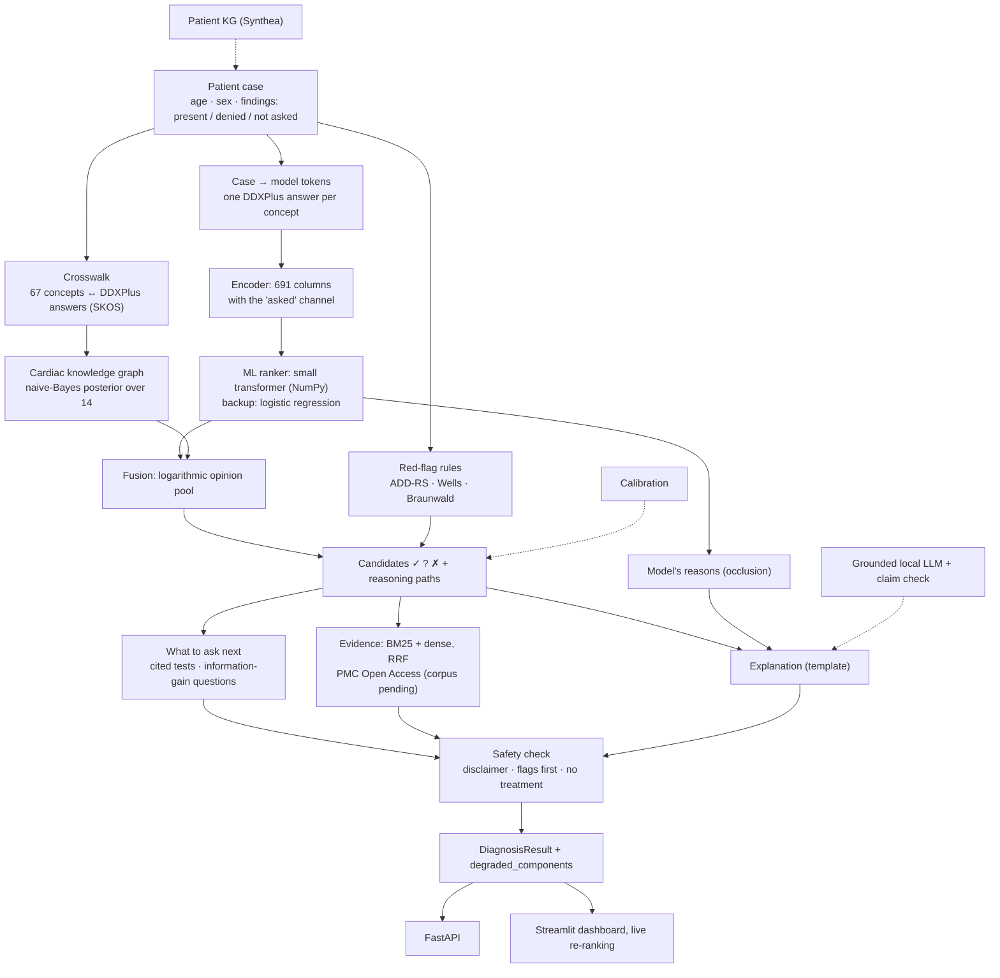

# 18 · Nightingale: the full project report

**Nightingale — Clinical Intelligence & Reasoning System**\
**Version 1.0 · 2026-10-14** (end of Week 4 of the plan; Week 1 began 2026-09-17)\
**Team:** [P1, cardiac knowledge graph] · [P2, data and ML] · [P3, retrieval, LLM and safety] ·
[P4, platform and evaluation]\
**Supervisor:** [Prof. Ashish Kumar: confirm title] · **Institution:** [to add]\
**Repository:** `github.com/HarshRohila02/nightingale` (public) · **Status file:** `PROGRESS.md`

> ⚠️ **Clinical decision support, not a diagnosis.** Nightingale is a research prototype. Its
> output is generated from synthetic training data and must not be used for real patient care.
> Rankings are not certainties, and confidence values are estimates. A qualified clinician is
> responsible for all diagnostic and treatment decisions.

This report explains the whole project in one place:
- the problem and the objectives;
- the data, every component and the tools;
- the final product;
- how it is evaluated, and the results so far;
- the phases, how much is done and how much is left;
- the risks and the decisions.

It is written from the repository's own records:
- `PROGRESS.md`, the status;
- `docs/08`, every experiment;
- `docs/00`–`17`, the plans and designs;
- `docs/report/`, the formal report's first draft.

**Two rules for the figures.** Every figure is from the **validation split** of synthetic DDXPlus
patients, and comes with its 95% bootstrap interval and its evidence level. The test split has not
been opened: it is opened once, in Phase 4.

---

## Status at a glance (2026-10-14)

| | |
|---|---|
| **Working prototype** | ✅ `v0.1-prototype` tagged 2026-10-14. It is the dashboard and API over the full ranking pipeline: the transformer, the knowledge graph, the fusion, the red flags, the model's reasons, and since then "what to ask next" |
| **Sub-phases done** | **15 of 26** (58%); 5 in progress; 6 not started. Counting the in-progress ones as half: about **67%** (§12) |
| **Objectives met** | O2, O3, O5 and O8 met. O4 and O6 are built but wait on a decision or a cloud run. O1 and O7 remain (§2.1) |
| **Experiments** | 18 of 23 run and recorded: 17 complete, plus EXP-007's first stage. EXP-011 (retrieval quality) is pre-registered and waits for its corpus. EXP-006 (fusion sweep) waits on decision E-2. EXP-009/010 (LLM baselines) and EXP-012 (the final ablation on the test split) are still to run |
| **Tests** | 1,102 automated tests: 1,087 pass and 15 skip on the laptop; CI is green on GitHub |
| **Deadline** | **2026-11-15**: the working prototype and the report are presented. **32 days left** |
| **The biggest pieces left** | The evidence corpus (a Kaggle run); the LLM explanation and its guardrails; calibration; the fusion sweep; the patient graph; the test-split evaluation and ablations; the final report |

---

## 1. Introduction

### 1.1 The problem
Acute chest pain is one of the most common and highest-stakes presentations in emergency and
primary care. The clinician must separate the causes that kill if missed from the benign ones,
often from the history and examination alone, before confirmatory tests return.
- **Dangerous causes:** myocardial infarction, pulmonary embolism, pneumothorax, aortic
  dissection, oesophageal rupture.
- **Benign causes:** reflux, panic attack.

The cost of an error is not symmetric. A false alarm costs a test; a missed heart attack can cost
a life.

### 1.2 Why existing aids fall short
1. **Black-box machine-learning classifiers** give a label or a probability with no reasoning a
   clinician can inspect, so the clinician cannot safely trust or override them.
2. **Large language models** write fluent clinical text, but can state false facts, cannot reliably
   cite their sources, and are poorly calibrated.

Neither shows the two things a clinician reasons with:
- **what evidence supports each candidate**;
- **what information is still missing** to tell the candidates apart.

### 1.3 Aim
**A clinician-facing decision-support prototype that ranks the causes of acute chest pain and
explains the ranking.** It combines:
- a machine-learning ranker;
- a cardiac knowledge graph;
- an independent set of red-flag rules;
- evidence retrieval from the literature;
- and, planned, a guardrailed local language model.

It is judged first on **keeping the dangerous conditions in view** (must-not-miss recall), and
only then on how often its first answer is right.

### 1.4 What we do and do not claim
- **We do not claim** that combining a knowledge graph with ML or an LLM is new. It is not.
- **The contributions:**
  1. a red-flag-aware differential ranker for one high-stakes presentation, evaluated on
     must-not-miss recall;
  2. a knowledge graph that covers a diagnosis absent from the training data (aortic dissection);
  3. a pre-registered evaluation at three evidence levels;
  4. a measured finding about incomplete histories and its repair (the "asked" channel);
  5. a deep model adopted only through a safety floor fixed before training;
  6. an ablation study of every component, negative results included (Phase 4).
- **No clinical efficacy is claimed.** The system is built and evaluated on synthetic and open data
  only.

---

## 2. Objectives, research questions and success criteria

### 2.1 Objectives (`docs/00` §3)

| # | Objective | Measurable outcome | Status, 2026-10-14 |
|---|---|---|---|
| O1 | A patient knowledge graph from case data | Built for ≥ 95% of cases | ⬜ Not started (sub-phase 1d; the cloud session's task T7 writes the code) |
| O2 | A cardiac knowledge graph of condition↔finding links | All 13 conditions, with qualifiers | ✅ 129 nodes, 321 edges, three sources |
| O3 | An ML ranker producing a ranked differential | Top-3 well above the prevalence baseline | ✅ Logistic regression, XGBoost and a small transformer (the configured ranker) |
| O4 | Fusing the graph and the ML into one explainable ranking | Fusion beats both alone | 🔄 Built (a logarithmic opinion pool); its weight sweep waits for decision E-2 |
| O5 | Must-not-miss conditions as red flags | Must-not-miss recall@3 ≥ 0.95 | ✅ One rule per must-not-miss condition; the configured ranker meets the target at every level. The rules alone reach sensitivity 0.823, below their own 0.95 target (§10.5) |
| O6 | Real, cited evidence per candidate | ≥ 80% of claims traceable to a passage | 🔄 The retrieval code is done; the corpus waits for the owner's Kaggle run |
| O7 | Each component's contribution | Ablation A0–A7 and A1b, at three evidence levels | ⬜ Phase 4 (on the test split) |
| O8 | A usable clinician-facing interface | A working dashboard over the full pipeline | ✅ Streamlit dashboard with live re-ranking, plus a FastAPI service |

### 2.2 Research questions and hypotheses (`docs/05` §1, frozen; v1.4)

| # | Research question | Hypothesis |
|---|---|---|
| RQ1 | Does fusing graph reasoning with an ML ranker improve accuracy over either alone? | **H1:** fusion beats ML-only and graph-only on top-3 and MRR. **H1-R:** the same at 50% and 25% evidence |
| RQ2 | Does the system improve safety over ML alone? | **H2:** fusion plus red flags beats ML-only on must-not-miss recall@3. **H2-R:** at 50% and 25% too |
| RQ3 | Does evidence grounding reduce unsupported claims? | **H3:** a retrieval-grounded explanation has fewer unsupported claims than an LLM alone |
| RQ4 | Which components contribute? | **H4:** removing the medical graph hurts must-not-miss recall more than top-1 |
| RQ5 | Are the confidence scores calibrated? | **H5:** ECE < 0.10 after calibration |
| RQ6 | Does a deep ranker hold up better when the history is incomplete? | **H6:** the deep ranker beats each classical model trained like it, at 50% and 25% |

Three facts shape these hypotheses:
- **H1 and H2 cannot be supported on complete DDXPlus histories,** because the ML-only baseline is
  already at the ceiling there (R-16). The protocol therefore adds 50% and 25% levels
  (amendment 3).
- **As written, the reduced-level claims need both 50% and 25%,** and at 50% the comparators are
  near perfect. The team has been asked how to judge them (decision **E-2**, still open; §12.3).
- **A failed hypothesis is a reportable result,** and the report will say so.

### 2.3 Success criteria (`docs/00` §6, `docs/05` §7)

| Level | Criteria |
|---|---|
| **Minimum** | A working prototype that takes a chest-pain case and returns a ranked, explained differential with red flags; complete documentation; evaluation against baselines. ✅ Met on validation; the test-split evaluation is Phase 4 |
| **Target** | The above, plus retrieval-grounded evidence with citations, calibrated confidence and the complete ablation study |
| **Stretch** | "What to ask next" (✅ built); an ECG extension (not pursued); a publishable write-up |

**Metric targets:**
- must-not-miss recall@3 ≥ **0.95**;
- dangerous false-negative rate ≤ **0.02**;
- red-flag sensitivity ≥ **0.95**;
- ECE < **0.10**;
- unsupported claims < **20%**;
- latency < 5 s without the LLM and < 20 s with it.

---

## 3. Scope

**The 14 conditions** (`src/conditions.py`): 13 present in DDXPlus, plus aortic dissection.

| Condition | Category | Must-not-miss | In DDXPlus |
|---|---|:-:|:-:|
| Possible NSTEMI / STEMI | Cardiac, ischaemic | ✓ | ✓ |
| Unstable angina | Cardiac, ischaemic | ✓ | ✓ |
| Stable angina | Cardiac, ischaemic | | ✓ |
| Pericarditis | Cardiac, inflammatory | | ✓ |
| Myocarditis | Cardiac, inflammatory | ✓ | ✓ |
| Acute pulmonary edema | Cardiac, failure | ✓ | ✓ |
| Atrial fibrillation | Cardiac, arrhythmia | | ✓ |
| PSVT | Cardiac, arrhythmia | | ✓ |
| Pulmonary embolism | Non-cardiac mimic | ✓ | ✓ |
| Spontaneous pneumothorax | Non-cardiac mimic | ✓ | ✓ |
| Boerhaave syndrome | Non-cardiac mimic | ✓ | ✓ |
| GERD | Non-cardiac mimic | | ✓ |
| Panic attack | Non-cardiac mimic | | ✓ |
| Aortic dissection | Vascular | ✓ | **✗**: the knowledge graph and a red-flag rule only |

**In scope:**
- one presentation, acute chest pain;
- decision support only: a ranked differential, evidence, reasoning, red flags, the tests and
  questions to consider;
- synthetic and open data only.

**Out of scope:**
- autonomous diagnosis, and any treatment or drug recommendation;
- real or identifiable patient data, and clinical deployment;
- other presentations;
- training a medical language model;
- any claim of clinical efficacy.

**Closed world (R-13).** The system knows only these 14 conditions. A patient with, say,
pneumonia is still ranked as one of them, and every result says so.

---

## 4. Background in brief

The full literature review, eight strands with 71 references, is in
`docs/presentation/midterm-prep.md` §2 and §10.
- **References marked [V]** were added from general knowledge and must be checked before
  submission.
- **References marked [R]** are already cited in the repository.

The strands, briefly:
1. **Computer-aided diagnosis.**
   - Lineage: probabilistic diagnosis (Ledley & Lusted 1959), naive Bayes for abdominal pain (de
     Dombal 1972), expert systems (MYCIN, INTERNIST-I, QMR-DT, DXplain), symptom checkers, causal ML.
   - What it leaves open: knowledge-based systems explain but do not learn, and learned systems
     learn but do not explain.
2. **Chest pain and clinical rules.**
   - The red flags follow published patterns: the ADD-RS for aortic dissection (Hiratzka 2010;
     Rogers 2011), the IRAD registry for its finding frequencies (Hagan 2000; Evangelista 2016),
     the Wells criteria for pulmonary embolism, and the Braunwald classification for unstable
     angina.
   - "What to ask next" cites ESC and ACC/AHA guidelines.
3. **Automatic diagnosis.**
   - DDXPlus (Fansi Tchango et al. 2022), about 1.3 million synthetic patients across 49
     pathologies, is our dataset.
   - The deep models published on it are interactive question-asking agents or transformers.
   - In the studies we reviewed, we found no evaluation of a fixed classifier on histories with a
     given share of answers removed, or of its cost.
4. **Tabular deep learning and missing data.**
   - The FT-Transformer (Gorishniy 2021) is the basis of our deep ranker.
   - Trees still often beat deep models on tables, so classical comparators stay.
   - With missing inputs, the best predictor depends on what is missing (NeuMiss, 2020).
5. **Knowledge graphs.**
   - UMLS, HPO, Hetionet and PrimeKG are broad.
   - BODHI-S matched only 31% of our conditions, so the graph is built from DDXPlus's own knowledge
     base. SKOS gives the mapping relations.
6. **Fusion, calibration and explanation.**
   - Fusion: the logarithmic opinion pool (Genest & Zidek 1986).
   - Calibration: Platt scaling, isotonic regression and temperature scaling.
   - Explanation: occlusion and SHAP.
7. **Retrieval and LLMs.**
   - Retrieval: BM25, dense retrieval and reciprocal rank fusion.
   - Medical LLMs are strong but hallucinate, and retrieval-augmented generation helps.
8. **Safety.** Alert fatigue: a flag that fires too often is ignored.

---

## 5. The final product

### 5.1 What it is
A local application. A clinician enters a chest-pain presentation: age, sex, and each finding
marked **present**, **denied** or **not asked**, plus risk factors. It returns, **live as each
finding is ticked**:
1. **a ranked differential** of the 14 conditions, red-flagged ones first;
2. **red flags** for any must-not-miss pattern, with the published rule that fired;
3. **why each candidate is there:**
   - the findings that support it (✓), contradict it (✗) or are still missing (?);
   - the knowledge graph's reasoning paths;
   - the model's own strongest reasons, for and against;
4. **what to ask next:**
   - the diagnostic tests to consider, each citing its guideline (investigations only, never a
     treatment);
   - the unrecorded findings whose answer would most narrow the differential;
5. **evidence:** short passages from open-access articles, each with its link and licence
   (switched on once the corpus is built);
6. **an explanation:** template-based now; a grounded LLM explanation is planned;
7. **what failed, if anything** (`degraded_components`), and the response time;
8. **the disclaimer**, on every screen and every result.

### 5.2 Its three interfaces
- **The dashboard** (Streamlit, `app/streamlit_app.py`):
  - served on `127.0.0.1:8501`, this machine only;
  - loads the four golden cases as examples;
  - shows ranks rather than raw scores, because the scores are not calibrated probabilities yet;
  - re-ranks on every change, in about 10 ms.
- **The API** (FastAPI, `src/api/app.py`), served on `127.0.0.1:8000`, with an `X-Elapsed-Ms`
  header on each result:
  - `POST /diagnose`: the full result as JSON;
  - `POST /next-questions`: the questions worth asking next;
  - `GET /conditions`, `GET /concepts`, `GET /health`.
- **The command-line demo** (`scripts/demo.py`): runs a case on the real graph and model.

### 5.3 How it behaves on the golden cases (hand-written vignettes the tests enforce)
- **GC-003, aortic dissection.** It ranks **first**, with a red flag, although the model has never
  seen a dissection patient: DDXPlus has none. Its row says the graph and the rules carry it. With
  the red flags switched off it is still first, through the fusion.
- **GC-001, acute coronary syndrome.**
  - The ischaemic red flag fires, and MI is first.
  - The top questions to ask are **pain at rest** and **a crescendo pattern**, the findings that
    separate unstable angina from MI.
  - The tests to consider are a 12-lead ECG and serial high-sensitivity troponin (ESC 2023).
- **GC-002, pulmonary embolism:** first, with its red flag; the tests are a probability score, then
  D-dimer or CT pulmonary angiography (ESC 2019).
- **GC-004, reflux:** first, with no flag; the tests exclude a cardiac cause first.

All four pass with red flags on and off, on the real graph and transformer and on the stubs.

### 5.4 Guarantees built into the product
- **It ranks and flags; it never diagnoses.** The disclaimer is attached by the safety layer and
  cannot be removed.
- **No treatment, drug or dose is ever recommended.**
  - The safety layer strips any such sentence and records that it did.
  - Retrieved passages with treatment language are never stored or shown.
- **Red flags run independently of the model** and are listed first.
- **A failed component never crashes it.** It degrades and names what failed.
- **Nothing leaves the laptop.** Both servers listen on `127.0.0.1` only.

### 5.5 Versions: what each one adds
| Version | Content | Status |
|---|---|---|
| `v0.1-prototype` | The dashboard and API over the transformer, the graph, the fusion, the red flags and the model's reasons | ✅ 2026-10-14 |
| `v0.2-prototype` | Plus what to ask next (✅ merged) and evidence with citations (code merged; the corpus waits for the Kaggle run) | After the corpus run |
| `v1.0` (final) | Plus calibrated confidence, the grounded LLM explanation with a claim check, the patient graph, and the test-split evaluation with every ablation | 2026-11-14 |

---

## 6. Data

### 6.1 Sources and licences
| Source | What | Licence | Role | Status |
|---|---|---|---|---|
| **DDXPlus** (`aai530-group6/ddxplus`) | Synthetic patients: age, sex, coded evidence, the true pathology, a ranked differential | CC-BY-4.0 | Training and validation; the graph's backbone (`release_conditions.json`) | In use |
| **BODHI-S** (`ekacare/BODHI-S`) | A condition–symptom graph with likelihood bands, SNOMED-coded | **CC-BY-NC-4.0, non-commercial** | Enriches four conditions | In use |
| **Hand-authored aortic dissection** | ADD-RS markers, with frequencies from the IRAD registry | Our work, from published sources | 20 graph edges and a red-flag rule | In use |
| **Golden cases** (`tests/fixtures/golden_cases.yaml`) | Four hand-written vignettes | Our work | Clinical expectations that must always pass | In use |
| **PMC Open Access** | Article passages, Creative Commons licences only | Per article | Cited evidence | Code ready; corpus pending |
| **Synthea** | Synthetic patient records | Open | Patient knowledge graph | Planned (1d) |
| UCI Heart Disease, PTB-XL | Cardiac features; ECGs | Open | Stretch goals | Not pursued |

### 6.2 DDXPlus and our subset
- **The full release:** 1,025,602 training and 132,448 validation patients across 49 pathologies.
- **Our subset**, the patients whose true condition is one of our 13:
  - **255,900 training** (25.0%) and **33,963 validation** (25.6%) patients;
  - 16,943 of the validation patients have a must-not-miss condition.
- **Class balance:** the largest class is 2.70× the smallest; the rarest, pneumothorax, has 10,162
  training patients. No class is too rare to learn.
- **Evidence tokens** come in four forms:
  - binary, e.g. `E_91`, fever;
  - categorical value, e.g. `E_54_@_V_161`;
  - numeric ordinal, e.g. `E_56_@_4`, pain intensity 0–10 (12.6% of tokens);
  - the "NA" sentinel.

  The vocabulary has 919 entries; our 13 conditions use 84 questions.
- **Three traps, all handled:**
  1. **A listed token can mean "no".** "Did not travel" is listed for 89.6% of patients, so every
     component reads `positive_codes()`, the answers other than "no".
  2. **The English is machine-translated from French.** `déchirante`, tearing, becomes
     "heartbreaking", so every component works on codes, not text.
  3. **The demographics are synthetic** (~50% female everywhere), so equal results by sex prove
     nothing about fairness.
- **The ground-truth differential is open-world:** 33% of its probability mass is on conditions
  outside our 13. Precision@3 and Recall@5 therefore count only the in-scope part (decision D-8).

### 6.3 The splits
- **Training:** used only to train, in the cloud.
- **Validation:** all development and every result in this report.
- **Test:** **locked until Phase 4**, opened exactly once.
  - It has never been downloaded.
  - The parquet builder refuses it unless a config switch is turned on.
  - A test checks that no cloud notebook fetches it.

### 6.4 Data management
- Nothing under `data/` or `models/` is ever committed.
- BODHI-S text is never committed (its licence); its facts are keyed by its ids.
- Models are stored as JSON, never as pickles.
- The Neo4j credentials live only in a local `.env` file, never shared.

---

## 7. System architecture and methods

### 7.1 Design principles (`docs/02` §1)
1. **Every module is replaceable behind an interface.** Neo4j can become NetworkX, and the model a
   degraded stub, without anything downstream noticing.
2. **Degrade, never crash.** On a failure the system still answers and says what is missing.
3. **Safety is not downstream of the model.** The red-flag rules run independently.
4. **Explanations are derived, not generated.** They come from graph operations; a language model
   may only phrase them.
5. **Typed boundaries.** All data between modules uses the Pydantic models in `src/contracts.py`,
   which change only with all four team members' agreement.

### 7.2 The request path
Solid boxes are built; dashed boxes are planned.



### 7.3 Contracts and the pipeline
- **The data types** (`src/contracts.py`):
  - `Finding`: a concept with an assertion, present, absent or unknown. "Denies leg swelling" and
    "leg swelling not asked" are different facts.
  - `PatientCase`, `Candidate`, `Explanation` and `DiagnosisResult`.
- **The interfaces:** `ConditionRanker`, `GraphStore`, `EvidenceRetriever` and `Explainer`.
  - Each had a stub in week 1, so the pipeline ran end to end before any real component existed.
  - The real components replaced the stubs one by one, and the "walking skeleton" was reached on
    2026-09-24.
- **The order of steps** (`src/pipeline.py`):
  1. score with the model and the graph independently;
  2. fuse;
  3. analyse the findings;
  4. evaluate the red flags;
  5. attach the evidence and the tests;
  6. explain;
  7. run the safety check.

### 7.4 The cardiac knowledge graph (`src/medical_kg/`)
- **129 nodes:**
  - 14 conditions;
  - 66 symptoms;
  - 49 risk factors.
- **321 edges, by source:**
  - **245 from DDXPlus**, weight 1.0;
  - **56 from BODHI-S**, weighted by likelihood band;
  - **20 hand-authored** for aortic dissection, weighted from IRAD frequencies.
- **Every edge keeps its source.** The graph is a multigraph keyed by source, so a fact stated
  twice counts once. `only_sources()` builds the subsets used in ablations.
- **Two stores, one graph:**
  - **Neo4j AuraDB Free:** the team's cloud copy, under the label `CardiacKG`, fingerprint
    `de349201157a`. It is read once at start-up and scored in memory.
  - **NetworkX:** the identical local fallback, used automatically when Aura is paused or offline.
    The result then reports `graph_backend`.
- **Two vocabularies.** DDXPlus links conditions to *questions*, not answers; the hand-authored and
  BODHI-S edges are answer-level. The crosswalk links them.

### 7.5 The crosswalk (`src/medical_kg/crosswalk.py`)
- **67 hand-authored concepts** (`SYM:*`, `RF:*`), used by the rules and golden cases, map to
  DDXPlus answers.
- **Each mapping has a SKOS match type**, exact, close, broader, narrower or related, and allows
  only the sound inferences for its type. For example, a broader answer does not imply its
  narrower concept.
- **A test fails** if any concept the code uses lacks an entry.

### 7.6 The graph score (`src/medical_kg/scoring.py`, EXP-005)
- **A naive-Bayes log-likelihood** over the graph, closed under the crosswalk, gives a posterior
  over the 14 conditions:
  - answers imply their questions;
  - a condition that asks a question gets that question's mean answer likelihood.
- **Not mentioned is not denied.** A finding the case does not mention counts for nothing; a denied
  one counts against the conditions expecting it.
- **Chosen over Personalised PageRank,** because it is more robust on the angina pair and can be
  broken down exactly into each finding's contribution, which feeds the explanation.
- **Two blind spots, by design:**
  - Stable and unstable angina tie when nothing is denied, and the tie goes to unstable angina.
  - An answer only one condition states (tearing pain) cannot discriminate.

### 7.7 Feature encoding and the "asked" channel (`src/ml/features.py`)
- **607 columns**, fixed by the release files:
  - binary findings;
  - one-hot categorical answers;
  - ordinals as a value plus an "answered" flag;
  - NA kept explicit.
- **The defect found (EXP-017, R-18).** A "no" answer gets no column, so a short history looked
  like a patient who denied everything. Given no evidence at all, XGBoost answered atrial
  fibrillation with certainty.
- **The repair (EXP-018/019):**
  - an explicit **"asked" channel**, 691 columns: "not asked" is now distinct from "denied";
  - **masked training copies**: each training patient also appears with part of their history
    removed.

  Models trained this way carry the suffix `+aug`, and ′ when they use the channel.

### 7.8 The ML rankers
| Label | Model | Role |
|---|---|---|
| B0 | Prevalence prior | The floor |
| B1-LR / B1-XGB | Multinomial logistic regression; XGBoost (sparse input) | The serious competitors; the `+aug` and ′ variants were retrained on masked copies |
| **B1-DL′+aug** | **A small FT-Transformer** | **The configured ranker since 2026-10-13**, after passing the safety floor |
| B2 | The graph alone | Is the graph useful alone? |

**The transformer** (`src/ml/deep.py`; D-12; EXP-021):
- **Input:** one token per DDXPlus question (84), each the sum of its answers' embeddings plus an
  asked / not-asked embedding; plus age, sex and a [CLS] token.
- **Architecture:** width 96, 2 blocks, 4 attention heads, ReGLU feed-forward. It uses the
  published defaults, fixed before training: nothing is tuned beyond early stopping (T-6).
- **Size and cost:** **225,645 parameters**; about 9.6 million multiply-adds per patient, the same
  for every patient.
- **Training:** both arms over five seeds (42–46) on a **Kaggle T4 GPU**; 2 h 10 min for all ten
  networks.
- **Storage:** weights saved as JSON, base64 float32 with a SHA-256 for each.
- **On the laptop:** a pure **NumPy forward pass** on the CPU, with nothing to install.
- **The safety floor (D-13), fixed before training.** It is used only if, on validation:
  1. it meets the safety targets at 100% and 25%;
  2. it is non-inferior to logistic regression trained like it at 25% on must-not-miss recall@3
     and MRR (margin 0.005, paired bootstrap);
  3. it passes every golden case.

  It passed at all five seeds, so logistic regression became the backup.

### 7.9 From a hand-written case to model input (`src/ml/case_tokens.py`)
- **The problem:** clinicians enter concepts, but models need DDXPlus tokens.
- **Two hand-curated tables** choose one representative answer per concept, each with the original
  French. They were reviewed and approved as is (A-8, 2026-10-12).
- **A-10 (2026-10-13):** "radiates to the jaw/arm" was moved to the answer DDXPlus's heart attack
  patients actually give, "under the jaw". It had been found through the model's reasons. A
  denial reaches the model only through the "asked" channel.
- **The limit (R-17):** this inversion has no ground truth. The tests check that every concept
  survives the round trip.

### 7.10 Fusion (`src/fusion/pool.py`, 2c)
- **A logarithmic opinion pool:** a weighted geometric mean of the model's probabilities and the
  graph's posterior, renormalised. One weight, α, sets the balance.
- **The model's probabilities are floored at 0.01,** so an overconfident model cannot veto the
  graph.
- **A condition the model cannot score takes the graph's posterior.** Aortic dissection is the
  case: this is how GC-003 ranks it first with the red flags off.
- **A degraded or invalid model leaves the graph's order exactly.**
- **α is 0.5 for now, untuned.** It will be chosen by EXP-006's pre-registered sweep, which waits
  for decision E-2.

### 7.11 Red-flag rules (`src/reasoning/red_flags.py`, 2d)
- **One rule per must-not-miss condition** (8), each after a published pattern rather than a single
  suggestive finding:
  - **aortic dissection:** the ADD-RS categories;
  - **pulmonary embolism:** a symptom *and* a Wells risk;
  - **unstable angina:** a Braunwald crescendo or rest pain;
  - MI, pneumothorax, Boerhaave, myocarditis and pulmonary edema have their own rules.
- **Flagged candidates are listed first.**
- **Sudden onset** means DDXPlus `E_59` ≥ 8 (A-5).
- **Which flags are clinically appropriate** for each condition was settled by a three-judge
  majority (A-7).

### 7.12 The safety layer (`src/reasoning/safety.py`)
It runs last, on every result, and enforces:
- the disclaimer, always present;
- red flags first;
- no treatment, drug or dose in any sentence, test or evidence passage; a removed sentence is
  recorded in the explanation;
- every failed component named.

### 7.13 Calibration (`src/fusion/calibration.py`, 2b, EXP-007)
- **Methods:** none, temperature scaling, one-vs-rest Platt scaling, and isotonic regression.
- **How they are fitted:** on validation, five-fold cross-fitted; the method with the lowest mean
  Brier score over the three levels is chosen.
- **Two rules:**
  - aortic dissection keeps its raw probability, since no patient has it;
  - calibration never reorders the candidates.
- **The pipeline refuses a calibrator fitted for another system.**
- **Stage 1 result:** the logistic regressions and the transformer are already calibrated against
  DDXPlus, so they stay raw.
- **Stage 2,** calibrating the fused score, waits for the fusion's α.

### 7.14 The model's reasons (`src/ml/reasons.py`)
- **Leave-one-finding-out occlusion:** remove each recorded finding in turn, rescore in one batch,
  and see how each condition's log-odds move.
- **Shown as names only:** the strongest reasons for and against, never a raw score.
- **Cost:** 0.4–6.5 ms per case.
- **It found a real problem:** A-10, the jaw answer.

### 7.15 What to ask next (`src/reasoning/investigations.py`, `next_questions.py`, 3d)
- **Tests to consider:**
  - a hand-written, cited table of the diagnostic investigations for each condition, after ESC,
    ACC/AHA, BTS and other guidelines;
  - shown for the top 3 candidates and every red-flagged one;
  - investigations only, and every line says "consider".
- **Questions to ask:**
  - the findings the case has neither recorded nor denied, ranked by **expected information gain**
    (the expected entropy reduction of the graph's posterior), computed through the crosswalk
    exactly as the case would be scored;
  - each comes with the conditions a "yes" or a "no" would favour;
  - pregnancy is never suggested for a man;
  - about 1.3 ms per case.

### 7.16 Evidence retrieval (`src/rag/`, 3a, EXP-011)
- **The corpus** is built on Kaggle (`notebooks/kaggle_retrieval_corpus.ipynb`):
  - PMC Open Access articles with a Creative Commons licence in their XML only;
  - fetched at ≤ 3 requests a second, with no API key;
  - passages embedded with `pritamdeka/S-PubMedBert-MS-MARCO` at a pinned snapshot;
  - a bundle checked by SHA-256.
- **On the laptop, no model runs:**
  - BM25, plus a dense search whose query vector mixes vectors precomputed on Kaggle;
  - the two are fused by reciprocal rank (k = 60);
  - about 1–1.3 ms per candidate at 20–50k passages (synthetic bundles).
- **Diagnosis only.**
  - Any sentence with treatment language is never stored, embedded or shown.
  - An article whose title names a treatment is dropped.
  - Text is screened again at load and at display, and `safety_check` is the last screen.
- **Without the bundle** (the default today), the pipeline reports `rag` and shows no evidence.

### 7.17 Explanations
- **Today:** a template explainer that names:
  - the top candidate's supporting and missing findings;
  - the model's strongest reasons;
  - five unrecorded findings, with a count of the rest.
- **Planned (3b, 3c):**
  - a local LLM through Ollama (which model is decision D-5) that may only *phrase* the derived
    reasoning;
  - every sentence checked against a graph path, a red flag, a model reason, a test or a cited
    passage;
  - a fallback to the template on any unsupported sentence, any treatment language or a timeout.

### 7.18 Degradation (`docs/02` §7)
| Failure | What happens | Reported as |
|---|---|---|
| Model missing or mismatched | Graph-only ranking, exactly the graph's order | `ml` |
| Neo4j paused or offline | The identical NetworkX copy answers | `graph_backend` |
| No evidence bundle, or a bad one | No evidence shown | `rag` |
| Calibrator for another system | Raw scores, no probability shown | `calibration` |
| LLM absent or ungrounded (planned) | The template explanation | (planned) |

### 7.19 Planned: the patient knowledge graph (1d)
- **The notebook:** generates Synthea patients on Kaggle at a fixed seed.
- **The graph:** built per patient from Synthea's records, with a SNOMED → `RF:*` table so a
  patient's history becomes `Finding`s with `source="synthea"`.
- **Not in the ranking** until the team decides how it feeds the case.

---

## 8. Technology stack

| Layer | Tools (installed version where recorded) |
|---|---|
| Language | **Python 3.11.9** (the team standard; also in CI) |
| Data | NumPy (1.26 range; NumPy 1.26.4 drew the evaluation masks), pandas, PyArrow (Parquet) |
| Classical ML | scikit-learn 1.9.1 (logistic regression), XGBoost 2.1.4 (sparse input; models as `.ubj`/JSON) |
| Deep learning | PyTorch, for **training only, on a Kaggle T4 GPU**. The laptop runs the transformer as a NumPy forward pass; a separate `.venv-gpu` (torch 2.11.0+cu128) is kept for short tests |
| Knowledge graph | Neo4j AuraDB Free (Neo4j 5.27), Python driver 5.28; NetworkX 3.6 as the fallback |
| Retrieval | BM25 and dense search in NumPy; `sentence-transformers` with `S-PubMedBert-MS-MARCO` on Kaggle only; NCBI E-utilities |
| LLM (planned) | Ollama 0.34 (installed), with a local model chosen under D-5 |
| Service and interface | FastAPI 0.143 with uvicorn 0.54; Streamlit 1.65; Pydantic v2 contracts |
| Compute | The owner's laptop CPU for inference and short jobs; **Kaggle** (GPU T4 x2, background runs) for every cloud job since 2026-10-13; Colab earlier. The laptop GPU (RTX 5060) is for short tests only, each with the owner's yes |
| Engineering | Git and GitHub (pull requests); **GitHub Actions CI** on Python 3.11 with a throwaway Neo4j container; pytest; **1,102 tests**; black and ruff, pinned in `requirements-dev.txt` |
| Documentation | Markdown docs `00`–`18`, an experiment log, a risk register, the frozen evaluation protocol with its amendment log, `PROGRESS.md` |

---

## 9. Evaluation methodology (`docs/05`, frozen; v1.4)

### 9.1 Pre-registration
- The protocol was **frozen on 2026-09-17, before any model was trained.** It changes only through
  dated amendments, each disclosed:
  - **1:** D-8, the in-scope differential;
  - **2:** red-flag sensitivity measured against the patient's own condition;
  - **3:** three evidence levels and the deep ranker;
  - **3a:** the errata.
- Experiments that choose something are pre-registered in `docs/08` before they run.

### 9.2 Three evidence levels
- **Every system is scored at 100%, 50% and 25%** of each patient's history.
  - Age, sex and the presenting complaint are always kept.
  - Whole questions are dropped at random, by a permutation seeded from the patient's id.
  - The levels are nested: a 25% history lies inside its 50% one.
- **The masks were drawn once, and their digests committed before scoring.** The digests are
  `e99a7a8fbf792675` for the mask and `af3a357f6454838a` for the asked set. Every scoring script
  refuses to run unless both reproduce.
- **The limit:** random masks measure robustness to missing answers; they are **not** a simulation
  of history-taking.

### 9.3 Metrics and targets
| Group | Metrics | Target |
|---|---|---|
| Ranking | Top-1, **top-3** (primary), top-5, MRR; Precision@3 and Recall@5 on the in-scope differential; F1 per condition | — |
| **Safety (headline)** | **Must-not-miss recall@3**; the dangerous false-negative rate (outside the top 5) | **≥ 0.95**; ≤ 0.02 |
| Red flags | Sensitivity, for each patient's own condition; precision, by A-7's mapping and strictly; alarm burden on patients *without* a must-not-miss condition | Sensitivity ≥ 0.95 |
| Calibration | ECE (10 bins), Brier, reliability diagrams | ECE < 0.10 |
| Retrieval and explanation | Precision@k, nDCG; unsupported-claim rate; 1–5 ratings by two team members | Unsupported < 20% |
| System | Latency p50, p95, p99; degradation coverage | < 5 s without the LLM |

### 9.4 Baselines and ablations
- **Baselines:**
  - B0, the prevalence prior;
  - B1-LR and B1-XGB: a claim against B1 must hold against **both**;
  - B1-DL, the deep ranker;
  - B2, the graph alone;
  - B3, an LLM alone (planned);
  - B4, text retrieval plus an LLM (planned).
- **Ablations:**
  - **A0:** the full system;
  - **A1:** no medical graph;
  - **A1b:** no medical graph, red flags kept;
  - **A2:** no ML;
  - **A3:** no retrieval;
  - **A4:** no red flags;
  - **A5:** no calibration;
  - **A6:** no patient graph;
  - **A7:** classical ML in place of the transformer.

  Each is scored on every metric at all three levels.

### 9.5 Statistics
- A **95% bootstrap interval** on every ratio metric (1,000 resamples, seed 42). No figure is
  reported without one.
- **McNemar's test** on paired top-3 correctness.
- A **paired bootstrap** for MRR differences.
- **Five seeds (42–46)** for every stochastic model. The seed-42 model is used, and every seed's
  figures are reported.
- A hypothesis passes only if **every** one of its comparisons passes.

---

## 10. Results so far (validation split, synthetic DDXPlus)

### 10.1 Data and graph findings
- **EXP-001, the R-01 spike:**
  - only 31% of our conditions matched BODHI-S, against a 60% gate;
  - so the graph is built from DDXPlus's own knowledge base, and BODHI-S enriches four
    conditions.
- **EXP-013:**
  - "a listed token can mean no";
  - the ground-truth differentials are open-world, which led to D-8.
- **The graph alone (B2) is circular on DDXPlus (R-12).**
  - Top-1 0.9234 [0.9206, 0.9259] and Precision@3 0.756 [0.753, 0.759], at 100%.
  - It is built from the knowledge base that generated these patients, so these figures are
    never reported as skill. The golden cases are the evidence that counts.

### 10.2 Complete histories are saturated (EXP-003/004, R-16)
| System, 100% | Top-1 | Top-3 | Must-not-miss recall@3 |
|---|---|---|---|
| B0 (prevalence) | 0.110 [0.106, 0.113] | 0.306 [0.301, 0.311] | 0.220 [0.214, 0.226] |
| B1-XGB | 0.9985 [0.9980, 0.9989] | 1.000 [1.000, 1.000] | 1.000 [1.000, 1.000] |
| B1-LR | 0.9983 [0.9978, 0.9987] | see EXP-004 | see EXP-004 |

- **Why:** DDXPlus draws each patient's evidence only from their condition's list. This is the
  dataset's construction, not skill or leakage.
- **Consequence:** the headline comparisons need the reduced levels.

### 10.3 Incomplete histories separate the models (EXP-017 → 019)
| At **25%** of the history | Must-not-miss recall@3 | Dangerous FN rate | Top-1 |
|---|---|---|---|
| B1-LR, standard training | 0.925 [0.921, 0.929] | 0.024 [0.021, 0.026] | 0.766 [0.761, 0.770] |
| B1-XGB, standard training | 0.877 [0.872, 0.882] | 0.059 [0.056, 0.062] | 0.245 [0.240, 0.250] |
| B1-LR′+aug (masked copies + "asked") | 0.9975 [0.9967, 0.9982] | see EXP-019 | 0.9459 [0.9436, 0.9482] |
| B1-XGB′+aug | 0.9978 [0.9970, 0.9984] | see EXP-019 | 0.9483 [0.9460, 0.9504] |
| **B1-DL′+aug, the transformer (configured)** | **0.998 [0.997, 0.999]** | 0.0004 [0.0001, 0.0007] | 0.949 [0.946, 0.951] |

- **Standard training misses both safety targets at 25%; every model trained on masked copies
  meets them.**
- **The "asked" channel adds a small, significant gain.**
- **EXP-020:** the conclusions hold at every seed (43–46).

### 10.4 The deep ranker (EXP-021, D-13)
- **D-13 holds at all five seeds, for both arms.**
- **Against logistic regression trained the same way,** at 25%:
  - MRR is higher: +0.0018 [+0.0009, +0.0026] at seed 42, and higher at nine of ten networks;
  - must-not-miss recall@3 is non-inferior: +0.0006 [−0.0001, +0.0013].
- **Against XGBoost trained the same way it is level, not better.** At one network (seed 46,
  unprimed) it is worse on top-3 at 25%, p = 0.0021. **We report that:** deep learning earns its
  place over logistic regression, not over XGBoost (R-19).

### 10.5 Red flags (EXP-008, EXP-019)
- **Sensitivity at 100%** rose from **0.449 [0.441, 0.456]** to **0.823 [0.818, 0.829]**. It stays
  below the 0.95 target, because DDXPlus often omits the defining finding. We do not loosen a rule
  to chase it.
- **Precision:**
  - **0.848 [0.845, 0.852]** by A-7's mapping;
  - **0.512 [0.508, 0.516]** strictly.
- **Alarm burden:** 0.246 [0.240, 0.253] of patients *without* a must-not-miss condition get a
  flag. The dissection rule's false alarms fell from 50% to 8% of patients.
- **At reduced evidence the rules collapse:** sensitivity is **0.327 [0.320, 0.334]** at 50% and
  **0.135 [0.130, 0.140]** at 25%, because most rules need two or three findings together. The
  ranker must keep the dangerous conditions in view too.

### 10.6 Calibration (EXP-007, stage 1; EXP-023)
- **The configured transformer's top-label ECE** is 0.0003 [0.0001, 0.0008] at 100% and 0.0047
  [0.0034, 0.0068] at 25%. Logistic regression's is 0.0110 [0.0092, 0.0131] at 25%. They stay raw.
- **A calibrator fitted on full histories over-sharpens short ones.** Platt scaling raised
  B1-LR′+aug's ECE at 25% to 0.0981: a point estimate in EXP-007's table, cross-fitted.
- **Isotonic regression gives some true conditions almost zero at 25%.** So a method is judged at
  every level.
- **No method fixes the near-certainty on hand-written cases,** so the dashboard shows ranks, not
  probabilities.

### 10.7 Cost and latency (EXP-022, laptop CPU)
- **The transformer**, batch 1, one thread:
  - p50 1.29 ms, **p95 1.38 ms**, p99 1.52 ms;
  - 1.23 MB as its JSON file.
- **The whole pipeline:** **10–13 ms at p95**, most of it the model's reasons. This is **soft real
  time**, so the dashboard re-ranks live (D-14).
- **Added on top:** what to ask next takes about 1.3 ms; retrieval about 1–1.3 ms per candidate
  (synthetic bundles).

### 10.8 Where the components go wrong (EXP-023, 3e)
- **The three ML components make the same errors at nearly the same rates.** The main one is
  **unstable angina ranked below stable angina**: 0.222 [0.206, 0.238] of its patients at 25% for
  the transformer. Only a troponin separates them, which is why "what to ask next" asks for one.
- **Must-not-miss misses at 25%:** 33 of 16,943 for the transformer, most at rank 4. None at 100%
  or 50%.
- **Output:** 22 SVG figures for the report, in `docs/figures/`.

### 10.9 The experiment index
| EXP | What | Status |
|---|---|---|
| 001 | Crosswalk spike (R-01) | ✅ |
| 002 | Class balance | ✅ |
| 003 | B0 baseline | ✅ |
| 004 | B1 baselines | ✅ |
| 005 | Graph scoring (2a) | ✅ |
| 006 | Fusion weight sweep | ⛔ Waits for E-2, then the owner's choice of where it runs |
| 007 | Calibration | 🔄 Stage 1 ✅; stage 2 waits for EXP-006 |
| 008 | Red flags | ✅ |
| 009, 010 | LLM baselines B3, B4 | ⬜ Need D-5 and a cloud GPU |
| 011 | Retrieval quality | 🔄 Pre-registered; waits for the corpus, then two team members' judgements |
| 012 | **Full ablation on the test split** | ⬜ Phase 4 |
| 013 | Label audit | ✅ |
| 014 | Crosswalk check | ✅ |
| 015 | Graph circularity | ✅ |
| 016 | BODHI-S enrichment | ✅ |
| 017 | Partial history | ✅ |
| 018 | The "asked" channel | ✅ |
| 019 | Three levels | ✅ |
| 020 | Seeds 43–46 | ✅ |
| 021 | The transformer and D-13 | ✅ |
| 022 | Cost and latency | ✅ |
| 023 | Error analysis | ✅ |

### 10.10 What the results do not show yet
- the fused system's own accuracy, waiting for E-2;
- any test-split figure;
- retrieval and explanation quality;
- any claim about real patients.

---

## 11. Phases and timeline

### 11.1 The plan (`PROGRESS.md` §5)
| Phase | Weeks | Target end | Outcome | Status |
|---|---|---|---|---|
| 0, preparation and documentation | 1 | 2026-09-23 | Docs, scaffold, spike, frozen protocol | ✅ 2026-09-17 |
| 1, data and knowledge foundations | 2–3 | 2026-10-21 | 🎯 **W3 walking skeleton** | 🔄 5 of 6 sub-phases; the skeleton reached 2026-09-24 |
| 2, reasoning, fusion and prototype | 4–5 | 2026-10-25 | 🎯 **W5 working prototype** | 🔄 4 of 6; **`v0.1-prototype` 2026-10-14** |
| 3, evidence and explanation | 6–7 | 2026-11-03 | 🎯 **W7 feature-complete** | 🔄 2 of 5 |
| 4, evaluation, ablations and write-up | 8–9 | **2026-11-15** | Results, report, presentation, `v1.0` | 🔄 2 of 5 started |

### 11.2 Sub-phases
**Phase 0, preparation** ✅
- 0a, the documentation set ✅
- 0b, the repository scaffold with stubs and golden cases ✅
- 0c, the feasibility spike: BODHI-S rejected as the backbone ✅
- 0d, the protocol frozen ✅

**Phase 1, data and knowledge**
- 1.0, environment (Python 3.11, AuraDB, the compute rules) ✅
- 1a, data: the DDXPlus subset and the audits ✅
- 1b, the cardiac knowledge graph and the crosswalk ✅
- 1c, the baseline ML ranker and the case-to-token seam ✅
- **1d, Synthea and the patient graph** ⬜
- 1e, the platform: API, evaluation harness, the walking skeleton ✅

**Phase 2, reasoning, fusion and prototype**
- 2a, graph scoring ✅
- **2b, calibration and the model's reasons** 🔄 (stage 2 left)
- **2c, fusion** 🔄 (the sweep left)
- 2d, red flags and the safety layer ✅
- 2e, the dashboard ✅
- 2f, the deep ranker ✅ (D-13 passed; reports and latency done)

**Phase 3, evidence and explanation**
- **3a, retrieval** 🔄 (code done; corpus and judgements left)
- **3b, the grounded LLM explainer and baselines B3/B4** ⬜
- **3c, guardrails** ⬜ (the cloud session's T5 is in review)
- 3d, what to ask next ✅
- 3e, calibration curves and error analysis ✅

**Phase 4, evaluation and write-up**
- **4a, the test split opened once; the full ablation** ⬜
- **4b, statistics and breakdowns** ⬜
- **4c, the final report** 🔄 (first draft of chapters 0–8)
- **4d, the presentation and the demo video** 🔄 (the mid-term evaluation prepared)
- **4e, compliance checklists; `v1.0`** ⬜

### 11.3 The road to 2026-11-15
| Dates | Work |
|---|---|
| Now → 10-21 | The cloud session's PRs reviewed and merged (T1–T5 open, T6–T8 next); the owner's Kaggle corpus run; `v0.2-prototype` |
| As soon as the team answers E-2 | The fusion sweep (EXP-006), then calibration stage 2 |
| 10-21 → 11-03 | The LLM explainer (D-5) and its guardrails; retrieval quality (EXP-011); the patient graph (1d) · 🎯 **W7 feature-complete, 11-03** |
| 11-04 → 11-05 | Freeze (`v0.9-freeze`); EXP-012 pre-registered; a dry run on validation |
| 11-06 → 11-07 | **The test split opened once**; every verdict |
| 11-01 → 11-13 | The report finished; the presentation; the demo video |
| 11-14 | Rehearsal; `v1.0` |
| **11-15** | 🎯 **The working prototype and the report presented** |

**The cut line, if time runs short:** PTB-XL/embeddings → what to ask next (already done) → hybrid
retrieval → the LLM explainer.

**Never cut:** the prototype, the red-flag layer, the ablation study.

**Checkpoints:**
- **10-31:** without working hybrid retrieval, fall back to dense retrieval only;
- **11-03:** an ungrounded LLM falls back to the template, and B3/B4 are reported as not run.

### 11.4 Milestones reached
- 2026-09-17: the protocol frozen.
- 2026-09-24: 🎯 the W3 walking skeleton (a real model and a real graph, end to end).
- 2026-09-25: amendment 3 and EXP-019.
- 2026-10-13: the transformer trained and adopted (D-13).
- 2026-10-14: 🎯 **`v0.1-prototype`**; 3d, 3a's code and 3e merged.

---

## 12. How much is done, and how much is left

### 12.1 By sub-phase (26 in all)
| | Count | Sub-phases |
|---|---:|---|
| ✅ Done | **15** | 0a–0d · 1.0, 1a, 1b, 1c, 1e · 2a, 2d, 2e, 2f · 3d, 3e |
| 🔄 In progress | **5** | 2b (calibration stage 2) · 2c (the fusion sweep) · 3a (the corpus and its judgements) · 4c (the report) · 4d (presentation and video) |
| ⬜ Not started | **6** | 1d (patient graph) · 3b (LLM explainer, B3/B4) · 3c (guardrails; code in review) · 4a (test split, ablation) · 4b (statistics, breakdowns) · 4e (compliance, `v1.0`) |

**15 of 26 is 58% done. Counting the in-progress sub-phases as half gives about 67%.** This is a
count, not an effort estimate. By effort, the largest pieces left are:
1. the LLM explainer with its guardrails and baselines;
2. the test-split evaluation with the ablations;
3. the final report.

Much of the work they rest on (the evaluation harness, the masks, the baselines, the report draft)
already exists.

### 12.2 What is left, and what each piece needs
| Work | Needs | Who | By |
|---|---|---|---|
| Review and merge the cloud PRs #5–#9 (T1 demo, T2 latency script, T3 rename, T4 stale passages, T5 guardrails v1) | The owner's review; laptop checks on the real data | Owner; a laptop session | ~10-17 |
| The cloud's remaining tasks: T6 LLM scaffolding, T7 Synthea code, T8 references and the report | Nothing: listed as safe in `docs/17` | Cloud session | ~10-21 |
| **The evidence corpus** (3a) | The owner's Kaggle run of `notebooks/kaggle_retrieval_corpus.ipynb` (`docs/11` §4.6) | Owner | ASAP |
| Retrieval quality (EXP-011) | The corpus; blind relevance judgements by two team members | Team | 10-31 |
| `v0.2-prototype` | The corpus in place; the dashboard checked end to end | Laptop session | After the corpus |
| **The fusion sweep** (EXP-006) | **The team's answer to E-2**; the owner's choice of where it runs (~8 min) | Team, then Claude | ASAP |
| Calibration stage 2 (2b) | EXP-006's α | Claude | After EXP-006 |
| The LLM explainer, guardrails, B3/B4 (3b, 3c) | **D-5** (which model); a cloud GPU for the batch runs | Owner decides; Claude builds | 11-03 |
| The patient graph (1d) | The Kaggle Synthea run; the team's choice of how it feeds the case | Owner, team | 11-03 |
| Freeze; the test split opened once; every ablation and verdict (4a, 4b) | Everything above frozen; the owner's yes to download `test.csv` | Claude, owner | 11-07 |
| The final report, presentation and video (4c, 4d) | The results; the references checked; the team's choices on AI acknowledgement | Team | 11-13 |
| Compliance checklists; `v1.0` (4e) | Licences re-verified | Team | 11-14 |

### 12.3 Open decisions that block work
- **E-2 (the team):** how the reduced-evidence claims are judged. The recommendation is to judge
  them at 25% only, with 50% reported beside it. **It blocks EXP-006 and calibration stage 2.**
- **D-5 (the owner):** which local LLM. The recommendation is `llama3.1:8b`. It blocks 3b.
- **Contract changes (all four members):**
  - a `suggested_questions` field;
  - `licence` and `attribution` on `Evidence`.
- **For the team:** GC-005 (a fifth golden case); A-2's clinical question; how AI assistance is
  acknowledged in the report.

---

## 13. Risks and limitations

### 13.1 Key risks (`docs/07`)
| Risk | Status | Handling |
|---|---|---|
| **R-02**, the timeline | 🔴 | Dated checkpoints and a cut line; no buffer left before 11-15 |
| **R-12**, circularity: the graph and the data share a source | 🔴 | Disclosed with every graph figure; the golden cases are the evidence |
| **R-13**, closed world | 🔴 | Stated wherever results appear |
| **R-16**, ML at the ceiling on complete histories | 🔴 | The three evidence levels (amendment 3) |
| **R-15**, red-flag over-firing | 🟠 | Published patterns; alarm burden measured on patients without a must-not-miss condition |
| **R-17**, the concept→token inversion has no ground truth | 🟠 | Round-trip tests; the clinical review (A-8); A-10 found through the model's reasons |
| **R-04**, LLM hallucination | 🟠 | Derived explanations; a claim check; the template fallback |
| **R-18**, "not asked" read as "no" | 🟡 | The "asked" channel and masked training |
| **R-19**, the deep ranker no better | 🟡 | Partly realised: better than logistic regression, level with XGBoost. Reported |
| **R-09**, fusion may not beat ML | 🟡 | A negative result is reportable |
| **R-14**, free cloud tiers | 🟡 | Kaggle background runs; resumable notebooks |
| **R-08**, test contamination | 🟡 | The test split locked; opened once |

### 13.2 Limitations to state with every result
- The patients are synthetic, so the results describe DDXPlus's generator, not real patients.
- The world is closed: 14 conditions only.
- The knowledge graph is circular on DDXPlus.
- Random masks are not real history-taking.
- Hand-written cases get near-certain model scores, so ranks are shown, not probabilities.
- There is no clinical validation; a team member is never described as a clinical expert.
- Latency is measured on one laptop.

---

## 14. Safety, ethics and compliance (`docs/04`, `docs/03`)
- **Decision support only:** the disclaimer is on every result and screen, and the safety layer
  enforces it.
- **No treatment or drug recommendation,** anywhere: not in explanations, tests or evidence.
- **Only synthetic and open data;** no real or identifiable patient record.
- **Licences:**
  - DDXPlus is CC-BY-4.0;
  - BODHI-S is CC-BY-NC-4.0, so the project stays non-commercial and its text is never committed;
  - PMC passages carry their Creative Commons licence;
  - the licences are re-verified before submission (4e).
- **Honest evaluation:**
  - a pre-registered protocol and the test split opened once;
  - negative results reported;
  - every figure with its interval and evidence level;
  - every amendment disclosed.
- **Secrets:** the Neo4j credentials stay in a local `.env`, never committed or shared.
- **Compute rules:**
  - training and long jobs run where the owner says (D-7);
  - each laptop-GPU test runs only after the owner's yes (D-9);
  - each install is asked first (D-4).

---

## 15. Key decisions (`PROGRESS.md` §6)
| Decision | What was decided |
|---|---|
| Scope (09-17) | Acute chest pain: 13 conditions plus aortic dissection; synthetic and open data only |
| R-01 fallback (09-17) | The graph's backbone is DDXPlus's knowledge base, not BODHI-S |
| D-2 | Python 3.11 for the team |
| D-6 | Neo4j on AuraDB Free; NetworkX as the fallback |
| D-7, D-9, D-4 | Compute placement by the owner; laptop GPU only for short tests with a yes; installs per task |
| D-8 | Precision@3 and Recall@5 use the in-scope differential |
| Amendment 3 (D-10, D-11) | Three evidence levels; the deep ranker is A0's ML component; B1 is both LR and XGB |
| E-1 (amendment 3a) | The errata: paired MRR test, seeds, labels, A1b |
| A-7 | Which red flags are clinically appropriate (a three-judge majority) |
| T-6 | No tuning beyond early stopping |
| D-12 | The deep model is a small transformer, the final choice |
| D-13 | Safety first: it replaces logistic regression only through the floor. It passed |
| D-14 | Real time means live re-ranking |
| A-8, A-10 | The representative answers approved; the jaw answer corrected |
| D-7 (10-13) | Kaggle for every cloud job |
| Deadline | The prototype and the report presented on 2026-11-15 |

---

## 16. Team, process and engineering practice
- **Roles:**
  - **P1:** the knowledge graph, graph scoring and red-flag rules;
  - **P2:** data, features, rankers, calibration and error analysis;
  - **P3:** the patient graph, retrieval, the grounded explanation and the safety layer;
  - **P4:** contracts, the API, the dashboard, the evaluation harness, CI and documentation.
- **`PROGRESS.md` is the single source of truth.** Every task writes a write-ahead marker first,
  then commits its work together with the status update, so an interrupted session can always be
  recovered.
- **Experiments** are logged in `docs/08`, and pre-registered when they choose anything.
- **Code reaches `master` through pull requests,** with CI on every push. Parallel work runs in
  separate git worktrees and `wip/` branches.
- **AI assistance (Claude Code):**
  - Claude Code was used throughout, under the owner's direction.
  - At most 2–3 agents work in parallel; every agent's work is reviewed on the real data before it
    is merged.
  - A cloud session works only on the tasks of `docs/17`, which need no risk and no input.
  - How this is acknowledged in the report is a team decision.
- **Tests:** 1,102, including the four golden clinical cases, run with red flags on and off.
  - Data-gated tests skip in CI, which has no data; they run on the laptop.
  - A golden case that fails means fixing the component, never the expectation.

---

## 17. How to run it (on the laptop, Windows)
```bash
./.venv/Scripts/python.exe -m pytest                                # all tests, golden cases included
./.venv/Scripts/python.exe -m streamlit run app/streamlit_app.py    # the dashboard, 127.0.0.1:8501
./.venv/Scripts/python.exe scripts/serve_api.py                     # the API, 127.0.0.1:8000/docs
./.venv/Scripts/python.exe scripts/demo.py --case GC-003            # the command-line demo
./.venv/Scripts/python.exe scripts/measure_latency.py               # EXP-022's latency
./.venv/Scripts/python.exe scripts/error_analysis.py                # EXP-023 (about 4 min)
```

**Before a demo** (`docs/15-prototype-demo.md`):
1. pull the latest code;
2. run the tests;
3. resume AuraDB (a free instance pauses after 72 h);
4. check that `data/` and `models/` are present;
5. warm the dashboard.

## 18. Repository map
| Path | What |
|---|---|
| `src/contracts.py`, `src/pipeline.py`, `src/conditions.py` | The data types, the pipeline, the 14 conditions |
| `src/medical_kg/` | The graph: sources, crosswalk, scoring, NetworkX and Neo4j stores |
| `src/ml/` | Features, masks, baselines, the transformer, the ranker, case→tokens, reasons |
| `src/fusion/` | The opinion pool and calibration |
| `src/reasoning/` | Red flags, safety, investigations, next questions |
| `src/rag/` | Retrieval: BM25, bundle, corpus, screening, retriever |
| `src/eval/` | Metrics, reports, error analysis, SVG figures |
| `src/api/`, `app/` | FastAPI; Streamlit |
| `scripts/` | Builders, trainers, scorers, the demo |
| `notebooks/` | Kaggle and Colab jobs (training, reports, corpus) |
| `tests/` | 1,102 tests; `tests/fixtures/golden_cases.yaml` |
| `configs/config.yaml` | The configured ranker, graph, fusion weights, retrieval |
| `docs/` | `00` charter · `01` requirements · `02` architecture · `03` data · `04` safety · `05` protocol (frozen) · `06` conventions · `07` risks · `08` experiments · `09` learning guide · `10` spike · `11` compute runbook · `12` overview (2026-10-02, superseded by this report) · `13` withdrawn scope cut · `14` supervisor brief · `15` demo guide · `16`–`17` cloud handoff and tasks · `18` this report · `report/` the formal report draft · `presentation/` the mid-term evaluation · `figures/` |

## 19. Future work, beyond this project
- **A clinical review of the golden cases,** and new cases by a clinician (GC-005).
- **Real, de-identified data under the proper approvals,** to test whether the findings carry over
  from synthetic patients.
- **Stretch goals:** an ECG modality (PTB-XL) and a risk sub-model (UCI Heart).
- **Interactive history-taking:** asking the top question and re-ranking, an agent loop over
  "what to ask next".
- **A must-not-miss-weighted question ranking**, instead of equal weight for every condition.

## 20. Glossary
| Term | Meaning |
|---|---|
| Differential diagnosis | A ranked list of candidate conditions, not one answer |
| Must-not-miss | A condition whose missed or low ranking risks death (8 of our 14) |
| Must-not-miss recall@3 | Of patients with such a condition, the share with it in the top 3 (the headline metric) |
| Dangerous false negative | A must-not-miss condition ranked outside the top 5 |
| MRR | Mean reciprocal rank: the average of 1 / (the true condition's rank) |
| ECE | Expected calibration error: the gap between stated confidence and how often it is right |
| Red flag | A rule-based alert for a must-not-miss pattern, independent of the model |
| Evidence level | The share of each history kept (100%, 50%, 25%) |
| "Asked" channel | Input columns that mark which questions were asked, so "not asked" ≠ "denied" |
| `+aug`, ′ | Trained with masked copies; with the "asked" channel |
| Crosswalk | The map between the project's concepts and DDXPlus's coded answers |
| Logarithmic opinion pool | A weighted geometric mean of two probability distributions |
| Occlusion | Removing one input at a time to see its effect |
| Golden case | A hand-written vignette encoding what a clinician would expect; it must always pass |
| Circularity (R-12) | The graph and the data come from the same source, so graph figures on DDXPlus inflate |

## 21. References
The full, numbered list of 71 references is in `docs/presentation/midterm-prep.md` §10, with each
marked:
- **[R]**, already cited in the repository;
- **[V]**, added from general knowledge and **to be checked against its DOI before use**.

The references the system itself is built on (all [R]):
- **DDXPlus:** Fansi Tchango et al., NeurIPS 2022, arXiv:2205.09148.
- **BODHI-S:** Eka Care, Hugging Face.
- **ADD-RS:** Hiratzka et al., *Circulation* 2010; Rogers et al., *Circulation* 2011.
- **IRAD:** Hagan et al., *JAMA* 2000; Evangelista et al., *Glob Cardiol Sci Pract* 2016.
- **FT-Transformer:** Gorishniy et al. 2021.
- **The logarithmic opinion pool:** Genest & Zidek 1986.
- **Calibration:** Platt 1999; Zadrozny & Elkan 2002; Guo et al. 2017.
- **Missing data:** NeuMiss 2020.
- **SKOS:** W3C.
- **Synthea:** Walonoski et al.

The investigations' guidelines are listed in `src/reasoning/investigations.py`. Two of them are
flagged for checking: BTS pleural 2023 and WSES oesophageal 2019.
