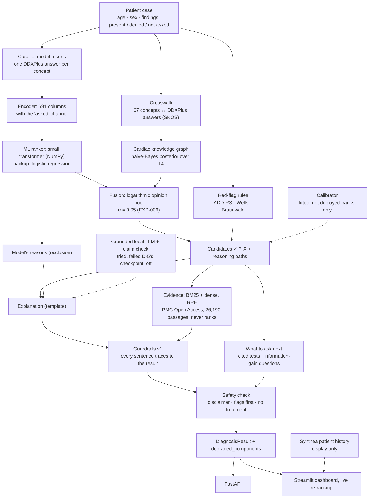

# 18 · Nightingale: the full project report

**Nightingale — Clinical Intelligence & Reasoning System**\
**Version 2.0 · 2026-11-12** (the start of Week 9 of the plan, three days before the presentation; Week 1 began 2026-09-17)\
**Team:** [P1, cardiac knowledge graph] · [P2, data and ML] · [P3, retrieval, LLM and safety] ·
[P4, platform and evaluation]\
**Supervisor:** [Prof. Ashish Kumar: confirm title] · **Institution:** [to add]\
**Repository:** `github.com/HarshRohila02/nightingale` (public) · **Status file:** `PROGRESS.md`

> ⚠️ **Clinical decision support, not a diagnosis.** Nightingale is a research prototype. Its
> output is generated from synthetic training data and must not be used for real patient care.
> Rankings are not certainties, and confidence values are estimates. A qualified clinician is
> responsible for all diagnostic and treatment decisions.

This report explains the whole project in one place:
- the problem and the objectives;
- the data, every component and the tools;
- the final product;
- how it was evaluated, and the results, failures included;
- the phases, how much is done and how much is left;
- the risks and the decisions.

It is written from the repository's own records:
- `PROGRESS.md`, the status;
- `docs/08`, every experiment, and the single record of every figure;
- `docs/00`–`19`, the plans and designs;
- `docs/report/`, the formal report's chapters (brought up to date on 2026-11-12).

**Two rules for the figures.** Every figure comes with its 95% bootstrap interval, its evidence
level, its model label and its split. Figures tagged `[TEST]` come from the test split, which was
opened **once**, on 2026-11-09, and must not be scored again; every other figure is from the
validation split. All the data are synthetic, so no figure says how the system would do on real
patients.

---

## Status at a glance (2026-11-12)

| | |
|---|---|
| **Working prototype** | ✅ `v0.1-prototype` 2026-10-14 and `v0.2-prototype` 2026-11-08. `v0.9-freeze` (2026-11-09) fixed the code and the configuration. `v1.0` is planned for 2026-11-14, after the rehearsal, on the owner's go-ahead. The prototype is the dashboard and API over the full ranking pipeline: the transformer, the knowledge graph, the fusion, the red flags, the model's reasons, what to ask next, evidence with its licences, and the patient-history panel (display only) |
| **Sub-phases done** | **22 of 26** (85%) done and 3a closed with one stated gap, so **23 of 26 are closed** (88%); 3 are in progress, all the team's or the owner's (§12) |
| **Objectives met** | O2, O3, O5, O7 and O8 are met. O1 is met in a reduced form, and O4 and O6 are not met as worded (§2.1) |
| **The test split** | Opened once, on 2026-11-09: 34,657 synthetic patients `[TEST]`. **H1, H2, H1-R, H2-R, H3 and H6 are not supported. H4, H5 and the Minimum hold**, and H4's support is hollow (§10.1). The safety targets are met at 25% of the history by every model trained on masked copies, not by the fusion |
| **Experiments** | All 23 are recorded and 22 ran to a result. EXP-009/010, the language-model trial, failed D-5's checkpoint, so the template explainer ships. EXP-011, retrieval quality, closed built and costed but **not judged** (§10.14) |
| **Tests** | 1,494 automated tests pass and 15 skip on the laptop; CI is green on GitHub |
| **Deadline** | **2026-11-15**: the working prototype and the report are presented. **Three days left** |
| **What is left** | For the owner: the `v1.0` go-ahead after the 11-14 rehearsal, and the cleanup of stale branches and worktrees. For the team: the deck, the demo video, the rehearsal, A-2's clinical question, and reading Meta's Llama 3.1 licence page (§12.2) |

---

## 1. Introduction

### 1.1 The problem
Acute chest pain is one of the most common and highest-stakes presentations in emergency and
primary care. The clinician must separate the causes that kill if missed from the benign ones,
often from the history and examination alone, before confirmatory tests return.
- **Dangerous causes:** myocardial infarction, pulmonary embolism, pneumothorax, aortic
  dissection, oesophageal rupture.
- **Benign causes:** reflux, panic attack.

The cost of an error is not symmetric. A false alarm costs a test; a missed heart attack can cost
a life.

### 1.2 Why existing aids fall short
1. **Black-box machine-learning classifiers** give a label or a probability with no reasoning a
   clinician can inspect, so the clinician cannot safely trust or override them.
2. **Large language models** write fluent clinical text, but can state false facts, cannot reliably
   cite their sources, and are poorly calibrated.

Neither shows the two things a clinician reasons with:
- **what evidence supports each candidate**;
- **what information is still missing** to tell the candidates apart.

### 1.3 Aim
**A clinician-facing decision-support prototype that ranks the causes of acute chest pain and
explains the ranking.** It combines:
- a machine-learning ranker;
- a cardiac knowledge graph;
- an independent set of red-flag rules;
- evidence retrieval from the literature, shown beside each candidate and never used to rank;
- and a guardrailed local language model, which was built and tried and **does not ship** (§7.17).

It is judged first on **keeping the dangerous conditions in view** (must-not-miss recall), and
only then on how often its first answer is right.

### 1.4 What we do and do not claim
- **We do not claim** that combining a knowledge graph with ML or an LLM is new. It is not.
- **The contributions:**
  1. a red-flag-aware differential ranker for one high-stakes presentation, evaluated on
     must-not-miss recall;
  2. a knowledge graph that covers a diagnosis absent from the training data (aortic dissection);
  3. a pre-registered evaluation at three evidence levels;
  4. a measured finding about incomplete histories and its repair (the "asked" channel);
  5. a deep model adopted only through a safety floor fixed before training;
  6. an ablation study of every component, negative results included, run once on the test split
     (§10.1).
- **What the study found:** the safety result belongs to training on masked copies (contribution 4),
  not to the fusion, and the graph's contribution is not measurable on DDXPlus (R-12, R-16; §10).
- **No clinical efficacy is claimed.** The system is built and evaluated on synthetic and open data
  only.

---

## 2. Objectives, research questions and success criteria

### 2.1 Objectives (`docs/00` §3)

| # | Objective | Measurable outcome | Status, 2026-11-12 |
|---|---|---|---|
| O1 | A patient knowledge graph from case data | Built for ≥ 95% of cases | ⚠️ Met in a reduced form (sub-phase 1d). It is built from Synthea's synthetic records, not from the chest-pain cases, and it is **display only** (the owner, 2026-10-20): 1,013 patients alive on 2026-01-01, of 1,359 generated, each a card beside the case. It never feeds the ranking, and free text is ignored by design. The ≥ 95% outcome, worded for test cases, was not assessed as worded: a DDXPlus patient has no history |
| O2 | A cardiac knowledge graph of condition↔finding links | All 13 conditions, with qualifiers | ✅ 129 nodes, 321 edges, three sources |
| O3 | An ML ranker producing a ranked differential | Top-3 well above the prevalence baseline | ✅ Logistic regression, XGBoost and a small transformer (the configured ranker) |
| O4 | Fusing the graph and the ML into one explainable ranking | Fusion beats both alone | ❌ Not met as worded. The fusion is built (a logarithmic opinion pool, α = 0.05 for the configured system), but H1 and H1-R are not supported and the fused system is level with its own model (§10.1, §10.5) |
| O5 | Must-not-miss conditions as red flags | Must-not-miss recall@3 ≥ 0.95 | ✅ One rule per must-not-miss condition. The ranker trained on masked copies meets the recall target at every level (A0′ at 25%: 0.9986 [0.9980, 0.9991] `[TEST]`). The rules alone reach sensitivity 0.8285 [0.8229, 0.8344] at 100% `[TEST]`, below their own 0.95 target (§10.3) |
| O6 | Real, cited evidence per candidate | ≥ 80% of claims traceable to a passage | ⚠️ Built, not assessed as worded. The corpus (2,067 articles, 26,190 passages) is wired and each excerpt is shown with its citation and licence, but the passages' relevance was never judged (EXP-011), and the explainer that generates claims failed its checkpoint (EXP-009/010) |
| O7 | Each component's contribution | Ablation A0–A7 and A1b, at three evidence levels | ✅ Run once on the test split (EXP-012); A3, A5 and A6 equal A0 by construction. The graph's contribution is not measurable, and the red flags lower top-1 (§10.1) |
| O8 | A usable clinician-facing interface | A working dashboard over the full pipeline | ✅ Streamlit dashboard with live re-ranking, plus a FastAPI service |

### 2.2 Research questions and hypotheses (`docs/05` §1, frozen; v1.5)

| # | Research question | Hypothesis | Verdict on the test split `[TEST]` |
|---|---|---|---|
| RQ1 | Does fusing graph reasoning with an ML ranker improve accuracy over either alone? | **H1:** fusion beats ML-only and graph-only on top-3 and MRR. **H1-R:** the same at 25% evidence (50% reported beside it, not counted) | **Not supported**, 0 of 5 seeds |
| RQ2 | Does the system improve safety over ML alone? | **H2:** fusion plus red flags beats ML-only on must-not-miss recall@3. **H2-R:** at 25% too | **Not supported**, 0 of 5 seeds |
| RQ3 | Does evidence grounding reduce unsupported claims? | **H3:** a retrieval-grounded explanation has fewer unsupported claims than an LLM alone | **Not supported** (validation, 50 patients: the grounded explainer's unsupported-claim rate was 0.741 [0.663, 0.803] against a bar of under 0.20; it was not carried to the test split) |
| RQ4 | Which components contribute? | **H4:** removing the medical graph hurts must-not-miss recall more than top-1 | **Supported by the rule, and hollow**, 5 of 5 seeds: removing the graph changes must-not-miss recall by exactly 0.0000 (§10.1) |
| RQ5 | Are the confidence scores calibrated? | **H5:** ECE < 0.10 after calibration | **Supported**, 5 of 5 seeds, on the raw scores (no calibrator ships) |
| RQ6 | Does a deep ranker hold up better when the history is incomplete? | **H6:** the deep ranker beats each classical model trained like it, at 25% (50% reported beside it) | **Not supported**, 0 of 5 seeds |

Three facts shape these hypotheses:
- **H1 and H2 cannot be supported on complete DDXPlus histories, and the test split confirmed it
  (R-16).** At 100% every comparator ranks the true condition in the top 3 for all 34,657
  patients `[TEST]`. The protocol therefore adds 50% and 25% levels (amendment 3).
- **E-2 was answered on 2026-11-07 (amendment 3b, `docs/05` v1.5).** As first approved, the
  reduced-evidence claims needed both 50% and 25%, and at 50% the comparators are near perfect. The
  owner took the recommendation: H1-R, H2-R, H6 and the reduced-evidence Target and Stretch are
  judged at **25% evidence only**, and their 50% comparisons are run and reported beside them,
  labelled descriptive and not counted. H3 and H4 are point estimates with their intervals, the
  100% Stretch includes the Target's calibration and unsupported-claim criteria, and a pass needs
  the claimed system to be the better one. **The other team members' agreement is not recorded.**
- **A failed hypothesis is a reportable result, and the report says so.** Six of the eight
  hypotheses are not supported. The two that hold are H5 and H4, and H4's support is hollow.

### 2.3 Success criteria (`docs/00` §6, `docs/05` §7)

| Level | Criteria | Status `[TEST]` |
|---|---|---|
| **Minimum** | A working prototype that takes a chest-pain case and returns a ranked, explained differential with red flags; complete documentation; evaluation against baselines | ✅ Met, 5 of 5 seeds (top-3 at 100%: A0 1.0000 against B0's 0.3061 [0.3013, 0.3109]) |
| **Target** | The above, plus retrieval-grounded evidence with citations, calibrated confidence and the complete ablation study | ⚠️ Evidence with citations is built, with its relevance unjudged. A calibrator was fitted and not deployed (ranks only). The ablation study is done. By the protocol's reading (`docs/05` §7), the Target is **not met at 100%** (the comparators tie at 1.000) and **met at 25% by A0′ only**, on a handful of patients (§10.1) |
| **Stretch** | "What to ask next" (✅ built); an ECG extension (not pursued); a publishable write-up (this report is in progress) | ⚠️ By the protocol's reading, **not met at 100% or at 25%** by either arm. The unsupported-claim rate of the template explainer that ships, and the clinician-reviewed explainability, were **not assessed** |

**Metric targets, and where each one stands:**

| Target | Result |
|---|---|
| Must-not-miss recall@3 ≥ **0.95** | **Met** at 25% by every model trained on masked copies: A0 0.9981 [0.9974, 0.9987] and A0′ 0.9986 [0.9980, 0.9991] `[TEST]`. The original B1-XGB (0.8710 [0.8659, 0.8764]) and B1-LR (0.9198 [0.9156, 0.9238]) miss it |
| Dangerous false-negative rate ≤ **0.02** | **Met** at 25% by A0 (0.0003 [0.0001, 0.0006]) and A0′ (0.0002 [0.0000, 0.0004]); **missed** by B1-XGB (0.0629 [0.0592, 0.0665]) and B1-LR (0.0272 [0.0249, 0.0297]) |
| Red-flag sensitivity ≥ **0.95** | **Not met:** 0.8285 [0.8229, 0.8344] at 100%, 0.3318 [0.3245, 0.3386] at 50% and 0.1369 [0.1317, 0.1420] at 25% |
| ECE < **0.10** | **Met** on the raw scores: A0 0.0099 [0.0094, 0.0103] and A0′ 0.0398 [0.0394, 0.0402] at 100%. At 25%, descriptive: 0.0644 [0.0620, 0.0666] and 0.0785 [0.0766, 0.0806] |
| Unsupported claims < **20%** | **Not met by the language-model explainer** (0.741 [0.663, 0.803], validation), which therefore does not ship. The shipped template explainer's rate was **not assessed** |
| Latency < **5 s** without the LLM | **Met:** the whole pipeline takes 13.6 to 16.9 ms at p95 on the laptop CPU, with the transformer and evidence retrieval (EXP-022). No LLM runs |

---

## 3. Scope

**The 14 conditions** (`src/conditions.py`): 13 present in DDXPlus, plus aortic dissection.

| Condition | Category | Must-not-miss | In DDXPlus |
|---|---|:-:|:-:|
| Possible NSTEMI / STEMI | Cardiac, ischaemic | ✓ | ✓ |
| Unstable angina | Cardiac, ischaemic | ✓ | ✓ |
| Stable angina | Cardiac, ischaemic | | ✓ |
| Pericarditis | Cardiac, inflammatory | | ✓ |
| Myocarditis | Cardiac, inflammatory | ✓ | ✓ |
| Acute pulmonary edema | Cardiac, failure | ✓ | ✓ |
| Atrial fibrillation | Cardiac, arrhythmia | | ✓ |
| PSVT | Cardiac, arrhythmia | | ✓ |
| Pulmonary embolism | Non-cardiac mimic | ✓ | ✓ |
| Spontaneous pneumothorax | Non-cardiac mimic | ✓ | ✓ |
| Boerhaave syndrome | Non-cardiac mimic | ✓ | ✓ |
| GERD | Non-cardiac mimic | | ✓ |
| Panic attack | Non-cardiac mimic | | ✓ |
| Aortic dissection | Vascular | ✓ | **✗**: the knowledge graph and a red-flag rule only |

**In scope:**
- one presentation, acute chest pain;
- decision support only: a ranked differential, evidence, reasoning, red flags, the tests and
  questions to consider;
- synthetic and open data only.

**Out of scope:**
- autonomous diagnosis, and any treatment or drug recommendation;
- real or identifiable patient data, and clinical deployment;
- other presentations;
- training a medical language model;
- any claim of clinical efficacy.

**Closed world (R-13).** The system knows only these 14 conditions. A patient with, say,
pneumonia is still ranked as one of them, and every result says so.

---

## 4. Background in brief

The full literature review, eight strands with 71 references, is in
`docs/presentation/midterm-prep.md` §2 and §10.
- **References marked [V]** were added from general knowledge and must be checked before
  submission.
- **References marked [R]** are already cited in the repository.
- **The formal report's own list,** `docs/report/references.md` (a draft of 2026-11-12), holds only
  entries that were looked up in Crossref or arXiv on 2026-11-11.

The strands, briefly:
1. **Computer-aided diagnosis.**
   - Lineage: probabilistic diagnosis (Ledley & Lusted 1959), naive Bayes for abdominal pain (de
     Dombal 1972), expert systems (MYCIN, INTERNIST-I, QMR-DT, DXplain), symptom checkers, causal ML.
   - What it leaves open: knowledge-based systems explain but do not learn, and learned systems
     learn but do not explain.
2. **Chest pain and clinical rules.**
   - The red flags follow published patterns: the ADD-RS for aortic dissection (Hiratzka 2010;
     Rogers 2011), the IRAD registry for its finding frequencies (Hagan 2000; Evangelista 2016),
     the Wells criteria for pulmonary embolism, and the Braunwald classification for unstable
     angina.
   - "What to ask next" cites ESC and ACC/AHA guidelines.
3. **Automatic diagnosis.**
   - DDXPlus (Fansi Tchango et al. 2022), about 1.3 million synthetic patients across 49
     pathologies, is our dataset.
   - The deep models published on it are interactive question-asking agents or transformers.
   - In the studies we reviewed, we found no evaluation of a fixed classifier on histories with a
     given share of answers removed, or of its cost.
4. **Tabular deep learning and missing data.**
   - The FT-Transformer (Gorishniy 2021) is the basis of our deep ranker.
   - Trees still often beat deep models on tables, so classical comparators stay.
   - With missing inputs, the best predictor depends on what is missing (NeuMiss, 2020).
5. **Knowledge graphs.**
   - UMLS, HPO, Hetionet and PrimeKG are broad.
   - BODHI-S matched only 31% of our conditions, so the graph is built from DDXPlus's own knowledge
     base. SKOS gives the mapping relations.
6. **Fusion, calibration and explanation.**
   - Fusion: the logarithmic opinion pool (Genest & Zidek 1986).
   - Calibration: Platt scaling, isotonic regression and temperature scaling.
   - Explanation: occlusion and SHAP.
7. **Retrieval and LLMs.**
   - Retrieval: BM25, dense retrieval and reciprocal rank fusion.
   - Medical LLMs are strong but hallucinate, and retrieval-augmented generation helps.
8. **Safety.** Alert fatigue: a flag that fires too often is ignored.

---

## 5. The final product

### 5.1 What it is
A local application. A clinician enters a chest-pain presentation: age, sex, and each finding
marked **present**, **denied** or **not asked**, plus risk factors. It returns, **live as each
finding is ticked**:
1. **a ranked differential** of the 14 conditions, red-flagged ones first;
2. **red flags** for any must-not-miss pattern, with the published rule that fired;
3. **why each candidate is there:**
   - the findings that support it (✓), contradict it (✗) or are still missing (?);
   - the knowledge graph's reasoning paths;
   - the model's own strongest reasons, for and against;
4. **what to ask next:**
   - the diagnostic tests to consider, each citing its guideline (investigations only, never a
     treatment);
   - the unrecorded findings whose answer would most narrow the differential;
5. **evidence:** short passages from open-access articles (2,067 articles, 26,190 passages), each
   with its link, attribution and licence. **Their relevance was never judged** (EXP-011), and the
   page says so;
6. **an explanation:** from a template, because the grounded language-model explanation failed its
   checkpoint and does not ship (§7.17); every sentence is checked against the result (guardrails v1);
7. **a patient-history card:** a synthetic Synthea patient, display only, never an input (§7.19);
8. **what failed, if anything** (`degraded_components`), and the response time;
9. **the disclaimer**, on every screen and every result.

### 5.2 Its three interfaces
- **The dashboard** (Streamlit, `app/streamlit_app.py`, its logic in `app/view.py`):
  - served on `127.0.0.1:8501`, this machine only;
  - loads the four golden cases as examples;
  - shows ranks rather than raw scores: no calibrator ships, and a short hand-written case is
    near-certain under any calibration (R-17);
  - re-ranks on every change, in about 10 to 25 ms;
  - shows evidence for the first three candidates, each excerpt with its own licence and a caption
    saying its relevance is unjudged;
  - has a "Patient history (Synthea, display only)" expander: 1,013 synthetic patients, a card beside
    the case, **never an input** (a test enforces it);
  - ends with a "Data sources, credits and licences" section that names every source and its
    licence (Eka Care for BODHI-S included) and says the project is non-commercial.
- **The API** (FastAPI, `src/api/app.py`), served on `127.0.0.1:8000`, with an `X-Elapsed-Ms`
  header on each result:
  - `POST /diagnose`: the full result as JSON;
  - `POST /next-questions`: the questions worth asking next;
  - `GET /conditions`, `GET /concepts`, `GET /health`.
- **The command-line demo** (`scripts/demo.py`): runs a case on the real graph and model.

### 5.3 How it behaves on the golden cases (hand-written vignettes the tests enforce)
- **GC-003, aortic dissection.** It ranks **first**, with a red flag, although the model has never
  seen a dissection patient: DDXPlus has none. Its row says the graph and the rules carry it. With
  the red flags switched off it is still first, through the fusion.
- **GC-001, acute coronary syndrome.**
  - The ischaemic red flag fires, and MI is first. The model's own first answer is unstable angina,
    listed second only because red flags come first.
  - The top questions to ask are **pain at rest** and **a crescendo pattern**, the findings that
    separate unstable angina from MI.
  - The tests to consider are a 12-lead ECG and serial high-sensitivity troponin (ESC 2023).
- **GC-002, pulmonary embolism:** first, with its red flag; the tests are a probability score, then
  D-dimer or CT pulmonary angiography (ESC 2019).
- **GC-004, reflux:** first, with no flag; the tests exclude a cardiac cause first.

All four pass with red flags on and off, on the real graph and transformer and on the stubs.

### 5.4 Guarantees built into the product
- **It ranks and flags; it never diagnoses.** The disclaimer is attached by the safety layer and
  cannot be removed.
- **No treatment, drug or dose is ever recommended.**
  - The safety layer strips any such sentence and records that it did.
  - Retrieved passages with treatment language are never stored or shown.
- **Red flags run independently of the model** and are listed first.
- **A failed component never crashes it.** It degrades and names what failed.
- **Nothing leaves the laptop.** Both servers listen on `127.0.0.1` only.

### 5.5 Versions: what each one adds
| Version | Content | Status |
|---|---|---|
| `v0.1-prototype` | The dashboard and API over the transformer, the graph, the fusion, the red flags and the model's reasons | ✅ 2026-10-14 |
| `v0.2-prototype` | Plus what to ask next, guardrails v1 and evidence with citations (the corpus wired) | ✅ 2026-11-08 |
| `v0.9-freeze` | Not a prototype: `configs/`, `src/` outside `src/eval/` and `tests/fixtures/` fixed; the test split opens only through the gate | ✅ 2026-11-09 |
| `v1.0` (final) | The same ranking as the freeze, plus the Synthea panel, the credits and the final documents. Calibrated probabilities and the language-model explanation are **not** part of it (§7.13, §7.17) | Planned 2026-11-14, after the rehearsal, on the owner's go-ahead |

---

## 6. Data

### 6.1 Sources and licences
| Source | What | Licence | Role | Status |
|---|---|---|---|---|
| **DDXPlus** (`aai530-group6/ddxplus`) | Synthetic patients: age, sex, coded evidence, the true pathology, a ranked differential | CC-BY-4.0 | Training and validation; the graph's backbone (`release_conditions.json`) | In use |
| **BODHI-S** (`ekacare/BODHI-S`) | A condition–symptom graph with likelihood bands, SNOMED-coded | **CC-BY-NC-4.0, non-commercial** | Enriches four conditions | In use |
| **Hand-authored aortic dissection** | ADD-RS markers, with frequencies from the IRAD registry | Our work, from published sources | 20 graph edges and a red-flag rule | In use |
| **Golden cases** (`tests/fixtures/golden_cases.yaml`) | Four hand-written vignettes | Our work | Clinical expectations that must always pass | In use |
| **PMC Open Access** | Article passages, Creative Commons licences only | Per article; 844 of the 2,067 articles carry a non-commercial term | Cited evidence | Built on Kaggle 2026-11-07 (2,067 articles, 26,190 passages), wired 2026-11-08; relevance unjudged |
| **Synthea** (v4.0.0, seed 42) | Synthetic patient records | Apache-2.0 | The patient-history panel, **display only** | Generated on Kaggle: 1,359 patients, 1,013 alive on 2026-01-01 |
| **S-PubMedBert-MS-MARCO** (`pritamdeka`) | The embedding model for the passages | **CC-BY-NC-2.0, non-commercial** | Embeds the corpus, on Kaggle only | In use |
| **Llama 3.1 8B** (`llama3.1:8b`) | A local language model | Meta's Llama 3.1 licence (its gated page was not re-verified online) | The EXP-009/010 trial only; **not shipped** | Run once, on Kaggle |
| UCI Heart Disease, PTB-XL | Cardiac features; ECGs | Open | Stretch goals | Not pursued |

### 6.2 DDXPlus and our subset
- **The full release:** 1,025,602 training and 132,448 validation patients across 49 pathologies.
- **Our subset**, the patients whose true condition is one of our 13:
  - **255,900 training** (25.0%) and **33,963 validation** (25.6%) patients;
  - 16,943 of the validation patients have a must-not-miss condition;
  - the test split's subset holds **34,657** patients (of 134,529 source rows), 16,972 of them with a
    must-not-miss condition.
- **Class balance:** the largest class is 2.70× the smallest; the rarest, pneumothorax, has 10,162
  training patients. No class is too rare to learn.
- **Evidence tokens** come in four forms:
  - binary, e.g. `E_91`, fever;
  - categorical value, e.g. `E_54_@_V_161`;
  - numeric ordinal, e.g. `E_56_@_4`, pain intensity 0–10 (12.6% of tokens);
  - the "NA" sentinel.

  The vocabulary has 919 entries; our 13 conditions use 84 questions.
- **Three traps, all handled:**
  1. **A listed token can mean "no".** "Did not travel" is listed for 89.6% of patients, so every
     component reads `positive_codes()`, the answers other than "no".
  2. **The English is machine-translated from French.** `déchirante`, tearing, becomes
     "heartbreaking", so every component works on codes, not text.
  3. **The demographics are synthetic** (~50% female everywhere), so equal results by sex prove
     nothing about fairness.
- **The ground-truth differential is open-world:** 33% of its probability mass is on conditions
  outside our 13. Precision@3 and Recall@5 therefore count only the in-scope part (decision D-8).

### 6.3 The splits
- **Training:** used only to train, in the cloud.
- **Validation:** all development, and every figure not tagged `[TEST]`.
- **Test:** **opened once, on 2026-11-09**, after the code and configuration were frozen
  (`v0.9-freeze`) and both mask digests were recorded in `docs/08`.
  - `test.csv` (88,582,473 bytes) was downloaded on 2026-11-09 with the owner's yes. The parquet
    was built through the freeze gate (`build_ddxplus_chestpain.py --split test --open-test-split`),
    and the single scoring ran on Kaggle (the owner's run; the scoring took 2,797 s).
  - The gate (`src/eval/freeze.py`) requires the freeze tag as an ancestor, no change in `configs/`,
    in `src/` outside `src/eval/` or in `tests/fixtures/`, and a clean tree. It records the opening
    and refuses a second one without a stated reason.
  - **It must not be scored again.** A second opening needs `--reopen-because` and is disclosed.
  - A test checks that no notebook fetches it except the single-scoring notebook.

### 6.4 Data management
- Nothing under `data/` or `models/` is ever committed. The corpus, the Synthea output and the test
  parquet live there.
- BODHI-S text is never committed (its licence); its facts are keyed by its ids.
- Models are stored as JSON, never as pickles.
- The Neo4j credentials live only in a local `.env` file, never shared.

---

## 7. System architecture and methods

### 7.1 Design principles (`docs/02` §1)
1. **Every module is replaceable behind an interface.** Neo4j can become NetworkX, and the model a
   degraded stub, without anything downstream noticing.
2. **Degrade, never crash.** On a failure the system still answers and says what is missing.
3. **Safety is not downstream of the model.** The red-flag rules run independently.
4. **Explanations are derived, not generated.** They come from graph operations; a language model
   may only phrase them.
5. **Typed boundaries.** All data between modules uses the Pydantic models in `src/contracts.py`,
   which change only with all four team members' agreement.

### 7.2 The request path
Solid boxes are built and shipped; dashed boxes are built but off, not deployed, or display only.



### 7.3 Contracts and the pipeline
- **The data types** (`src/contracts.py`):
  - `Finding`: a concept with an assertion, present, absent or unknown. "Denies leg swelling" and
    "leg swelling not asked" are different facts.
  - `PatientCase`, `Candidate`, `Explanation` and `DiagnosisResult`.
- **The interfaces:** `ConditionRanker`, `GraphStore`, `EvidenceRetriever` and `Explainer`.
  - Each had a stub in week 1, so the pipeline ran end to end before any real component existed.
  - The real components replaced the stubs one by one, and the "walking skeleton" was reached on
    2026-09-24.
- **The order of steps** (`src/pipeline.py`):
  1. score with the model and the graph independently;
  2. fuse;
  3. analyse the findings;
  4. evaluate the red flags;
  5. attach the evidence and the tests;
  6. explain;
  7. run the safety check.

### 7.4 The cardiac knowledge graph (`src/medical_kg/`)
- **129 nodes:**
  - 14 conditions;
  - 66 symptoms;
  - 49 risk factors.
- **321 edges, by source:**
  - **245 from DDXPlus**, weight 1.0;
  - **56 from BODHI-S**, weighted by likelihood band;
  - **20 hand-authored** for aortic dissection, weighted from IRAD frequencies.
- **Every edge keeps its source.** The graph is a multigraph keyed by source, so a fact stated
  twice counts once. `only_sources()` builds the subsets used in ablations.
- **Two stores, one graph:**
  - **Neo4j AuraDB Free:** the team's cloud copy, under the label `CardiacKG`, fingerprint
    `de349201157a`. It is read once at start-up and scored in memory.
  - **NetworkX:** the identical local fallback, used automatically when Aura is paused or offline.
    The result then reports `graph_backend`.
- **Two vocabularies.** DDXPlus links conditions to *questions*, not answers; the hand-authored and
  BODHI-S edges are answer-level. The crosswalk links them.

### 7.5 The crosswalk (`src/medical_kg/crosswalk.py`)
- **67 hand-authored concepts** (`SYM:*`, `RF:*`), used by the rules and golden cases, map to
  DDXPlus answers.
- **Each mapping has a SKOS match type**, exact, close, broader, narrower or related, and allows
  only the sound inferences for its type. For example, a broader answer does not imply its
  narrower concept.
- **A test fails** if any concept the code uses lacks an entry.

### 7.6 The graph score (`src/medical_kg/scoring.py`, EXP-005)
- **A naive-Bayes log-likelihood** over the graph, closed under the crosswalk, gives a posterior
  over the 14 conditions:
  - answers imply their questions;
  - a condition that asks a question gets that question's mean answer likelihood.
- **Not mentioned is not denied.** A finding the case does not mention counts for nothing; a denied
  one counts against the conditions expecting it.
- **Chosen over Personalised PageRank,** because it is more robust on the angina pair and can be
  broken down exactly into each finding's contribution, which feeds the explanation.
- **Two blind spots, by design:**
  - Stable and unstable angina tie when nothing is denied, and the tie goes to unstable angina.
  - An answer only one condition states (tearing pain) cannot discriminate.

### 7.7 Feature encoding and the "asked" channel (`src/ml/features.py`)
- **607 columns**, fixed by the release files:
  - binary findings;
  - one-hot categorical answers;
  - ordinals as a value plus an "answered" flag;
  - NA kept explicit.
- **The defect found (EXP-017, R-18).** A "no" answer gets no column, so a short history looked
  like a patient who denied everything. Given no evidence at all, XGBoost answered atrial
  fibrillation with certainty.
- **The repair (EXP-018/019):**
  - an explicit **"asked" channel**, 691 columns: "not asked" is now distinct from "denied";
  - **masked training copies**: each training patient also appears with part of their history
    removed.

  Models trained this way carry the suffix `+aug`, and ′ when they use the channel.

### 7.8 The ML rankers
| Label | Model | Role |
|---|---|---|
| B0 | Prevalence prior | The floor |
| B1-LR / B1-XGB | Multinomial logistic regression; XGBoost (sparse input) | The serious competitors; the `+aug` and ′ variants were retrained on masked copies |
| **B1-DL′+aug** | **A small FT-Transformer** | **The configured ranker since 2026-10-13**, after passing the safety floor |
| B2 | The graph alone | Is the graph useful alone? |

**The transformer** (`src/ml/deep.py`; D-12; EXP-021):
- **Input:** one token per DDXPlus question (84), each the sum of its answers' embeddings plus an
  asked / not-asked embedding; plus age, sex and a [CLS] token.
- **Architecture:** width 96, 2 blocks, 4 attention heads, ReGLU feed-forward. It uses the
  published defaults, fixed before training: nothing is tuned beyond early stopping (T-6).
- **Size and cost:** **225,645 parameters**; about 9.6 million multiply-adds per patient, the same
  for every patient.
- **Training:** both arms over five seeds (42–46) on a **Kaggle T4 GPU**; 2 h 10 min for all ten
  networks.
- **Storage:** weights saved as JSON, base64 float32 with a SHA-256 for each.
- **On the laptop:** a pure **NumPy forward pass** on the CPU, with nothing to install.
- **The safety floor (D-13), fixed before training.** It is used only if, on validation:
  1. it meets the safety targets at 100% and 25%;
  2. it is non-inferior to logistic regression trained like it at 25% on must-not-miss recall@3
     and MRR (margin 0.005, paired bootstrap);
  3. it passes every golden case.

  It passed at all five seeds, so logistic regression became the backup.

### 7.9 From a hand-written case to model input (`src/ml/case_tokens.py`)
- **The problem:** clinicians enter concepts, but models need DDXPlus tokens.
- **Two hand-curated tables** choose one representative answer per concept, each with the original
  French. They were reviewed and approved as is (A-8, 2026-10-12).
- **A-10 (2026-10-13):** "radiates to the jaw/arm" was moved to the answer DDXPlus's heart attack
  patients actually give, "under the jaw". It had been found through the model's reasons. A
  denial reaches the model only through the "asked" channel.
- **The limit (R-17):** this inversion has no ground truth. The tests check that every concept
  survives the round trip.

### 7.10 Fusion (`src/fusion/pool.py`, 2c)
- **A logarithmic opinion pool:** a weighted geometric mean of the model's probabilities and the
  graph's posterior, renormalised. One weight, α, sets the balance.
- **The model's probabilities are floored at 0.01,** so an overconfident model cannot veto the
  graph.
- **A condition the model cannot score takes the graph's posterior.** Aortic dissection is the
  case: this is how GC-003 ranks it first with the red flags off.
- **A degraded or invalid model leaves the graph's order exactly.**
- **α was chosen by EXP-006's pre-registered sweep** (the owner's Kaggle run of 2026-11-07,
  validation): **0.05 for the configured B1-DL′+aug (A0′, set in `configs/config.yaml`) and 0.30 for
  B1-DL+aug (A0)**. For both, no α met the sweep's constraint, so the rule took the highest mean
  must-not-miss recall@3. The objective is flat, and **the fusion adds nothing measurable over the
  transformer alone** (§10.5).

### 7.11 Red-flag rules (`src/reasoning/red_flags.py`, 2d)
- **One rule per must-not-miss condition** (8), each after a published pattern rather than a single
  suggestive finding:
  - **aortic dissection:** the ADD-RS categories;
  - **pulmonary embolism:** a symptom *and* a Wells risk;
  - **unstable angina:** a Braunwald crescendo or rest pain;
  - MI, pneumothorax, Boerhaave, myocarditis and pulmonary edema have their own rules.
- **Flagged candidates are listed first.**
- **Sudden onset** means DDXPlus `E_59` ≥ 8 (A-5).
- **Which flags are clinically appropriate** for each condition was settled by a three-judge
  majority (A-7).

### 7.12 The safety layer (`src/reasoning/safety.py`)
It runs last, on every result, and enforces:
- the disclaimer, always present;
- red flags first;
- no treatment, drug or dose in any sentence, test or evidence passage; a removed sentence is
  recorded in the explanation;
- every failed component named.

### 7.13 Calibration (`src/fusion/calibration.py`, 2b, EXP-007)
- **Methods:** none, temperature scaling, one-vs-rest Platt scaling, and isotonic regression.
- **How they are fitted:** on validation, five-fold cross-fitted; the method with the lowest mean
  Brier score over the three levels is chosen.
- **Two rules:**
  - aortic dissection keeps its raw probability, since no patient has it;
  - calibration never reorders the candidates.
- **The pipeline refuses a calibrator fitted for another system.**
- **Stage 1 result:** the logistic regressions and the transformer are already calibrated against
  DDXPlus, so they stay raw.
- **Stage 2** (2026-11-08, laptop CPU, 150 s, validation): for A0′'s fused score the rule chose
  **temperature scaling**. ECE, raw then calibrated: 0.0327 [0.0324, 0.0329] → 0.0008 [0.0008, 0.0008]
  at 100%; 0.0603 [0.0595, 0.0614] → 0.0051 [0.0041, 0.0062] at 50%; 0.0773 [0.0757, 0.0793] →
  0.0176 [0.0156, 0.0195] at 25%.
- **Not deployed.** On the hand-written cases any calibrator leaves a short history near-certain
  (R-17: GC-002's first condition goes from 0.936 to 0.998), so the owner decided on 2026-11-09
  that **`calibration.file` stays null: ranks only, and no probability is shown.** The fitted
  calibrator is a result, not a feature, and ablation A5 (no calibration) equals A0 exactly.
- **An unresolved discrepancy** (`docs/08` EXP-007, noted 2026-11-12): the raw fused score's
  validation ECE differs between the Kaggle run (0.040 / 0.064 / 0.078, EXP-006) and the laptop run
  above, and the test split agrees with the Kaggle figures. Why was not investigated. No verdict
  depends on it: H5 is judged on the test split's figures, and no calibrator ships.

### 7.14 The model's reasons (`src/ml/reasons.py`)
- **Leave-one-finding-out occlusion:** remove each recorded finding in turn, rescore in one batch,
  and see how each condition's log-odds move.
- **Shown as names only:** the strongest reasons for and against, never a raw score.
- **Cost:** 0.4–6.5 ms per case.
- **It found a real problem:** A-10, the jaw answer.

### 7.15 What to ask next (`src/reasoning/investigations.py`, `next_questions.py`, 3d)
- **Tests to consider:**
  - a hand-written, cited table of the diagnostic investigations for each condition, after ESC,
    ACC/AHA, BTS and other guidelines;
  - shown for the top 3 candidates and every red-flagged one;
  - investigations only, and every line says "consider".
- **Questions to ask:**
  - the findings the case has neither recorded nor denied, ranked by **expected information gain**
    (the expected entropy reduction of the graph's posterior), computed through the crosswalk
    exactly as the case would be scored;
  - each comes with the conditions a "yes" or a "no" would favour;
  - pregnancy is never suggested for a man;
  - about 1.3 ms per case.

### 7.16 Evidence retrieval (`src/rag/`, 3a, EXP-011)
- **The corpus** was built on Kaggle on 2026-11-07 (`notebooks/kaggle_retrieval_corpus.ipynb`):
  - **2,067 articles and 26,190 passages** from PMC Open Access, with 446 articles skipped, from
    20 searches;
  - only articles with a Creative Commons licence in their XML: 15 licence strings, the largest
    CC BY 4.0 (979 articles); **844 articles carry a non-commercial term**, and each excerpt shows
    its own licence;
  - fetched at ≤ 3 requests a second, with no API key;
  - passages embedded with `pritamdeka/S-PubMedBert-MS-MARCO` (768 dimensions) at a pinned
    snapshot;
  - a bundle checked by SHA-256, wired into the pipeline on 2026-11-08 (`retrieval.bundle` in
    `configs/config.yaml`).
- **On the laptop, no model runs:**
  - BM25, plus a dense search whose query vector mixes vectors precomputed on Kaggle;
  - the two are fused by reciprocal rank (k = 60);
  - **cost** (EXP-011, 2026-11-08): start-up 1.8 s; one candidate's retrieval takes p50 0.78 ms and
    p95 1.22 ms.
- **Diagnosis only.**
  - Any sentence with treatment language is never stored, embedded or shown.
  - An article whose title names a treatment is dropped.
  - Text is screened again at load and at display, and `safety_check` is the last screen.
- **Retrieval never ranks** (tested): the evidence is attached after the ranking.
- **Two stated limits** (EXP-011 closed on 2026-11-10; R-20):
  - **The relevance was never judged.** Two team members were to judge a pool of 159 rows and had
    no time, so Precision@3 and nDCG@3 do not exist, and the hybrid stays the default by default,
    not by a result. The dashboard says so under the passages. The judging tool and the sheets
    are ready (`scripts/judge_retrieval.py`).
  - **The laptop's query vector is a poor stand-in** for embedding the whole query. Its cosine with
    the full-sentence embedding has a mean of 0.963, but its dense top 10 overlaps the full
    sentence's by a median of **0.400**, under the pre-registered threshold of 0.5. The first
    excerpt for a condition is not always on point.
- **Without the bundle** (CI's ordinary state), the pipeline reports `rag` and shows no evidence.

### 7.17 Explanations and guardrails
- **What ships:** a template explainer that names:
  - the top candidate's supporting and missing findings;
  - the model's strongest reasons;
  - five unrecorded findings, with a count of the rest.
- **Guardrails v1** (`src/reasoning/guardrails.py`, 3c, shipped) run after the explainer and before
  the safety check. Each sentence must trace to a source the result holds (a candidate, a red flag,
  a model reason, a test or a cited passage), or it is listed in `unsupported_claims`. Citations
  point only to the retrieved passages. The check is lexical, so a wrong relation between words the
  result holds passes (disclosed).
- **The grounded language-model explainer (3b) was built, tried and does not ship.** `src/llm/`
  holds an Ollama client and an explainer that may only *phrase* the derived reasoning, with a
  fallback to the template on any unsupported sentence, any treatment language or a timeout.
  - **The trial** (EXP-009/010; the owner's Kaggle run of 2026-11-07, validation, 47 minutes):
    `llama3.1:8b` at temperature 0, on 50 patients and the four golden cases, in four arms; no
    call failed.
  - **D-5's checkpoint failed.** The grounded explainer's raw answers hold an unsupported-claim
    rate of **0.741 [0.663, 0.803]** (163 of 220 claims), against a bar of under 0.20. So the
    **template explainer stays, `llm.enabled` is false**, and B3 and B4 are reported as not carried
    into the evaluation (§10.13).
  - **The guardrails did their job:** all 50 grounded answers failed guardrails v1, so the
    template's text was delivered and none of the model's prose reached a user.
  - The check asks each sentence to trace to what the arm was given, so a correct paraphrase fails:
    the rates measure staying within the inputs, not correctness. One model, one run.

### 7.18 Degradation (`docs/02` §7)
| Failure | What happens | Reported as |
|---|---|---|
| Model missing or mismatched | Graph-only ranking, exactly the graph's order | `ml` |
| Neo4j paused or offline | The identical NetworkX copy answers | `graph_backend` |
| No evidence bundle, or a bad one | No evidence shown | `rag` |
| Calibrator for another system | Raw scores, no probability shown | `calibration` |
| LLM absent, ungrounded or failing the guardrails | The template explanation (the LLM is off: `llm.enabled` is false) | `llm` |

### 7.19 The patient knowledge graph (1d): built, display only
- **The data:** Synthea v4.0.0 at seed 42, generated on Kaggle (`notebooks/kaggle_synthea.ipynb`):
  1,359 patients, 1,013 of them alive on 2026-01-01.
- **The graph** (`src/patient_kg/`, `scripts/build_patient_kg.py`): built per patient from Synthea's
  records, with a SNOMED → `RF:*` table, so a patient's history becomes `Finding`s with
  `source="synthea"`. Six risk-factor concepts are mapped, and 349 active condition codes are not.
  The laptop rebuild takes 12 s and reproduces the findings of every patient.
- **The panel** (`scripts/build_patient_display.py`, built on 2026-11-10): 1,013 cards, 1.7 MB, in
  the dashboard's "Patient history (Synthea, display only)" expander. A card shows the active
  conditions (disorders first, then social history and findings), the risk factors the history
  supports, a "Medication history (not advice)" and counts.
- **It is never an input** (the owner's decision of 2026-10-20). The ranking, the form, the flags
  and the explanation are the same with or without a card, which is tested in the source, by driving
  the page and by mutation. So ablation A6 (no patient graph) equals A0 by construction.
- **Stated limit:** a Synthea patient is not a DDXPlus patient, so the card's age and sex are not
  tied to the case, and the page says it is context only.

---

## 8. Technology stack

| Layer | Tools (installed version where recorded) |
|---|---|
| Language | **Python 3.11.9** (the team standard; also in CI) |
| Data | NumPy (1.26 range; NumPy 1.26.4 drew the evaluation masks), pandas, PyArrow (Parquet) |
| Classical ML | scikit-learn 1.9.1 (logistic regression), XGBoost 2.1.4 (sparse input; models as `.ubj`/JSON) |
| Deep learning | PyTorch, for **training only, on a Kaggle T4 GPU**. The laptop runs the transformer as a NumPy forward pass; a separate `.venv-gpu` (torch 2.11.0+cu128) is kept for short tests |
| Knowledge graph | Neo4j AuraDB Free (Neo4j 5.27), Python driver 5.28; NetworkX 3.6 as the fallback |
| Retrieval | BM25 and dense search in NumPy; `sentence-transformers` with `S-PubMedBert-MS-MARCO` on Kaggle only; NCBI E-utilities |
| LLM (not shipped) | Ollama 0.34 on the laptop, used for no shipped output; the trial ran `llama3.1:8b` (Q4_K_M, Ollama 0.40.15) on Kaggle |
| Patient history | Synthea v4.0.0 (Java, run on Kaggle only); read by `src/patient_kg/` |
| Service and interface | FastAPI 0.143 with uvicorn 0.54; Streamlit 1.65; Pydantic v2 contracts |
| Compute | The owner's laptop CPU for inference and short jobs; **Kaggle** (GPU T4 x2, background runs) for every cloud job since 2026-10-13; Colab earlier. The laptop GPU (RTX 5060) is for short tests only, each with the owner's yes |
| Engineering | Git and GitHub (pull requests); **GitHub Actions CI** on Python 3.11 with a throwaway Neo4j container; pytest; **1,494 tests**; black and ruff, pinned in `requirements-dev.txt` |
| Documentation | Markdown docs `00`–`19`, an experiment log, a risk register, the frozen evaluation protocol with its amendment log, `PROGRESS.md` |

---

## 9. Evaluation methodology (`docs/05`, frozen; v1.5)

### 9.1 Pre-registration
- The protocol was **frozen on 2026-09-17, before any model was trained.** It changes only through
  dated amendments, each disclosed:
  - **1:** D-8, the in-scope differential;
  - **2:** red-flag sensitivity measured against the patient's own condition;
  - **3:** three evidence levels and the deep ranker;
  - **3a:** the errata;
  - **3b** (v1.5, 2026-11-07): E-2 answered, so the reduced-evidence claims are judged at 25% only,
    with 50% reported beside them.
- Experiments that choose something are pre-registered in `docs/08` before they run.
- **The freeze:** `v0.9-freeze` (2026-11-09) fixed `configs/`, `src/` outside `src/eval/` and
  `tests/fixtures/`. The test split opens only through the gate, once.

### 9.2 Three evidence levels
- **Every system is scored at 100%, 50% and 25%** of each patient's history.
  - Age, sex and the presenting complaint are always kept.
  - Whole questions are dropped at random, by a permutation seeded from the patient's id.
  - The levels are nested: a 25% history lies inside its 50% one.
- **The masks were drawn once, and their digests committed before scoring.** The digests are
  `e99a7a8fbf792675` for the mask and `af3a357f6454838a` for the asked set. Every scoring script
  refuses to run unless both reproduce. Those are the validation split's digests; the test split's,
  drawn without reading a label and recorded in `docs/08` before any scoring, are
  `0136f67f1ca6542f` and `795acf2689f1415e`.
- **The limit:** random masks measure robustness to missing answers; they are **not** a simulation
  of history-taking.

### 9.3 Metrics and targets
| Group | Metrics | Target |
|---|---|---|
| Ranking | Top-1, **top-3** (primary), top-5, MRR; Precision@3 and Recall@5 on the in-scope differential; F1 per condition | — |
| **Safety (headline)** | **Must-not-miss recall@3**; the dangerous false-negative rate (outside the top 5) | **≥ 0.95**; ≤ 0.02 |
| Red flags | Sensitivity, for each patient's own condition; precision, by A-7's mapping and strictly; alarm burden on patients *without* a must-not-miss condition | Sensitivity ≥ 0.95 |
| Calibration | ECE (10 bins), Brier, reliability diagrams | ECE < 0.10 |
| Retrieval and explanation | Precision@k, nDCG; unsupported-claim rate; 1–5 ratings by two team members | Unsupported < 20% |
| System | Latency p50, p95, p99; degradation coverage | < 5 s without the LLM |

### 9.4 Baselines and ablations
- **Baselines:**
  - B0, the prevalence prior;
  - B1-LR and B1-XGB: a claim against B1 must hold against **both**;
  - B1-DL, the deep ranker;
  - B2, the graph alone;
  - B3, an LLM alone, and B4, text retrieval plus an LLM: run on validation (50 patients) and **not
    carried into the evaluation** (§7.17, §10.13).
- **Ablations:**
  - **A0:** the full system;
  - **A1:** no medical graph;
  - **A1b:** no medical graph, red flags kept;
  - **A2:** no ML;
  - **A3:** no retrieval;
  - **A4:** no red flags;
  - **A5:** no calibration;
  - **A6:** no patient graph;
  - **A7:** classical ML in place of the transformer.

  Each is scored on every metric at all three levels. **A3, A5 and A6 equal A0 by construction**
  (retrieval never ranks, no calibrator ships, and a DDXPlus patient has no history), so they are
  listed and not recomputed. A0 uses B1-DL+aug and A0′ uses B1-DL′+aug; both are always reported,
  and judged separately.

### 9.5 Statistics
- A **95% bootstrap interval** on every ratio metric (1,000 resamples, seed 42). No figure is
  reported without one.
- **McNemar's test** on paired top-3 correctness.
- A **paired bootstrap** for MRR differences.
- **Five seeds (42–46)** for every stochastic model. The seed-42 model is used, and every seed's
  figures are reported.
- A hypothesis passes only if **every** one of its comparisons passes. A Target compares point
  estimates, and a Stretch needs every test to pass (amendment 3b).
- The reduced-evidence claims are judged at 25% only; the 50% comparisons are reported beside
  them and not counted.

---

## 10. Results

**Which figures these are.** The pre-registered evaluation (EXP-012) ran once on the **test split**
on 2026-11-09. Its figures are tagged `[TEST]`: 34,657 synthetic patients, 16,972 of them with a
must-not-miss condition, seed 42 unless stated, each with its 95% interval. A rehearsal on
validation had given the same verdicts row for row, and had reproduced 1,944 of 1,944 earlier
figures exactly. The run is known to be valid: one opening, both mask digests reproduced before any
label was read, the freeze tag an ancestor, and nothing under `configs/`, `src/` or
`tests/fixtures/` changed since. **The test split must not be scored again.** Every other figure
is validation. All of it is synthetic and closed-world (R-12, R-13): none says how the system would
do on real patients.

### 10.1 The pre-registered verdicts `[TEST]`
The reading in force is amendment 3b: the reduced-evidence claims are judged at 25% only. The
verdicts are the same as on validation, row for row.

| Claim | A0 (B1-DL+aug) | A0′ (B1-DL′+aug) | Seeds reaching the verdict, of 5 |
|---|---|---|---|
| H1, H2 (100%) | not supported | not supported | 0 |
| H1-R, H2-R (25%) | not supported | not supported | 0 |
| H6 (the deep ranker against the models trained like it) | not supported | not supported | 0 |
| H4 (the graph and flags removed: point estimates) | supported, **but hollow** | supported, **but hollow** | 5 |
| H5 (top-label ECE below 0.10 at 100%) | supported | supported | 5 |
| Minimum | met | met | 5 |
| Target, 100% | not met | not met | 0 |
| Stretch, 100% | not met | not met | 0 |
| Target, reduced evidence (25%) | **not met** | **met** | 0 / 5 |
| Stretch, reduced evidence | not met | not met | 0 |

H3 is EXP-009/010's, on validation: **not supported** (§7.17, §10.13). Under the older reading
(50% counted too), H1-R, H2-R and H6 fail with more comparisons and neither arm meets the reduced
Target; both readings are in the output file.

**What stands behind each verdict.**
- **H1, H2 at 100%: the comparators are perfect (R-16).** B1-XGB, B1-LR and both transformers miss
  0 of 34,657 patients in the top 3 and 0 of 16,972 must-not-miss patients, so no test can pass
  against them. The one H1 check that passes is top-3 against B2, the graph alone (1.0000 against
  0.9992, p = 5.6 × 10⁻⁷), and B2 is circular (R-12). **A0's MRR is lower than B1's:** 0.9157 against
  B1-XGB's 0.9994, a difference of −0.0837 [−0.0859, −0.0819]. The red-flag layer is the cause: it
  ranks flagged conditions first even when the flag names the wrong one (strict flag precision
  0.5089 [0.5047, 0.5128] at 100%).
- **H1-R, H2-R at 25%.** Both arms beat the original B1-XGB, B1-LR and B2 on every check. They do not
  beat the models trained on masked copies. A0 against B1-XGB+aug: top-3 −0.0001 (p = 0.883) and MRR
  −0.0052 [−0.0062, −0.0044]. A0′ against B1-XGB′+aug is ahead on top-3 (+0.0005, p = 0.045) and behind
  on MRR (−0.0041 [−0.0051, −0.0030]). Failed checks: A0 5 of 12 (H1-R) and 2 of 5 (H2-R); A0′ 4 of 12
  and 2 of 5.
- **H6 at 25%.** The transformer beats the logistic regression trained like it on all three metrics,
  and is level with the XGBoost trained like it. Unprimed, against B1-LR+aug: top-3 +0.0008
  (p = 0.0024), MRR +0.0022 [+0.0015, +0.0028]. Against B1-XGB+aug: top-3 0.0000 (p = 0.883), MRR
  +0.0002 [−0.0005, +0.0009]. At 100% the models tie at a ceiling. H6 needs every comparator, so it
  fails.
- **H4 is supported by the rule, and the rule is measuring something other than the graph.**
  Removing the graph and the flags (A1) leaves must-not-miss recall@3 exactly where it was (a
  degradation of 0.0000), while **top-1 rises** by 0.1642 [0.1606, 0.1685] (A0 0.8346 to A1 0.9987),
  because the flags no longer push their conditions first. Against A1b, which keeps the flags and
  drops only the graph, both degradations are 0.0000 and the contrast is 0: **the graph itself
  contributes nothing measurable.** The same is true of validation's H4.
- **H5.** The top-label ECE at 100% is 0.0099 [0.0094, 0.0103] for A0 and 0.0398 [0.0394, 0.0402] for
  A0′, raw (no calibrator ships). At 50% and 25%, descriptive: A0 0.0355 [0.0342, 0.0368] and 0.0644
  [0.0620, 0.0666]; A0′ 0.0648 [0.0640, 0.0659] and 0.0785 [0.0766, 0.0806]. Hand-written cases stay
  near-certain (R-17).
- **Minimum.** Top-3 at 100%: A0 1.0000 against B0's 0.3061 [0.3013, 0.3109].
- **Target and Stretch.** At 100% they are not met: the comparators tie at 1.000, and a tie fails a
  point-estimate comparison. **At 25% the Target is met by A0′ and not by A0, on a few patients.** A0′
  misses 40 of 34,657 in the top 3 (24 of 16,972 must-not-miss patients), B1-DL′+aug 41 (24),
  B1-XGB′+aug 56 (33) and B1-LR′+aug 80 (45). A0 misses 73 (32) against B1-XGB+aug's 71 (36), so it
  fails by two patients on top-3 (−0.0001, p = 0.883). The fused system equals its own component to
  within a patient: **this is not a robust win.** The reduced-evidence Stretch is not met by either
  arm. The unsupported-claim rate of the template explainer that ships, and the clinician-reviewed
  explainability, were **not assessed**.
- **The five seeds.** Every verdict that reads supported or met holds at 5 of 5 seeds, and every one
  that reads not supported or not met holds at 0 of 5, so none is an accident of seed 42. At 25%: A0
  top-3 0.9976 (standard deviation 0.0002), MRR 0.9577 (0.0008); A0′ top-3 0.9986 (0.0001), MRR
  0.9657 (0.0008).

### 10.2 The systems at 100% and 25% of the history `[TEST]`
Seed 42, 34,657 patients, intervals in brackets. The 50% rows are in `docs/08` EXP-012.

| System | Evidence | Top-1 | Top-3 | MRR | Must-not-miss recall@3 |
|---|:--:|---|---|---|---|
| B0 (prevalence only) | any | 0.1062 [0.1030, 0.1094] | 0.3061 [0.3013, 0.3109] | 0.2906 [0.2878, 0.2934] | 0.2168 [0.2105, 0.2231] |
| B1-XGB | 100% | 0.9987 [0.9983, 0.9991] | 1.0000 [1.0000, 1.0000] | 0.9994 [0.9992, 0.9996] | 1.0000 [1.0000, 1.0000] |
|  | 25% | 0.2482 [0.2439, 0.2524] | 0.9035 [0.9003, 0.9068] | 0.5789 [0.5763, 0.5816] | 0.8710 [0.8659, 0.8764] |
| B1-LR | 100% | 0.9986 [0.9982, 0.9990] | 1.0000 [1.0000, 1.0000] | 0.9993 [0.9991, 0.9995] | 1.0000 [1.0000, 1.0000] |
|  | 25% | 0.7652 [0.7604, 0.7697] | 0.9436 [0.9412, 0.9461] | 0.8575 [0.8546, 0.8602] | 0.9198 [0.9156, 0.9238] |
| B1-DL+aug (= A1) | 100% | 0.9987 [0.9983, 0.9991] | 1.0000 [1.0000, 1.0000] | 0.9994 [0.9992, 0.9996] | 1.0000 [1.0000, 1.0000] |
|  | 25% | 0.9328 [0.9298, 0.9353] | 0.9980 [0.9975, 0.9984] | 0.9639 [0.9623, 0.9652] | 0.9982 [0.9975, 0.9988] |
| B1-DL′+aug (= A1′) | 100% | 0.9987 [0.9984, 0.9991] | 1.0000 [1.0000, 1.0000] | 0.9994 [0.9992, 0.9996] | 1.0000 [1.0000, 1.0000] |
|  | 25% | 0.9481 [0.9456, 0.9503] | 0.9988 [0.9985, 0.9991] | 0.9723 [0.9711, 0.9735] | 0.9986 [0.9980, 0.9991] |
| B2 (graph alone; circular, R-12) | 100% | 0.9237 [0.9209, 0.9264] | 0.9992 [0.9989, 0.9995] | 0.9612 [0.9598, 0.9626] | 0.9998 [0.9995, 0.9999] |
|  | 25% | 0.7676 [0.7632, 0.7717] | 0.9389 [0.9365, 0.9415] | 0.8540 [0.8512, 0.8567] | 0.9405 [0.9371, 0.9442] |
| A1b (B1-DL+aug + flags, no graph) | 100% | 0.8346 [0.8303, 0.8382] | 1.0000 [1.0000, 1.0000] | 0.9157 [0.9135, 0.9175] | 1.0000 [1.0000, 1.0000] |
|  | 25% | 0.9223 [0.9192, 0.9249] | 0.9980 [0.9975, 0.9984] | 0.9585 [0.9568, 0.9599] | 0.9982 [0.9975, 0.9988] |
| A4 (A0 without the flags) | 100% | 0.9987 [0.9983, 0.9991] | 1.0000 [1.0000, 1.0000] | 0.9994 [0.9992, 0.9996] | 1.0000 [1.0000, 1.0000] |
|  | 25% | 0.9328 [0.9299, 0.9354] | 0.9979 [0.9974, 0.9983] | 0.9639 [0.9623, 0.9652] | 0.9981 [0.9974, 0.9987] |
| A0 (B1-DL+aug, fused, flagged first) | 100% | 0.8346 [0.8303, 0.8382] | 1.0000 [1.0000, 1.0000] | 0.9157 [0.9135, 0.9175] | 1.0000 [1.0000, 1.0000] |
|  | 25% | 0.9223 [0.9192, 0.9249] | 0.9979 [0.9974, 0.9983] | 0.9584 [0.9568, 0.9599] | 0.9981 [0.9974, 0.9987] |
| A0′ (B1-DL′+aug, fused, flagged first) | 100% | 0.8346 [0.8303, 0.8382] | 1.0000 [1.0000, 1.0000] | 0.9156 [0.9134, 0.9175] | 1.0000 [1.0000, 1.0000] |
|  | 25% | 0.9371 [0.9343, 0.9396] | 0.9988 [0.9985, 0.9992] | 0.9667 [0.9653, 0.9680] | 0.9986 [0.9980, 0.9991] |

- **The original B1 fails the safety targets at 25%, and every model trained on masked copies meets
  them.** This reproduces EXP-019 on a split nobody tuned on. The value is in training on masked
  copies, not in the fusion.
- **The fusion adds nothing measurable.** A4 (A0 without the flags) equals A1 (the transformer alone)
  at 25% on MRR, 0.9639 [0.9623, 0.9652] for both, and is within 0.0001 on top-3. This is EXP-006's
  finding, now on the test split (R-12, R-16). What the flags do is reorder: they lower top-1 and MRR
  at 100% and raise nothing in recall.
- **Precision@3 and Recall@5 are capped by the open-world differentials (D-8).** Recall@5 on the full
  differential is 0.3303 [0.3284, 0.3322] for A0 at 100%.

### 10.3 Safety and the red-flag layer `[TEST]`
Seed 42. The safety targets are must-not-miss recall@3 ≥ 0.95 and a dangerous false-negative rate ≤ 0.02.
The red-flag precision shown is the strict one (a flag counts only when it names the true condition).

| System | Evidence | Dangerous false-negative rate | Precision@3 (D_in) | Recall@5 (D_in) | Recall@5 (full D) | Red-flag sensitivity | Red-flag precision (strict) |
|---|:--:|---|---|---|---|---|---|
| A0 | 100% | 0.0000 [0.0000, 0.0000] | 0.7430 [0.7402, 0.7459] | 0.5632 [0.5610, 0.5654] | 0.3303 [0.3284, 0.3322] | 0.8285 [0.8229, 0.8344] | 0.5089 [0.5047, 0.5128] |
|  | 50% | 0.0001 [0.0000, 0.0002] | 0.7470 [0.7444, 0.7498] | 0.5630 [0.5606, 0.5652] | 0.3308 [0.3289, 0.3327] | 0.3318 [0.3245, 0.3386] | 0.6469 [0.6379, 0.6550] |
|  | 25% | 0.0003 [0.0001, 0.0006] | 0.7400 [0.7373, 0.7428] | 0.5625 [0.5600, 0.5647] | 0.3311 [0.3291, 0.3331] | 0.1369 [0.1317, 0.1420] | 0.8220 [0.8084, 0.8352] |
| A0′ | 100% | 0.0000 [0.0000, 0.0000] | 0.7430 [0.7402, 0.7459] | 0.5632 [0.5610, 0.5654] | 0.3303 [0.3284, 0.3322] | 0.8285 [0.8229, 0.8344] | 0.5089 [0.5047, 0.5128] |
|  | 50% | 0.0000 [0.0000, 0.0000] | 0.7470 [0.7445, 0.7499] | 0.5630 [0.5607, 0.5652] | 0.3308 [0.3289, 0.3327] | 0.3318 [0.3245, 0.3386] | 0.6469 [0.6379, 0.6550] |
|  | 25% | 0.0002 [0.0000, 0.0004] | 0.7409 [0.7382, 0.7436] | 0.5630 [0.5605, 0.5652] | 0.3313 [0.3295, 0.3334] | 0.1369 [0.1317, 0.1420] | 0.8220 [0.8084, 0.8352] |
| B1-XGB | 25% | 0.0629 [0.0592, 0.0665] | 0.7048 [0.7018, 0.7079] | 0.5272 [0.5249, 0.5294] | 0.3005 [0.2990, 0.3023] | — | — |
| B1-LR | 25% | 0.0272 [0.0249, 0.0297] | 0.6877 [0.6849, 0.6904] | 0.5298 [0.5275, 0.5319] | 0.3034 [0.3015, 0.3051] | — | — |

- **The original B1 fails the safety targets at 25%.** B1-XGB's must-not-miss recall@3 is 0.8710
  [0.8659, 0.8764] with a dangerous false-negative rate of 0.0629 [0.0592, 0.0665]; B1-LR's is 0.9198
  [0.9156, 0.9238] and 0.0272 [0.0249, 0.0297]. A0 reaches 0.9981 [0.9974, 0.9987] and 0.0003
  [0.0001, 0.0006]; A0′ reaches 0.9986 [0.9980, 0.9991] and 0.0002 [0.0000, 0.0004].
- **The red-flag layer is below its target and collapses with less evidence.** Sensitivity is 0.8285
  [0.8229, 0.8344] at 100% against a target of 0.95, 0.3318 [0.3245, 0.3386] at 50% and 0.1369
  [0.1317, 0.1420] at 25%, because most rules need two or three findings together, and at 25% the masks
  keep about 28% of a patient's questions beyond the initial one (EXP-019). So the ranker must keep
  the dangerous conditions in view too.
- **On validation** (EXP-008): sensitivity rose from 0.449 [0.441, 0.456] to **0.823 [0.818, 0.829]**
  at 100% and stays below the target, because DDXPlus often omits the defining finding. We do not
  loosen a rule to chase it. Precision is 0.848 [0.845, 0.852] by A-7's mapping and 0.512
  [0.508, 0.516] strictly. The alarm burden is 0.246 [0.240, 0.253] of the patients *without* a
  must-not-miss condition, and the dissection rule's false alarms fell from 50% to 8% of patients.
- **Patients missed in the top 3 at 25%** (of 34,657, with the must-not-miss patients missed, of
  16,972, in brackets): A0′ 40 (24), B1-DL′+aug 41 (24), B1-XGB′+aug 56 (33), B1-LR′+aug 80 (45), A0 73
  (32), B1-DL+aug 71 (31), B1-XGB+aug 71 (36), B1-LR+aug 97 (62), B1-XGB 3,346 (2,190), B1-LR 1,954
  (1,361) and B2 2,119 (1,009). At 100% every system but B2 misses none, and at 50% the `+aug`
  systems miss at most three. So 25% is the only level at which a comparison can still be won.

### 10.4 By condition, by sex and by age
- **By condition** (A0′ at 25%, `[TEST]`). Top-3 is at least 0.993 for every one of the 13 conditions;
  the lowest is spontaneous pneumothorax, 0.9933 [0.9888, 0.9970] (1,343 patients). Top-1 is lowest
  for **unstable angina, 0.6896 [0.6726, 0.7059]** (2,880 patients), then myocarditis 0.8606
  [0.8430, 0.8775] (1,478), spontaneous pneumothorax 0.8883 [0.8712, 0.9047] and stable angina
  0.8927 [0.8793, 0.9049] (2,386). This is the unstable-below-stable-angina confusion that EXP-023
  found on validation (§10.12).
- **By sex** (A0′ at 25%, top-1, `[TEST]`): 0.9375 [0.9338, 0.9410] for women (17,898) and 0.9368
  [0.9330, 0.9408] for men (16,759). The intervals overlap, and **near-equal by-sex results are an
  artifact of DDXPlus's synthetic demographics, not evidence of fairness** (EXP-002).
- **By age (validation, descriptive, seed 42).** Five bands, fixed in `docs/08` before any figure by
  age existed: 0-17, 18-39, 40-59, 60-79 and 80+. A test-split age breakdown would need a second
  opening of the split, so **none was made**. The run (the owner's choice: the laptop CPU, 588 s) is
  on the whole validation split of 33,963 patients with both mask digests reproduced.

**A0′ by age band, 25% of the history (validation):**

| Band | Patients | Top-1 | Top-3 | MRR | Must-not-miss recall@3 |
|---|---:|---|---|---|---|
| 0-17 | 4,093 | 0.9807 [0.9763, 0.9849] | 0.9995 [0.9988, 1.0000] | 0.9900 [0.9877, 0.9921] | 0.9987 [0.9968, 1.0000] |
| 18-39 | 12,336 | 0.9356 [0.9316, 0.9396] | 0.9984 [0.9976, 0.9990] | 0.9660 [0.9638, 0.9682] | 0.9978 [0.9965, 0.9989] |
| 40-59 | 10,133 | 0.9260 [0.9207, 0.9315] | 0.9981 [0.9972, 0.9989] | 0.9608 [0.9580, 0.9637] | 0.9971 [0.9956, 0.9985] |
| 60-79 | 6,022 | 0.9357 [0.9293, 0.9420] | 0.9987 [0.9977, 0.9995] | 0.9660 [0.9624, 0.9694] | 0.9987 [0.9974, 0.9997] |
| 80+ | 1,379 | 0.9318 [0.9181, 0.9449] | 0.9978 [0.9949, 1.0000] | 0.9639 [0.9565, 0.9711] | 0.9971 [0.9927, 1.0000] |

**Must-not-miss recall@3 at 25% by age band, several systems (validation; the target is at least 0.95):**

| Band | Patients | B1-XGB | B1-LR | B1-DL′+aug | A0 | A0′ |
|---|---:|---|---|---|---|---|
| 0-17 | 4,093 | 0.9198 [0.9069, 0.9332] | 0.9705 [0.9621, 0.9782] | 0.9987 [0.9968, 1.0000] | 0.9955 [0.9923, 0.9981] | 0.9987 [0.9968, 1.0000] |
| 18-39 | 12,336 | 0.8791 [0.8712, 0.8867] | 0.9227 [0.9164, 0.9285] | 0.9984 [0.9973, 0.9992] | 0.9973 [0.9959, 0.9986] | 0.9978 [0.9965, 0.9989] |
| 40-59 | 10,133 | 0.8648 [0.8549, 0.8744] | 0.9205 [0.9124, 0.9277] | 0.9971 [0.9956, 0.9985] | 0.9971 [0.9956, 0.9987] | 0.9971 [0.9956, 0.9985] |
| 60-79 | 6,022 | 0.8747 [0.8622, 0.8860] | 0.9178 [0.9078, 0.9271] | 0.9987 [0.9974, 0.9997] | 0.9984 [0.9968, 0.9997] | 0.9987 [0.9974, 0.9997] |
| 80+ | 1,379 | 0.8620 [0.8355, 0.8869] | 0.9134 [0.8928, 0.9339] | 0.9971 [0.9927, 1.0000] | 0.9971 [0.9927, 1.0000] | 0.9971 [0.9927, 1.0000] |

- **The safety result holds in every age band.** A0′'s must-not-miss recall@3 at 25% is at least
  0.9971 in all five bands, and at 100% and 50% it is 1.0000 in every band. B1-XGB is below 0.95 in
  all five bands, and B1-LR in four of five (its 0-17 band meets it).
- **Top-1 is highest in the youngest band at every level** (A0′ at 100%: 0.9103 [0.9013, 0.9189]
  against about 0.82 elsewhere). Why is not established here: DDXPlus's ages and its condition mix by
  age are generated, so this is a property of the generator and not a finding about children.
- **The 80+ band is small** (1,379 patients), so its intervals are the widest.
- Read with the by-sex tables: **near-equal results across age or sex are an artifact of synthetic
  demographics, not evidence of fairness** (EXP-002). No verdict depends on this breakdown.

### 10.5 Fusion and its weight (EXP-006, validation)
- **The golden gate held at every α on the grid for all six components,** so it removed none.
- **α chosen,** by the rule recorded before the sweep: B1-LR+aug 0.35, B1-XGB+aug 0.45, B1-LR′+aug 0.25
  and B1-XGB′+aug 0.1 (each the highest mean MRR meeting the constraint); **B1-DL′+aug 0.05** and
  B1-DL+aug 0.3 (no α met the constraint, so the rule took the highest mean must-not-miss recall@3).
  The configured component is B1-DL′+aug, so `configs/config.yaml` reads `ml_weight` 0.95 and
  `kg_weight` 0.05: the smallest graph share on the grid.
- **The objective is flat.** For B1-DL+aug the mean MRR is 0.9852 from α 0.05 to 0.45 and falls only
  past 0.85 (0.9132 at α = 1, the graph alone), so the choice among small α rests on differences in
  the fourth decimal.
- **Fusion adds nothing measurable on DDXPlus validation.** B1-DL′+aug at α = 0.05, against the model
  alone: MRR 0.9992 [0.9990, 0.9994] / 0.9932 [0.9926, 0.9938] / 0.9727 [0.9715, 0.9739] at 100 / 50 /
  25% evidence (the model alone 0.9992 / 0.9932 / 0.9728); must-not-miss recall@3 1.0000 / 1.0000 /
  0.9978 [0.9971, 0.9985] (the model alone 1.0000 / 1.0000 / 0.9981). At 25% the fused system is
  right alone for 1 patient and the model alone for 7 (exact p = 0.070).
- **Aortic dissection,** which no DDXPlus patient has, reaches the top 3 for 0.0% / 0.1% / 1.9% of
  patients and pushes no must-not-miss patient out of it. Read this with R-12 and R-16: DDXPlus draws
  each patient's evidence from their condition's list, so the model already saturates, and the
  graph's contribution is the one condition the model cannot score, and the explanation, not accuracy.

### 10.6 Data and graph findings (validation)
- **EXP-001, the R-01 spike:**
  - only 31% of our conditions matched BODHI-S, against a 60% gate;
  - so the graph is built from DDXPlus's own knowledge base, and BODHI-S enriches four
    conditions.
- **EXP-013:**
  - "a listed token can mean no";
  - the ground-truth differentials are open-world, which led to D-8.
- **The graph alone (B2) is circular on DDXPlus (R-12).**
  - Top-1 0.9234 [0.9206, 0.9259] and Precision@3 0.756 [0.753, 0.759], at 100% on validation (0.9237
    [0.9209, 0.9264] top-1 on the test split).
  - It is built from the knowledge base that generated these patients, so these figures are
    never reported as skill. The golden cases are the evidence that counts.

### 10.7 Complete histories are saturated (EXP-003/004, R-16)
| System, 100%, validation | Top-1 | Top-3 | Must-not-miss recall@3 |
|---|---|---|---|
| B0 (prevalence) | 0.110 [0.106, 0.113] | 0.306 [0.301, 0.311] | 0.220 [0.214, 0.226] |
| B1-XGB | 0.9985 [0.9980, 0.9989] | 1.000 [1.000, 1.000] | 1.000 [1.000, 1.000] |
| B1-LR | 0.9983 [0.9978, 0.9987] | 1.0000 [1.0000, 1.0000] | 1.0000 [1.0000, 1.0000] |

- **Why:** DDXPlus draws each patient's evidence only from their condition's list. This is the
  dataset's construction, not skill or leakage.
- **The test split shows the same:** every comparator ranks the true condition in the top 3 for all
  34,657 patients at 100% `[TEST]`.
- **Consequence:** the headline comparisons need the reduced levels.

### 10.8 Incomplete histories separate the models (EXP-017 → 019, validation)
| At **25%** of the history | Must-not-miss recall@3 | Dangerous FN rate | Top-1 |
|---|---|---|---|
| B1-LR, standard training | 0.925 [0.921, 0.929] | 0.024 [0.021, 0.026] | 0.766 [0.761, 0.770] |
| B1-XGB, standard training | 0.877 [0.872, 0.882] | 0.059 [0.056, 0.062] | 0.245 [0.240, 0.250] |
| B1-LR′+aug (masked copies + "asked") | 0.9975 [0.9967, 0.9982] | see EXP-019 | 0.9459 [0.9436, 0.9482] |
| B1-XGB′+aug | 0.9978 [0.9970, 0.9984] | see EXP-019 | 0.9483 [0.9460, 0.9504] |
| **B1-DL′+aug, the transformer (configured)** | **0.998 [0.997, 0.999]** | 0.0004 [0.0001, 0.0007] | 0.949 [0.946, 0.951] |

- **Standard training misses both safety targets at 25%; every model trained on masked copies
  meets them.**
- **The "asked" channel adds a small, significant gain.**
- **EXP-020:** the conclusions hold at every seed (43–46).

### 10.9 The deep ranker (EXP-021, D-13; validation)
- **D-13 holds at all five seeds, for both arms.**
- **Against logistic regression trained the same way,** at 25%:
  - MRR is higher: +0.0018 [+0.0009, +0.0026] at seed 42, and higher at nine of ten networks;
  - must-not-miss recall@3 is non-inferior: +0.0006 [−0.0001, +0.0013].
- **Against XGBoost trained the same way it is level, not better.** At one network (seed 46,
  unprimed) it is worse on top-3 at 25%, p = 0.0021. **We report that:** deep learning earns its
  place over logistic regression, not over XGBoost (R-19). On the test split H6 is not supported
  (§10.1).

### 10.10 Calibration (EXP-007, EXP-023; validation)
- **The configured transformer's top-label ECE** is 0.0003 [0.0001, 0.0008] at 100% and 0.0047
  [0.0034, 0.0068] at 25%. Logistic regression's is 0.0110 [0.0092, 0.0131] at 25%. They stay raw.
- **A calibrator fitted on full histories over-sharpens short ones.** Platt scaling raised
  B1-LR′+aug's ECE at 25% to 0.0981: a point estimate in EXP-007's table, cross-fitted.
- **Isotonic regression gives some true conditions almost zero at 25%.** So a method is judged at
  every level.
- **Stage 2 chose temperature scaling for the fused score, and it was not deployed** (§7.13).
- **No method fixes the near-certainty on hand-written cases,** so the dashboard shows ranks, not
  probabilities.

### 10.11 Cost and latency (EXP-022, laptop CPU)
- **The transformer**, batch 1, one thread:
  - p50 1.29 ms, **p95 1.38 ms**, p99 1.52 ms;
  - 1.23 MB as its JSON file.
- **The whole pipeline:** 10–13 ms at p95 with the transformer before retrieval was wired
  (2026-10-13), and **13.6 to 16.9 ms at p95 on the golden cases with the transformer and the
  evidence retrieval** (2026-11-08), 2.5 to 3.3 ms of it retrieval. This is **soft real time**, so
  the dashboard re-ranks live (D-14).
- **Added on top:** what to ask next takes about 1.3 ms; one candidate's retrieval p95 1.22 ms.

### 10.12 Where the components go wrong (EXP-023, 3e; validation)
- **The three ML components make the same errors at nearly the same rates.** The main one is
  **unstable angina ranked below stable angina**: 0.222 [0.206, 0.238] of its patients at 25% for
  the transformer. Only a troponin separates them, which is why "what to ask next" asks for one.
- **Must-not-miss misses at 25%:** 33 of 16,943 for the transformer, most at rank 4. None at 100%
  or 50%.
- **Output:** 22 SVG figures for the report, in `docs/figures/`, each carrying the disclaimer.

### 10.13 The language-model trial and the evidence (EXP-009/010, EXP-011)
**Unsupported-claim rates** (EXP-009/010, validation, 50 patients, 100% evidence; the check is
lexical):

| Arm | Claims | Unsupported | Rate [95% interval] |
|---|---|---|---|
| B3, the model alone | 247 | 247 | 1.000 [1.000, 1.000] |
| B3r, told to use only the facts it is given | 248 | 248 | 1.000 [1.000, 1.000] |
| B4, retrieval and the model | 244 | 243 | 0.996 [0.984, 1.000] |
| A0+LLM, raw answer, before the guardrails | 220 | 163 | 0.741 [0.663, 0.803] |

- **D-5's checkpoint failed** (A0+LLM's rate is not under 0.20), so the template explainer stays and
  B3 and B4 are reported as not carried into the evaluation, with this entry as their record.
- **H3 is not supported:** two of its four comparisons pass. B3 − A0+LLM and B3r − A0+LLM are +0.259
  [+0.191, +0.333] each; B3 − B4 and B3r − B4 are +0.004 [+0.000, +0.012], whose interval touches 0.
- **A language model asked for the ranked list of the 14 conditions ranks worse than the pipeline at
  every level,** and adding retrieved passages to its prompt made it worse (B4 below B3). The sample
  is 50 patients, drawn by hash order and not stratified, so the intervals are wide.
- **The 150-item explanation rating sheet was not rated,** so no rated figure exists.
- **EXP-011 (evidence retrieval) closed built and costed, not judged.** The corpus is 2,067 articles
  and 26,190 passages; retrieval costs p95 1.22 ms a candidate; the laptop's query vector overlaps the
  full-sentence embedding's top 10 by a median of 0.400, under the pre-registered 0.5. No relevance
  figure exists, so the evidence is shown as unjudged (§7.16, R-20).

### 10.14 The experiment index
| EXP | What | Status |
|---|---|---|
| 001 | Crosswalk spike (R-01) | ✅ |
| 002 | Class balance | ✅ |
| 003 | B0 baseline | ✅ |
| 004 | B1 baselines | ✅ |
| 005 | Graph scoring (2a) | ✅ |
| 006 | Fusion weight sweep | ✅ Run 2026-11-07: α = 0.05 for A0′, 0.30 for A0; the fusion adds nothing measurable |
| 007 | Calibration | ✅ Stage 2 run 2026-11-08: temperature scaling chosen, **not deployed** (ranks only) |
| 008 | Red flags | ✅ |
| 009, 010 | LLM baselines B3, B4, and the grounded explainer | ✅ Run 2026-11-07; **D-5's checkpoint failed**, so the template ships; B3 and B4 not carried |
| 011 | Retrieval quality | ⚠️ Built, costed and fidelity-checked; **relevance not judged** (closed 2026-11-10) |
| 012 | **Full ablation** | ✅ Rehearsal on validation 2026-11-07; **the test split opened once, 2026-11-09** |
| 013 | Label audit | ✅ |
| 014 | Crosswalk check | ✅ |
| 015 | Graph circularity | ✅ |
| 016 | BODHI-S enrichment | ✅ |
| 017 | Partial history | ✅ |
| 018 | The "asked" channel | ✅ |
| 019 | Three levels | ✅ |
| 020 | Seeds 43–46 | ✅ |
| 021 | The transformer and D-13 | ✅ |
| 022 | Cost and latency | ✅ Re-measured 2026-11-08 with evidence retrieval |
| 023 | Error analysis | ✅ |

### 10.15 What the results do not show
- **Anything about real patients.** The data are synthetic and the world is closed: 14 conditions.
- **Whether the fusion helps where the model does not saturate.** DDXPlus draws each patient's
  evidence from their condition's list (R-16), and the test split is a second sample from the same
  generator.
- **Whether the retrieved passages are relevant.** They were never judged.
- **The quality of the explanations.** No rated figure exists, the template explainer's
  unsupported-claim rate was not assessed, and no clinician reviewed an explanation.
- **A calibrated probability on a hand-written case.** None is shown (R-17).
- **An age breakdown on the test split.** The age breakdown is on validation only.
- **The language-model explainer on the test split.** It failed its checkpoint and was not carried.

---

## 11. Phases and timeline

### 11.1 The plan (`PROGRESS.md` §5)
| Phase | Weeks | Target end | Outcome | Status, 2026-11-12 |
|---|---|---|---|---|
| 0, preparation and documentation | 1 | 2026-09-23 | Docs, scaffold, spike, frozen protocol | ✅ 2026-09-17 |
| 1, data and knowledge foundations | 2–3 | 2026-10-21 | 🎯 **W3 walking skeleton** | ✅ 2026-11-10: 6 of 6 sub-phases; the skeleton reached 2026-09-24 |
| 2, reasoning, fusion and prototype | 4–5 | 2026-10-25 | 🎯 **W5 working prototype** | ⚠️ every sub-phase done; the demo video, the team's, is carried; **`v0.1-prototype` 2026-10-14** |
| 3, evidence and explanation | 6–7 | 2026-11-03 | 🎯 **W7 feature-complete** | ⚠️ 3b to 3e done; 3a closed with one stated gap (EXP-011's relevance judging was not done); **`v0.2-prototype` 2026-11-08** |
| 4, evaluation, ablations and write-up | 8–9 | **2026-11-15** | Results, report, presentation, `v1.0` | 🔄 4a and 4b done (the test split read once); 4c the report is at its final text; 4d the deck and video are the team's; 4e compliance done, `v1.0` still to tag |

### 11.2 Sub-phases
**Phase 0, preparation** ✅
- 0a, the documentation set ✅
- 0b, the repository scaffold with stubs and golden cases ✅
- 0c, the feasibility spike: BODHI-S rejected as the backbone ✅
- 0d, the protocol frozen ✅

**Phase 1, data and knowledge** ✅
- 1.0, environment (Python 3.11, AuraDB, the compute rules) ✅
- 1a, data: the DDXPlus subset and the audits ✅
- 1b, the cardiac knowledge graph and the crosswalk ✅
- 1c, the baseline ML ranker and the case-to-token seam ✅
- 1d, Synthea and the patient graph ✅ 2026-11-10 (display only; the panel is in the dashboard)
- 1e, the platform: API, evaluation harness, the walking skeleton ✅

**Phase 2, reasoning, fusion and prototype** ✅
- 2a, graph scoring ✅
- 2b, calibration and the model's reasons ✅ 2026-11-09 (stage 2 run; temperature scaling would be chosen, but no probability is shown)
- 2c, fusion ✅ 2026-11-07 (EXP-006 run, α = 0.05 for the configured component)
- 2d, red flags and the safety layer ✅
- 2e, the dashboard ✅
- 2f, the deep ranker ✅ (D-13 passed; reports and latency done)

**Phase 3, evidence and explanation**
- 3a, retrieval ⚠️ closed 2026-11-10: code, corpus and wiring done; the relevance judging was not done
- 3b, the grounded LLM explainer and baselines B3/B4 ✅ 2026-11-08: run, scored, and **not shipped** (it failed D-5's checkpoint)
- 3c, guardrails ✅ 2026-11-08 (v1, lexical)
- 3d, what to ask next ✅
- 3e, calibration curves and error analysis ✅

**Phase 4, evaluation and write-up**
- 4a, the test split opened once; the full ablation ✅ 2026-11-10 (read on 2026-11-09)
- 4b, statistics and breakdowns ✅ 2026-11-10 (the age breakdown on validation, 2026-11-11)
- **4c, the final report** 🔄 the text is final (chapters 1 to 8 and this report); the team's front matter, word limit, acknowledgement, names and 19 open citation markers remain
- **4d, the presentation and the demo video** 🔄 the deck's prompt is written (`docs/presentation/final-ppt-prompt.md`); the deck, the video and the rehearsal are the team's
- **4e, compliance checklists; `v1.0`** 🔄 the checklists were ticked with evidence on 2026-11-10; the `v1.0` tag is held for the owner's go-ahead

### 11.3 How the road to 2026-11-15 went
| Dates | What happened |
|---|---|
| 10-15 | The cloud session's PRs #5–#12 reviewed and merged on the laptop |
| 11-03 | The owner's four answers; the Kaggle notebook for EXP-006 and the rehearsal; PRs #13–#15 merged |
| 11-07 | E-2 answered (amendment 3b); the Kaggle runs back: α = 0.05; the rehearsal reproduces 1,944 of 1,944 figures; the corpus complete |
| 11-08 | The corpus wired and `v0.2-prototype` tagged; the language-model run scored (D-5's checkpoint failed); EXP-007 stage 2 run |
| 11-09 | The owner's decisions (ranks only, no ratings); **`v0.9-freeze`**; `test.csv` downloaded and the digests recorded before any scoring; the single test scoring run on Kaggle |
| 11-10 | The test results checked and recorded; EXP-011 closed unjudged; the compliance pass; the Synthea panel and the demo guide |
| 11-11 | The age breakdown run on validation; the README, `CLAUDE.md` and the final deck prompt brought up to date; a release-candidate check |
| 11-12 | The report text brought to the final state and checked against `docs/08` |
| 11-12 → 11-13 | The deck and the demo video (the team's) |
| 11-14 | Rehearsal; `v1.0` |
| **11-15** | 🎯 **The working prototype and the report presented** |

**The cut line, as it was applied:** the language-model explainer fell back to the template at the 11-03 checkpoint
(it failed on 11-08's scoring), B3 and B4 are reported as not carried, and EXP-011's judging was dropped, so hybrid
retrieval stays by default and not by a result.

**Never cut, and not cut:** the prototype, the red-flag layer, the ablation study.

### 11.4 Milestones reached
- 2026-09-17: the protocol frozen.
- 2026-09-24: 🎯 the W3 walking skeleton (a real model and a real graph, end to end).
- 2026-09-25: amendment 3 and EXP-019.
- 2026-10-13: the transformer trained and adopted (D-13).
- 2026-10-14: 🎯 **`v0.1-prototype`**; 3d, 3a's code and 3e merged.
- 2026-11-07: amendment 3b (E-2 answered); α chosen (EXP-006).
- 2026-11-08: **`v0.2-prototype`** (evidence wired); the language-model trial scored.
- 2026-11-09: **`v0.9-freeze`**; the test split opened once.
- 2026-11-10: the test results recorded; Phase 1 closed; the compliance pass.

---

## 12. How much is done, and how much is left

### 12.1 By sub-phase (26 in all)
| | Count | Sub-phases |
|---|---:|---|
| ✅ Done | **22** | 0a–0d · 1.0, 1a, 1b, 1c, 1d, 1e · 2a, 2b, 2c, 2d, 2e, 2f · 3b, 3c, 3d, 3e · 4a, 4b |
| ⚠️ Closed with a stated gap | **1** | 3a (the corpus is built and wired; the evidence's relevance was never judged) |
| 🔄 In progress | **3** | 4c (the report's front matter and open citations, the team's) · 4d (deck, demo video, rehearsal, the team's) · 4e (`v1.0` to tag) |
| ⬜ Not started | **0** | |

**23 of 26 are closed (88%); counting the three in progress as half gives about 94%.** This is a count, not an
effort estimate. What is left is small and is mostly the team's: the deck, the video, the rehearsal and the report's
front matter.

### 12.2 What is left, and what each piece needs
| Work | Needs | Who | By |
|---|---|---|---|
| The deck and the demo video (4d) | The `[TO ADD]` fields in `docs/presentation/final-ppt-prompt.md`; the figures in `docs/08` | Team | 11-12 → 11-13 |
| The rehearsal; the `v1.0` tag (4e) | A green commit; the owner's go-ahead (`git tag v1.0`; a later fix would be `v1.0.1`) | Team, owner | 11-14 |
| The report's front matter (abstract, names, institution, word limit, how AI assistance is acknowledged) and its 19 `[citation needed]` markers | The team's sources and choices (`docs/report/00-outline.md`) | Team | Before submission |
| A-2's clinical question | A clinician's answer | Team | Open |
| Meta's Llama 3.1 licence page | Reading it (it was gated when the licences were re-verified) | Team | Open |
| Stale local branches and worktrees (13 fully merged branches, 9 clean worktrees) | The owner's explicit yes (nothing is deleted without one) | Owner | Optional |

### 12.3 Open decisions
**None blocks work.**
- **E-2** was answered on 2026-11-07 (amendment 3b); **D-5** was decided on 2026-10-20 and its checkpoint failed.
- **Contract changes (all four members):** a `suggested_questions` field and `licence` and `attribution` on `Evidence`
  were added and flagged; the team's agreement is not recorded in `PROGRESS.md`.
- **For the team:** A-2's clinical question; how AI assistance is acknowledged in the report.

---

## 13. Risks and limitations

### 13.1 Key risks (`docs/07`)
| Risk | Status | Handling |
|---|---|---|
| **R-02**, the timeline | 🔴 | The dated checkpoints and the cut line were applied (the language-model explainer fell back to the template); what is left is the team's: the deck, the video, the rehearsal |
| **R-12**, circularity: the graph and the data share a source | 🔴 | Disclosed with every graph figure; the golden cases are the evidence |
| **R-13**, closed world | 🔴 | Stated wherever results appear |
| **R-16**, ML at the ceiling on complete histories | 🔴 | The three evidence levels (amendment 3) |
| **R-15**, red-flag over-firing | 🟠 | Published patterns; alarm burden measured on patients without a must-not-miss condition |
| **R-17**, the concept→token inversion has no ground truth | 🟠 | Round-trip tests; the clinical review (A-8); A-10 found through the model's reasons |
| **R-04**, LLM hallucination | 🟠 | Realised in the trial: the model's raw answers had an unsupported-claim rate of 0.741 [0.663, 0.803] (EXP-009/010); guardrails v1 stopped all 50, so the template explainer ships |
| **R-18**, "not asked" read as "no" | 🟡 | The "asked" channel and masked training |
| **R-19**, the deep ranker no better | 🟡 | Partly realised: better than logistic regression, level with XGBoost. Reported |
| **R-09**, fusion may not beat ML | 🟡 | Realised: the fusion adds nothing measurable over the transformer alone (EXP-006, EXP-012); reported |
| **R-14**, free cloud tiers | 🟡 | Kaggle background runs; resumable notebooks |
| **R-08**, test contamination | 🟡 | The test split was opened once, on 2026-11-09, through the gate; it is not to be scored again |
| **R-20**, the evidence's relevance is unjudged and part of it non-commercially licensed | 🟡 | The dashboard says so; the project stays non-commercial |

### 13.2 Limitations to state with every result
- The patients are synthetic, so the results describe DDXPlus's generator, not real patients.
- The world is closed: 14 conditions only.
- The knowledge graph is circular on DDXPlus.
- Random masks are not real history-taking.
- Hand-written cases get near-certain model scores, so ranks are shown, not probabilities.
- There is no clinical validation; a team member is never described as a clinical expert.
- Latency is measured on one laptop.
- The retrieved evidence's relevance was never judged (EXP-011).
- The template explainer's own unsupported-claim rate was not measured, and no clinician reviewed an explanation.
- The age breakdown is on validation only; near-equal results by sex or age are an artifact of synthetic demographics.

---

## 14. Safety, ethics and compliance (`docs/04`, `docs/03`)
- **Decision support only:** the disclaimer is on every result and screen, and the safety layer
  enforces it.
- **No treatment or drug recommendation,** anywhere: not in explanations, tests or evidence.
- **Only synthetic and open data;** no real or identifiable patient record.
- **Licences:**
  - DDXPlus is CC-BY-4.0;
  - BODHI-S is CC-BY-NC-4.0, so the project stays non-commercial and its text is never committed;
  - PMC passages carry their Creative Commons licence;
  - the licences were re-verified on 2026-11-10 (4e): the embedding model S-PubMedBert-MS-MARCO is CC-BY-NC-2.0 and Synthea is Apache-2.0, so the project stays non-commercial; Meta's Llama 3.1 licence page was gated and has not been read.
- **Honest evaluation:**
  - a pre-registered protocol and the test split opened once;
  - negative results reported;
  - every figure with its interval and evidence level;
  - every amendment disclosed.
- **Compliance checklists** (`docs/03` §7, `docs/04` §8) were ticked with evidence on 2026-11-10. The pass found and fixed four gaps: the dashboard lacked its Eka Care credit, the 22 figures lacked the disclaimer, free text was untested, and the embedding model's licence was missing from the register.
- **Secrets:** the Neo4j credentials stay in a local `.env`, never committed or shared.
- **Compute rules:**
  - training and long jobs run where the owner says (D-7);
  - each laptop-GPU test runs only after the owner's yes (D-9);
  - each install is asked first (D-4).

---

## 15. Key decisions (`PROGRESS.md` §6)
| Decision | What was decided |
|---|---|
| Scope (09-17) | Acute chest pain: 13 conditions plus aortic dissection; synthetic and open data only |
| R-01 fallback (09-17) | The graph's backbone is DDXPlus's knowledge base, not BODHI-S |
| D-2 | Python 3.11 for the team |
| D-6 | Neo4j on AuraDB Free; NetworkX as the fallback |
| D-7, D-9, D-4 | Compute placement by the owner; laptop GPU only for short tests with a yes; installs per task |
| D-8 | Precision@3 and Recall@5 use the in-scope differential |
| Amendment 3 (D-10, D-11) | Three evidence levels; the deep ranker is A0's ML component; B1 is both LR and XGB |
| E-1 (amendment 3a) | The errata: paired MRR test, seeds, labels, A1b |
| A-7 | Which red flags are clinically appropriate (a three-judge majority) |
| T-6 | No tuning beyond early stopping |
| D-12 | The deep model is a small transformer, the final choice |
| D-13 | Safety first: it replaces logistic regression only through the floor. It passed |
| D-14 | Real time means live re-ranking |
| A-8, A-10 | The representative answers approved; the jaw answer corrected |
| D-7 (10-13) | Kaggle for every cloud job |
| 1d, D-5 (10-20) | The patient history is display only; `llama3.1:8b` kept with a checkpoint on 11-03 (it failed on 11-08, so the template explainer ships) |
| E-2 (11-07) | Answered by the owner: amendment 3b, the reduced-evidence claims judged at 25% only; the other members' agreement is not recorded |
| α (11-07) | EXP-006's rule: 0.05 for A0′ (the configured component) and 0.30 for A0 |
| Freeze (11-09) | `v0.9-freeze`; `calibration.file` stays null (ranks only); the 150-item explanation rating sheet is not rated |
| Test read (11-09) | The test split opened once, on Kaggle; the verdicts are the validation rehearsal's |
| EXP-011 (11-10) | The judging is dropped (no time); the hybrid retriever stays by default and the dashboard says the evidence is unjudged |
| Records (11-07) | Commit messages and pull-request descriptions carry no attribution line; new records name people, not tools |
| Deadline | The prototype and the report presented on 2026-11-15 |

---

## 16. Team, process and engineering practice
- **Roles,** partitioned into four segments in [`docs/19-work-partition.md`](19-work-partition.md),
  with each segment's components, experiments, what is left, report sections and slides:
  - **P1, the medical knowledge graph and graph reasoning:** the graph from three sources, the
    crosswalk, the Neo4j and NetworkX stores, the naive-Bayes score, case → model tokens, the
    question ranking, the patient graph (display only, built);
  - **P2, data and the ML rankers:** DDXPlus decoding, the encoder with the "asked" channel,
    masked training, B0/B1, the transformer and its safety floor, calibration, the model's
    reasons;
  - **P3, clinical safety, fusion, evidence and explanation:** the red-flag rules, the safety
    layer, the opinion-pool fusion, the cited tests, the golden cases, evidence retrieval, the
    template explainer, guardrails v1 and the language-model trial (built, run, not shipped);
  - **P4, the platform, evaluation and integration:** contracts and pipeline, the metrics harness,
    the evaluation protocol and its three levels, the API, the dashboard, latency, error analysis,
    CI, the ablation runner and its test-split gate, and the report assembly.
- **`PROGRESS.md` is the single source of truth.** Every task writes a write-ahead marker first,
  then commits its work together with the status update, so an interrupted session can always be
  recovered.
- **Experiments** are logged in `docs/08`, and pre-registered when they choose anything.
- **Code reaches `master` through pull requests,** with CI on every push. Parallel work runs in
  separate git worktrees and `wip/` branches.
- **AI assistance (Claude Code):**
  - Claude Code was used throughout, under the owner's direction.
  - At most 2–3 agents work in parallel; every agent's work is reviewed on the real data before it
    is merged.
  - A cloud session works only on the tasks of `docs/17`, which need no risk and no input.
  - How this is acknowledged in the report is a team decision.
- **Tests:** 1,509 (1,494 pass and 15 skip on the laptop), including the four golden clinical cases, run with red flags on and off.
  - Data-gated tests skip in CI, which has no data; they run on the laptop.
  - A golden case that fails means fixing the component, never the expectation.

---

## 17. How to run it (on the laptop, Windows)
```bash
./.venv/Scripts/python.exe -m pytest                                # all tests, golden cases included
./.venv/Scripts/python.exe -m streamlit run app/streamlit_app.py    # the dashboard, 127.0.0.1:8501
./.venv/Scripts/python.exe scripts/serve_api.py                     # the API, 127.0.0.1:8000/docs
./.venv/Scripts/python.exe scripts/demo.py --case GC-003            # the command-line demo
./.venv/Scripts/python.exe scripts/measure_latency.py               # EXP-022's latency
./.venv/Scripts/python.exe scripts/error_analysis.py                # EXP-023 (about 4 min)
```

**Before a demo** (`docs/15-prototype-demo.md`):
1. pull the latest code;
2. run the tests;
3. resume AuraDB (a free instance pauses after 72 h);
4. check that `data/` and `models/` are present;
5. warm the dashboard.

## 18. Repository map
| Path | What |
|---|---|
| `src/contracts.py`, `src/pipeline.py`, `src/conditions.py` | The data types, the pipeline, the 14 conditions |
| `src/medical_kg/` | The graph: sources, crosswalk, scoring, NetworkX and Neo4j stores |
| `src/ml/` | Features, masks, baselines, the transformer, the ranker, case→tokens, reasons |
| `src/fusion/` | The opinion pool and calibration |
| `src/reasoning/` | Red flags, safety, investigations, next questions |
| `src/rag/` | Retrieval: BM25, bundle, corpus, screening, retriever |
| `src/eval/` | Metrics, reports, error analysis, SVG figures, the ablation core, the verdict rules, the test-split gate |
| `src/llm/`, `src/patient_kg/` | The language-model explainer (built, not shipped); the Synthea patient graph (display only) |
| `src/api/`, `app/` | FastAPI; Streamlit |
| `scripts/` | Builders, trainers, scorers, the demo |
| `notebooks/` | Kaggle and Colab jobs (training, reports, corpus) |
| `tests/` | 1,509 tests; `tests/fixtures/golden_cases.yaml` |
| `configs/config.yaml` | The configured ranker, graph, fusion weights, retrieval |
| `docs/` | `00` charter · `01` requirements · `02` architecture · `03` data · `04` safety · `05` protocol (frozen) · `06` conventions · `07` risks · `08` experiments · `09` learning guide · `10` spike · `11` compute runbook · `12` overview (2026-10-02, superseded by this report) · `13` withdrawn scope cut · `14` supervisor brief · `15` demo guide · `16`–`17` cloud handoff and tasks · `18` this report · `19` work partition · `report/` the formal report (chapters 1 to 8, the references) · `presentation/` the mid-term evaluation and the final deck prompt · `figures/` |

## 19. Future work, beyond this project
- **A clinical review of the golden cases,** and new cases by a clinician (GC-005).
- **Real, de-identified data under the proper approvals,** to test whether the findings carry over
  from synthetic patients.
- **Stretch goals:** an ECG modality (PTB-XL) and a risk sub-model (UCI Heart).
- **Interactive history-taking:** asking the top question and re-ranking, an agent loop over
  "what to ask next".
- **A must-not-miss-weighted question ranking**, instead of equal weight for every condition.
- **An independent test set of clinical vignettes,** which would escape the graph's circularity (R-12) but give wide intervals.
- **An out-of-scope signal** trained on DDXPlus's other pathologies, against the closed world (R-13).
- **Blind relevance judging** of the retrieved passages (EXP-011's tool and its 159-row pool exist), and a re-run of the language-model explainer under a new pre-registered design (EXP-009b; none is planned).

## 20. Glossary
| Term | Meaning |
|---|---|
| Differential diagnosis | A ranked list of candidate conditions, not one answer |
| Must-not-miss | A condition whose missed or low ranking risks death (8 of our 14) |
| Must-not-miss recall@3 | Of patients with such a condition, the share with it in the top 3 (the headline metric) |
| Dangerous false negative | A must-not-miss condition ranked outside the top 5 |
| MRR | Mean reciprocal rank: the average of 1 / (the true condition's rank) |
| ECE | Expected calibration error: the gap between stated confidence and how often it is right |
| Red flag | A rule-based alert for a must-not-miss pattern, independent of the model |
| Evidence level | The share of each history kept (100%, 50%, 25%) |
| "Asked" channel | Input columns that mark which questions were asked, so "not asked" ≠ "denied" |
| `+aug`, ′ | Trained with masked copies; with the "asked" channel |
| Crosswalk | The map between the project's concepts and DDXPlus's coded answers |
| Logarithmic opinion pool | A weighted geometric mean of two probability distributions |
| Occlusion | Removing one input at a time to see its effect |
| Golden case | A hand-written vignette encoding what a clinician would expect; it must always pass |
| Circularity (R-12) | The graph and the data come from the same source, so graph figures on DDXPlus inflate |

## 21. References
The full, numbered list of 71 references is in `docs/presentation/midterm-prep.md` §10, with each
marked:
- **[R]**, already cited in the repository;
- **[V]**, added from general knowledge and **to be checked against its DOI before use**.

The references the system itself is built on (all [R]):
- **DDXPlus:** Fansi Tchango et al., NeurIPS 2022, arXiv:2205.09148.
- **BODHI-S:** Eka Care, Hugging Face.
- **ADD-RS:** Hiratzka et al., *Circulation* 2010; Rogers et al., *Circulation* 2011.
- **IRAD:** Hagan et al., *JAMA* 2000; Evangelista et al., *Glob Cardiol Sci Pract* 2016.
- **FT-Transformer:** Gorishniy et al. 2021.
- **The logarithmic opinion pool:** Genest & Zidek 1986.
- **Calibration:** Platt 1999; Zadrozny & Elkan 2002; Guo et al. 2017.
- **Missing data:** NeuMiss 2020.
- **SKOS:** W3C.
- **Synthea:** Walonoski et al.

The investigations' guidelines are listed in `src/reasoning/investigations.py`. Two of them are
flagged for checking: BTS pleural 2023 and WSES oesophageal 2019.
