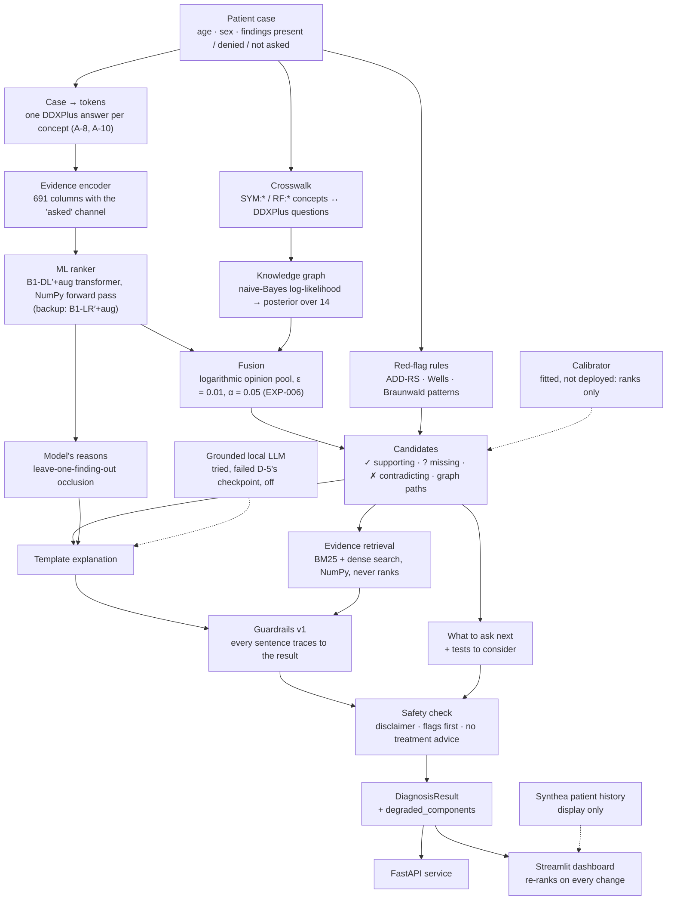

# 4 · The system as built

> **Draft 2, 2026-11-11.** This chapter describes the system as it stands in the repository's
> `master` on 2026-11-11, after the freeze tag `v0.9-freeze` (2026-11-09) and the dashboard changes
> of 2026-11-10. The tagged prototypes are `v0.1-prototype` (2026-10-14) and `v0.2-prototype`
> (2026-11-08); the `v1.0` tag has not been made. The freeze fixes `configs/`, `src/` outside
> `src/eval/`, and `tests/fixtures/`. The dashboard in `app/` is outside that gate and changed on
> 2026-11-10 (§4.15); none of those changes can alter a ranking. Components that were built but do
> not ship, and those never built, are listed in §4.18.

## 4.1 Overview and design principles

Nightingale takes a patient case (age, sex, findings marked present or denied, risk factors,
vitals) and returns a ranked differential over 14 conditions, with red flags, the evidence for and
against each candidate, an explanation, the tests to consider and the questions to ask next, the
list of any degraded components, and the disclaimer. Five principles govern the design (`docs/02`
§1):

1. **Every module is replaceable behind an interface.** Neo4j may become NetworkX, the model may
   become a degraded stub, and nothing downstream notices.
2. **Degrade, never crash.** If a component fails, the system still returns a ranking and says
   what is missing.
3. **Safety is not downstream of the model.** Red-flag rules run independently and can raise a
   condition the model scored near zero.
4. **Explanations are derived, not generated.** Supporting, missing and contradicting findings come
   from graph operations. A language model may only phrase them; one was tried and does not ship
   (§4.14).
5. **Typed boundaries.** All data between modules uses the Pydantic models in `src/contracts.py`,
   which change only with the agreement of all four team members.

Figure 4.1 shows the request path as built.

**Figure 4.1 — The request path as built** (solid: built and shipped; dashed: built but off, not
deployed, or display only).



## 4.2 Contracts, pipeline and stubs

`src/contracts.py` defines the shared models: `Finding` (a concept id with an assertion of
**present**, **absent** or **unknown**, because "denies leg swelling" and "leg swelling not asked"
are different facts, FR-1.3), `PatientCase`, `Candidate`, `Explanation` and `DiagnosisResult`
(`docs/02` §4). Four protocols define the components: `ConditionRanker`, `GraphStore`,
`EvidenceRetriever` and `Explainer`. Every protocol had a trivial stub in week 1, so the pipeline
ran end to end before any real component existed; the real graph and model replaced the stubs one
at a time, and the week-3 "walking skeleton" milestone (a real model and a real graph, end to end)
was reached on 2026-09-24 (PROGRESS §5).

`src/pipeline.py` runs the steps in the order of `docs/02` §3: score with the model and the graph
independently, fuse, analyse the findings, evaluate the red flags, attach evidence, explain, check
the explanation (guardrails), and finally run the safety check. A contracts change agreed by the
team on 2026-10-02 (C-1) requires a ranker's scores to be finite, non-negative and to have a
positive sum, and makes `fused_score` a log-probability whose default is the lowest one,
`LOG_FLOOR` (`docs/02` §4.4).

**Free text is untrusted and ignored.** `PatientCase.free_text` exists in the contract, and no
component reads it: the ranker, the graph, the red-flag rules, the retriever, the explainer and the
guardrails all work from the structured findings. `tests/test_free_text.py` shows that a hostile
text ("ignore all previous instructions…") changes no ranking, flag or explanation for any golden
case and is not echoed, and that no module in `src/`, `app/` or `scripts/` mentions the field. The
dashboard offers no free-text box (`docs/04` §8).

## 4.3 The cardiac knowledge graph

`build_cardiac_kg()` merges the three sources of §3.3 into one backend-neutral graph
(`src/medical_kg/cardiac_kg.py`). **Table 4.1** gives its size (`docs/02` §5.1).

**Table 4.1 — The knowledge graph.**

| Measure | Value |
|---|---|
| Nodes | 129: 14 conditions, 66 symptoms, 49 risk factors. These are the 84 DDXPlus questions, 2 more that BODHI-S uses, and 29 answer-level concept nodes (18 from the hand-authored facts, 11 from BODHI-S) |
| Edges | 321: 245 `ddxplus` (weight 1.0), 56 `bodhi_s` and 20 `hand_authored` (weighted by likelihood band) |
| Questions unique to one condition | 49 of 84 |
| Questions shared by ≥ 75% of conditions | 9: the seven pain questions, breathlessness and travel |

**Two vocabularies.** DDXPlus links conditions to evidence *questions* (`DDX:E_nn`, for example
"characterise your pain"), not to answers, so its part of the graph cannot tell tearing pain from
burning pain. The hand-authored and BODHI-S edges are answer-level: they point at concepts such as
`SYM:pain_character_tearing`. The crosswalk (§4.4) links the two.

**Provenance.** The store is a multigraph keyed by source, so a fact two sources state is kept
twice but counted once, and `only_sources()` keeps a subset for ablations (`docs/02` §5.1).

**Two stores, one graph.** `NetworkXGraphStore` serves the graph from memory. `Neo4jGraphStore`
reads the team's copy on Neo4j AuraDB Free (decision D-6) once at start-up and scores it in memory
exactly as NetworkX does, so a paused cloud instance cannot stall a consultation. A fingerprint over
every node and edge shows the two copies are the same graph and catches a hand edit in Neo4j. When
Aura is paused, offline or refuses the login, `open_graph_store()` falls back to NetworkX and
reports `graph_backend` as degraded (§4.16). Scripts open Aura read-only; only the loader writes it.

## 4.4 The crosswalk

The red-flag rules and the golden cases use hand-authored concepts (`SYM:*`, `RF:*`); the graph
and the model use DDXPlus's codes. `CROSSWALK` (`src/medical_kg/crosswalk.py`) maps each of the 67
hand-authored concepts to the DDXPlus answers that express it, and a test fails if any concept the
code uses lacks an entry (`docs/02` §5.2). Each entry carries a SKOS match type, read as "the
DDXPlus answer is ___ the concept", and each type allows only the sound inferences (Table 4.2).

**Table 4.2 — What each match type allows** (`docs/02` §5.2).

| Match | Concept present ⇒ answer | Answer ⇒ concept | Concept denied ⇒ question denied |
|---|---|---|---|
| exact, close | yes | yes | yes, for a yes/no question |
| broader | yes | — | — |
| narrower | — | yes | yes, for a yes/no question |
| related, none | — | — | — |

A denial carries over only to a yes/no question: denying radiation to the jaw or arm says nothing
about radiation to the back, so it cannot deny "does the pain radiate?". A concept that means the
same as a yes/no DDXPlus question sits on that question's node (`canonical_concept_id`), so the
same fact from two sources is one node with two edges.

The crosswalk translates both ways. `expand_case` adds to a hand-authored case the DDXPlus
questions it implies, for the graph; a derived finding carries its *question's* label, never the
finding's, so a reasoning path cannot claim that GERD presents with pressure-type pain when the
graph only links GERD to "characterise your pain". `concepts_from_evidences` turns a DDXPlus
patient's tokens into concepts, so the red-flag rules can run on DDXPlus patients; a question the
row does not list stays unknown, not denied.

## 4.5 The graph score

The graph scores a case by a **naive-Bayes log-likelihood** (`src/medical_kg/scoring.py`; 2a,
EXP-005). For each condition c, with a uniform prior,

```
score(c) = Σ over present findings k of log P(k | c)  +  Σ over denied findings k of log(1 − P(k | c))
```

- A present finding counts for the conditions that explain it and against those that cannot
  (probability `LEAK` = 0.01).
- A denied finding counts against the conditions that expect it.
- **A finding the case does not mention counts for nothing.** Not mentioned is not denied.
- DDXPlus's weight 1.0 ("listed, frequency unknown") is capped at `CAP` = 0.9.
- Both constants were fixed before any measurement. On the hand-written checks, every verdict held
  at all twelve settings of LEAK 0.001–0.03 and CAP 0.8–0.95 (EXP-005); no constant was chosen on
  validation.

**The graph is first closed under the crosswalk.** Without that, every chest-pain patient's
`SYM:chest_pain` would count against the nine conditions DDXPlus describes only by questions, and
hand the case to aortic dissection, the one condition that names the answer. Two rules close it:

- **Upward:** an answer implies its question. A condition with answer-level edges of weights w₁,
  w₂, … implying question q lists q with 1 − Π(1 − wᵢ), the probability of giving at least one of
  those answers (noisy-OR).
- **Downward:** a condition that asks q but whose answer the graph does not state gets each
  answer at the **mean** of the conditions that do state it. Ignorance is "average", neither
  "impossible" nor "certain".

Each fact is counted once: an answer and the questions it entails are scored as the answer alone
(a defect found in review, EXP-005 point 4). The scores are log-likelihoods, at most 0, comparable
only within a case; the fusion reads them as a posterior, a softmax over the conditions.
`contributions()` gives each finding's exact part in a score, and a reasoning path cites only
edges the graph holds, never implied or imputed ones.

**Two limitations, by design** (EXP-005, `docs/02` §5.1):

1. **An answer only one condition states cannot discriminate.** Tearing pain is stated only for
   dissection, so it is imputed at dissection's own value for every other condition that asks
   about pain character. The red-flag rule and the ML ranker carry that knowledge instead.
2. **Stable and unstable angina tie when nothing is denied.** Stable angina's 20 questions are all
   among unstable angina's 24. Rest pain present puts unstable angina first by a likelihood ratio
   of about 90; rest pain denied puts stable first; with neither, the two tie, and the tie rule
   (registry order) puts unstable angina, the must-not-miss one, first. Telling them apart is the
   ML ranker's job.

Personalised PageRank was measured against naive Bayes and not chosen: with the same closure the
two rank validation identically, but naive Bayes holds the angina decision by a factor of about 90
where PageRank holds it by 8%, and its per-finding contributions are exact (EXP-005).

## 4.6 Feature encoding and the "asked" channel

`EvidenceEncoder` (`src/ml/features.py`) turns age, sex and the evidence tokens into numbers. It
reads nothing else, so no label can leak in (`docs/03` §2.2).

- **The columns come from the release files, never from patients:** 607 of them, the same on every
  machine, named by a fingerprint (`3a0d5a5e01d7f427`). A trained model records the fingerprint and
  refuses rows encoded with another.
- Binary evidences are 0/1; a categorical or multi-choice question has one column for "answered
  with something other than the default" and one per non-default answer; an ordinal 0–10 scale is
  kept as its value, ordered, plus an "answered" flag, because 0 can be a real answer; the NA
  sentinel is handled explicitly.
- **A default answer gets no column**, so it reads exactly like an unlisted question.

That last property is the defect EXP-017 exposed (R-18, §6.3): a question answered "no" and a
question never asked were the same row, so a short history read as a long list of denials.
**The "asked" channel** (2026-09-24) appends one column per question, `E_nn=unasked`, for 691
columns in all (fingerprint `ddd14019c66eff10`); with the channel off, the encoder is exactly the
original one, which a test pins.

| Patient | Questions counted as asked |
|---|---|
| DDXPlus, full history | All of them: an unlisted DDXPlus question means "no" |
| DDXPlus, masked (§5.4) | The questions the mask kept, plus unlisted ones drawn at the same share (decision A-9) |
| Hand-written case | The questions its tokens answer, plus the yes/no questions its denials answer |

"Asked" is **never** read from the default answers DDXPlus lists (such as "did not travel"):
DDXPlus lists them only for conditions whose definition includes the question, so they would leak
the label. At full evidence the channel is constant, so only a model trained on masked copies
(`+aug`, §4.7) learns anything from it; the training script refuses the channel without
augmentation.

## 4.7 The classical rankers

All models are trained on a cloud runtime, never on the owner's laptop (decision D-7), and no model
is tuned beyond early stopping on a 10% patient-level holdout of the training split (decision
T-6).

- **B0**, the floor: every patient gets the same ranking, the training split's class frequencies
  (EXP-003).
- **B1-LR**, multinomial logistic regression: C = 1, max-abs scaling, converged in 17 iterations
  (EXP-004).
- **B1-XGB**, XGBoost with fixed defaults: learning rate 0.1, depth 6, row and column subsampling
  0.8, at most 1,000 rounds with 50 rounds of patience (best round 117) (EXP-004). XGBoost reads a
  sparse matrix's absent entries as missing but a dense array's zeros as values, so the wrapper
  always hands it a sparse (CSR) matrix.
- **`+aug` variants** (EXP-018) train on every training patient plus one masked copy of each,
  keeping a share of its questions drawn uniformly from [0.1, 0.9], with masks drawn from the
  training seed, never the evaluation masks (`src/ml/evidence_masks.py`; 511,800 rows in all).
- **′ (prime) variants** use the encoder with the "asked" channel. B1-LR′+aug was the configured
  ranker from 2026-09-25 to 2026-10-13 (EXP-019) and is now the backup.

`ModelRanker` (`src/ml/ranker.py`) wraps any model with labels and probabilities. `open_ranker()`
returns a degraded ranker with flat scores when the release files, the model or a matching
fingerprint are missing, which is the ordinary state of CI and a fresh clone; flat scores abstain
in the fusion, so the ranking is provably the graph's own, and `ml` is reported as degraded.

## 4.8 From a hand-written case to model input

A clinician's case is written in concepts (`SYM:chest_pain`), and the model needs DDXPlus tokens
(`E_55_@_V_101`). `expand_case` stops at the question, deliberately, so a separate module,
`src/ml/case_tokens.py`, chooses the **answer** a patient with that concept would have given.

- Two hand-curated tables choose one representative answer per concept (17 entries, each with the
  DDXPlus French). Taking the lowest answer id would be wrong: it gives *forearm* for radiation to
  the jaw or arm, which no validation patient gives.
- **Narrower matches are admitted** (decision A-8, kept by the team on 2026-10-02). Without them
  sudden onset, exertional pain and relief by rest produce nothing, and those are the
  discriminators for pulmonary embolism, pneumothorax, dissection and the anginas. Every token so
  derived is listed.
- **A denial is never a token.** It marks its question asked only when it answers a whole yes/no
  question, and only a model with the "asked" channel can see it.
- Every finding that yields nothing is kept with a reason, and the tests round-trip each concept
  back through `concepts_from_evidences`.

The 17 answers were reviewed and approved as they were on 2026-10-12. **On 2026-10-13 one was
changed (decision A-10):** `SYM:radiation_jaw_arm` had stood for `E_57_@_V_121` (*mâchoire*, the
jaw), which in DDXPlus only acute pulmonary edema patients give; it now stands for
`E_57_@_V_163` (*sous la mâchoire*, under the jaw), the jaw answer of DDXPlus's MI and angina
patients. The model's reasons (§4.13) found it (EXP-021). The inversion still has no ground truth
(R-17, §7.4).

## 4.9 The deep ranker B1-DL

**Choice.** Asked by the supervisor (2026-10-04) for the deep model best suited to the approach and
for its complexity, the owner chose one small transformer (decision D-12); no other architecture was
trained, so none was selected on data (EXP-021).

**Architecture** (`src/ml/deep.py`), an FT-Transformer (Gorishniy et al. 2021) at a smaller size,
fixed before training:

- **Tokens:** one per DDXPlus question (84), plus age and sex, plus a [CLS] token: 87 tokens for
  every patient, with no positions. A token is its bias plus the sum of its columns' scaled values
  times their embeddings, so an unasked question adds its `unasked` embedding.
- **Blocks:** 2 blocks, width 96, 4 heads (24 per head); pre-normalisation; a ReGLU feed-forward
  of width 128; dropout 0.2 on attention and 0.1 in the feed-forward. The last block computes the
  [CLS] row only. **Head:** LayerNorm, ReLU, linear.
- **Size:** 225,645 parameters and 9,610,752 multiply-adds per patient with the "asked" channel
  (B1-DL′+aug); 217,581 and 9,602,688 without (B1-DL+aug). The cost is the same for every patient.

**Training** (`scripts/train_deep.py`), identical across arms and seeds: the comparators' own
training rows at each seed (511,800: 460,620 fitted, 51,180 held out by patient for early
stopping); AdamW, learning rate 1e-4, weight decay 1e-5; batch 1,024 in FP32; at most 50 epochs,
patience 5, best epoch kept (18 to 43 across runs). Both arms, seeds 42–46, ten networks in all,
trained on Kaggle (two Tesla T4 GPUs) in 2 h 10 min (EXP-021). Logistic regression fits on all rows
and the transformer on 90%, an asymmetry that can only disadvantage the transformer.

**Two implementations, one model.** Training uses PyTorch on the cloud. The laptop, the pipeline
and CI run a **NumPy forward pass**, with nothing to install. The weights are plain JSON, each array
base64-encoded float32 with its SHA-256, never a pickle, and the loader checks every hash and the
encoder fingerprint. On 2,000 validation rows the two implementations differ by at most 4.3 × 10⁻⁷
in probability, with no top-1 disagreement, in every run; the laptop reproduces seed 42's
validation metrics to within 7 × 10⁻¹¹ (EXP-021).

**Adoption: safety first** (decision D-13, 2026-10-12, fixed before training as code in
`src/eval/safety_floor.py`). The transformer could replace B1-LR′+aug only if, on validation, it
met the safety targets at 100% and 25% of the history, was non-inferior to the logistic regression
trained like it at 25% on must-not-miss recall@3 and MRR (paired 95% lower bound above −0.005), and
passed every golden case with red flags on and off. **It passed on 2026-10-13** (§6.8), and D-13
holds at all five seeds for both arms (EXP-021, 2026-10-14), so the configured ranker is
**B1-DL′+aug, seed 42**, with B1-LR′+aug as the backup (two keys in `configs/config.yaml` switch
back). On the test split it beats the logistic regression trained like it and is level with the
XGBoost trained like it (H6 not supported, §1.3).

## 4.10 Fusion: a logarithmic opinion pool

The model and the graph each give a distribution over the conditions; the fusion pools them
(`src/fusion/pool.py`; `docs/02` §6). Over the 13 conditions the model knows,

```
log q(c) = (1 − α) · log max(p_ml(c), ε) + α · log P_kg(c),   normalised over the 13
```

where `P_kg` is the graph's posterior and α is the graph's weight. Three choices were fixed on
2026-09-25, before any fused ranking of a validation patient was scored:

1. **A condition the model cannot score takes its probability from the graph alone.** Aortic
   dissection gets P(dissection) = P_kg(dissection), and the 13 share the rest in the pool's
   proportions. The first design, a min-max weighted sum, capped dissection at the graph's weight,
   so it could never rank first however strongly the graph supported it (EXP-005 point 7).
2. **No model probability below ε = 0.01 is taken at face value.** A pool multiplies, so one
   near-certain expert would otherwise veto what the other supports. At α = 0.5 the graph must
   prefer a condition about 100 times over the model's answer to put it first. The value was
   chosen with GC-001 in view, where the retrained models give unstable angina 0.98–1.00 and MI
   almost 0, and no other value was tried; it is not tuned.
3. **An absent signal abstains.** A degraded model leaves the graph's order exactly; a failed
   graph leaves the model's; a model whose scores are not finite, non-negative probabilities is
   treated as failed.

**One consequence, found in review:** P(dissection) is the same at every α, and α moves only its
rank. With a near-certain model, presentations that score 0 on the ADD-RS but involve back pain or
hypertension can put dissection 2nd or 3rd, above where the graph alone ranks it. The team kept the
design on 2026-10-02 (A-2) but did not answer whether that is clinically wanted, so the question
stays open for a clinician (`docs/02` §6, §9).

`fused_score` is a log-probability, not a calibrated probability. **The one tuned quantity, α, was
chosen by EXP-006's pre-registered sweep on validation** (the owner's Kaggle run of 2026-11-07, 11
minutes, both mask digests reproduced). It is **0.05 for the configured component B1-DL′+aug (A0′)
and 0.30 for B1-DL+aug (A0)**, and the configured pair is in `configs/config.yaml` (`ml_weight`
0.95, `kg_weight` 0.05); it is never retuned by hand. For both components no α met the rule's
constraint (the fused ranking's must-not-miss recall@3 at least the component's own at every
level), so the rule's fallback branch took the highest mean must-not-miss recall@3. The objective
is flat: for B1-DL+aug the mean MRR is 0.9852 from α 0.05 to 0.45 and falls only past 0.85.

**The fusion adds nothing measurable on DDXPlus.** On validation, B1-DL′+aug at α = 0.05 against the
model alone has MRR 0.9992 [0.9990, 0.9994] / 0.9932 [0.9926, 0.9938] / 0.9727 [0.9715, 0.9739] at
100 / 50 / 25% evidence (the model alone 0.9992 / 0.9932 / 0.9728, point estimates), and
must-not-miss recall@3 1.0000 / 1.0000 / 0.9978 [0.9971, 0.9985] (alone 1.0000 / 1.0000 / 0.9981)
(EXP-006). On the test
split A4, A0 without the flags, equals A1, the transformer alone (B1-DL+aug), at 25% to the fourth
decimal on MRR (0.9639 [0.9623, 0.9652] both) `[TEST]` (EXP-012). Aortic dissection, which no DDXPlus patient has, reaches the
top 3 for 0.0% / 0.1% / 1.9% of validation patients and pushes no must-not-miss patient out of it
(EXP-006). Read this with R-12 and R-16: DDXPlus draws each patient's evidence from their
condition's list, so the model already saturates, and the graph's contribution is the one condition
the model cannot score and the explanation, not accuracy.

## 4.11 Red-flag rules and the safety layer

**Red flags** (`src/reasoning/red_flags.py`) run on every case, independently of the ranker
(FR-6.1). Each rule follows a published pattern rather than any single suggestive finding, because
a flag on half of all patients teaches users to ignore flags (R-15). Every must-not-miss condition
has a rule (EXP-008).

**Table 4.3 — The red-flag rules** (`docs/04` §3).

| Condition | Pattern |
|---|---|
| Possible NSTEMI / STEMI | Chest pain with two of: exertional, pressure character, radiation to jaw or arm, sweating |
| Unstable angina (Braunwald) | A crescendo pattern, or chest pain at rest with an ischaemic character |
| Pulmonary embolism (Wells) | Pleuritic pain or breathlessness **and** a Wells risk: one swollen leg or calf pain, immobilisation, recent surgery, previous DVT |
| Spontaneous pneumothorax | Sudden pleuritic pain with breathlessness (sudden: onset speed ≥ 8 of 10, decision A-5) |
| Myocarditis | Chest pain after a viral illness, with breathlessness or palpitations |
| Acute pulmonary edema | Breathlessness with orthopnoea, paroxysmal nocturnal dyspnoea or known heart failure |
| Boerhaave | Chest pain after forceful vomiting |
| Aortic dissection (ADD-RS) | Chest, back or abdominal pain with tearing character, a pulse deficit or an inter-arm blood-pressure difference; or findings from two of the ADD-RS's three categories. Back radiation is in none of them |

A rule's reason says what fired it and what must be excluded, and never recommends a treatment.
The pipeline lists every flagged candidate before every unflagged one, whatever its score
(FR-6.2). That ordering means a golden case with a flag cannot detect a ranking regression, so the
ranking is also tested with red flags off (`tests/test_ranker.py`).

**What the rules achieve, and do not.** The measure of alarm fatigue is the share of patients
*without* a must-not-miss condition who get a flag: 25% on validation, mostly the infarction rule on
stable angina (EXP-008). Red-flag sensitivity is the share of a must-not-miss condition's own
patients whose flag reaches them (`docs/05` amendment 2). It is **below the 0.95 target**, because
DDXPlus often omits the defining finding, and a rule is not loosened to chase it: 0.823 [0.818,
0.829] at 100% on validation (EXP-008), and on the test split 0.8285 [0.8229, 0.8344] at 100% evidence,
**0.3318 [0.3245, 0.3386] at 50% and 0.1369 [0.1317, 0.1420] at 25%** `[TEST]` (A0 and A0′,
EXP-012), because most rules need two or three findings together. Strict flag precision (a flag
counts only when it names the true condition) is 0.5089 [0.5047, 0.5128] at 100% `[TEST]`. The
flags' effect on the ranking is that they lower top-1 and MRR at full evidence and raise nothing in
recall (EXP-012). DDXPlus generated its patients from the definitions the crosswalk reads (R-12), so
none of these rates is evidence about real histories.

**Which flags are appropriate** (decision A-7, for red-flag precision only): the ischaemic flags
are also appropriate for the cardiac conditions on the same ECG-and-troponin pathway, and the
flags for dissection, embolism, pneumothorax and Boerhaave for their own condition only. Three
judges, each applying a stated perspective (an emergency physician's pathway, a cardiologist's
guidance, an alarm-fatigue sceptic), decided all 104 flag–condition pairs, and their majority was
adopted unchanged under the owner's delegation; they were told not to read results but were not
fully blind to firing rates (`docs/04` §3). With this mapping red-flag precision is 0.848 [0.845,
0.852] at 100% on validation (EXP-008). The repository records no clinician's review of the rules.

**Guardrails v1** (3c; `src/reasoning/guardrails.py`) check the explanation after the explainer
writes it and before the safety layer, whoever wrote it.

- **Claim support.** Each sentence must trace to one thing the result holds: a candidate (its label,
  graph assessments and paths), the red flags, the model's reasons, a suggested test or a cited
  passage. A sentence that traces to none is listed in `unsupported_claims` and `grounded` becomes
  false; the text is left in place, flagged rather than suppressed.
- **Citations.** An explanation may cite only the passages retrieved, and a link goes only to PMC;
  any other citation is removed and listed.
- **Lexical, and disclosed as such** (§7.8). The check catches a word the result does not hold, not
  a wrong relation between words it does. "Supporting findings: chest pain" passes for any
  candidate, because chest pain is a recorded finding; a negation of a recorded finding passes; and
  a paraphrase does not trace. The template's sentences always trace (tested on every golden case),
  and all 312 explanations checked on the real components were grounded (EXP-009). In the
  language-model trial the check stopped all 50 answers (§4.14).

**The safety layer v1** (`src/reasoning/safety.py`) checks every result last and repairs rather
than fails: the disclaimer is exactly the text of `docs/04` §2 (FR-6.4); every flagged candidate
comes before every unflagged one and is named in the red flags (FR-6.2); and a sentence that
recommends a treatment, names a drug or gives a dose is removed and listed among the explanation's
unsupported claims (FR-6.5), while investigations such as an ECG are kept. It is deterministic and
lexical (§7.8). On 3,000 validation patients it found nothing to repair (EXP-008).

## 4.12 Calibration

No raw score is shown as a probability until it passes calibration (`docs/05` §3.3, `docs/04`
F-2). `src/fusion/calibration.py` implements the four methods of EXP-007 (§5.10) under two rules: a
condition with no patient in the fitting data keeps its raw probability (otherwise a one-vs-rest fit
would give aortic dissection 0 whatever the findings), and calibration never changes the ranking. A
calibrator records the system it was fitted for, and the pipeline refuses one fitted for another,
reporting `calibration` as degraded.

**No calibrator is configured: the system shows ranks only.** Stage 1 (2026-10-13) found the
logistic regressions already calibrated, and both transformer arms calibrated too, so they stay raw
(cross-fitted ECE at 25%: B1-DL′+aug 0.0047 [0.0034, 0.0068], B1-DL+aug 0.0039 [0.0028, 0.0062],
validation, both better than the logistic regressions' at 25%). Stage 2 (2026-11-08) fitted A0′'s fused score, and the rule chose temperature scaling
(the lowest mean Brier over the three levels, 0.0338 against isotonic's 0.0342, Platt's 0.0381 and
the raw score's 0.0365). Its top-label ECE went from 0.0327 [0.0324, 0.0329] / 0.0603 [0.0595,
0.0614] / 0.0773 [0.0757, 0.0793] raw to 0.0008 [0.0008, 0.0008] / 0.0051 [0.0041, 0.0062] / 0.0176
[0.0156, 0.0195] at 100 / 50 / 25% evidence (A0′, validation). **The owner decided on 2026-11-09
that `calibration.file` stays null**, because a short hand-written case is near-certain under any
calibration (R-17; for example GC-001's first listed condition goes from 0.012 to 0.001). The
calibrator is kept as a result, not deployed, so ablation A5 is A0 exactly, and H5 is judged on the
raw fused score (§1.3). Stage 1's other findings are in §6.9.

## 4.13 The model's reasons

The graph explains itself through its paths and the ✓ / ? / ✗ analysis; the model does not. So the
system asks the model directly, by **leave-one-finding-out occlusion** (`src/ml/reasons.py`): it
removes each recorded finding in turn, rescores, and measures how each condition's log-odds move.
A finding whose removal lowers a condition's odds is a reason for it. A denial is a finding too.

- The case and each case-without-one-finding are scored in one batch (0.4–6.5 ms a case,
  PROGRESS §8).
- The explanation names reasons, strongest first, and **never shows a number**, because the models
  are near-certain on hand-written cases (§6.4) and no calibration method fixes that (§6.9).
- **Limits, stated wherever reasons are shown:** each finding is judged alone, so two findings that
  matter only together (most red-flag patterns) can each look weak; a finding the inversion cannot
  turn into a token is invisible to the model; and aortic dissection, which the model was not
  trained on, has no model reasons.

## 4.14 Explanations, what to ask next and evidence

The **template explainer** writes the explanation from the graph and the model, so it cannot state
a fact the system does not hold. It is the explainer that ships. For each candidate it keeps every
supporting *question* the graph matched, with the recorded finding that answered it beside it; it
names five of the expected findings not recorded and counts the rest; and it names the top
candidate's model reasons (`docs/02` §7).

**The grounded language-model explainer was built, run and stopped.** `LLMExplainer` (`src/llm/`,
3b) asks a local model, through Ollama's `/api/generate`, to phrase the explanation from a prompt
that holds only what the result holds. Its answer is kept only if guardrails v1 and the treatment
lexicon pass; otherwise the template stands in and `llm` is reported as degraded. `llm.enabled` is
false, and the pipeline is then exactly the template's (tested).

- **The trial** (EXP-009/010, validation only): the owner's Kaggle run of 2026-11-07 (47 minutes),
  `llama3.1:8b` at temperature 0, 50 validation patients and the four golden cases, four arms, no
  call failed. Decision D-5 had fixed its checkpoint on 2026-10-20 and the pre-registration had
  recorded it: the template stays if the grounded explainer's unsupported-claim rate is not under
  0.20.
- **The checkpoint failed.** A0+LLM's raw answers hold an unsupported-claim rate of **0.741 [0.663,
  0.803]** (163 of 220 claims). B3, the model alone, and B3r, told to use only the facts it is
  given, score 1.000 [1.000, 1.000] each, and B4, retrieval and the model, 0.996 [0.984, 1.000]. **H3
  is not supported:** two of its four comparisons pass.
- **Nothing reached a user.** Guardrails v1 stopped all 50 grounded answers (1 to 11 unsupported
  claims each), so the template's text was delivered 50 times, and no answer delivered an
  unsupported claim or treatment language.
- **Limits.** The claim check is lexical and punishes paraphrase, so the rates measure staying
  within the inputs, not correctness. One model, one run, a sample of 50 with wide intervals. The
  150-item sheet for rating the explanations exists and was not rated (the owner's decision of
  2026-11-09). B3 and B4 are reported as not carried into the evaluation. Asked to rank the 14
  conditions itself, the model ranked worse than the pipeline at every level: at 100%, top-3 0.78
  [0.66, 0.90] for B3 and 0.58 [0.44, 0.72] for B4, against 1.00 [1.00, 1.00] for the pipeline's
  ranking.

### 4.14.1 What to ask next (3d)

FR-5.5 asks for the next test or question that best discriminates the leading candidates. The
graph's `Test` node and `DISCRIMINATED_BY` edge were never built, so "what to ask next" has two
parts, neither of them a graph edge (`docs/02` §5.3).

- **The tests to consider** (`src/reasoning/investigations.py`). A hand-authored table gives, for
  each of the 14 conditions, the diagnostic investigations that confirm or exclude it, in the order
  its guideline uses them, and each line cites that guideline. The pipeline puts one line per
  condition into `suggested_next_tests`, for the first three candidates and every red-flagged one.
  - Every line says "consider", and lists **investigations only, never a treatment or a drug**
    (FR-6.5). The safety layer would remove a line that broke this, and a test scans the table for
    treatment language.
  - The table does not rank tests against each other, nor weigh their cost or harm.
  - Two of its references, first written from memory, were checked on 2026-10-15 against the
    publishers' pages and are exact as cited: Roberts ME, Rahman NM, Maskell NA, et al. British
    Thoracic Society Guideline for pleural disease. *Thorax*. 2023;78(Suppl 3):s1–s42,
    doi:10.1136/thorax-2022-219784; and Chirica M, Kelly MD, Siboni S, et al. Esophageal
    emergencies: WSES guidelines. *World J Emerg Surg*. 2019;14:26,
    doi:10.1186/s13017-019-0245-2.
- **The questions to ask** (`src/reasoning/next_questions.py`). Of the findings the form offers
  that the case has neither recorded nor denied, it ranks those whose answer would most reduce the
  graph's uncertainty over the 14 conditions: the **expected entropy reduction** of the graph's
  posterior, under the same naive-Bayes likelihoods that rank the case (§4.5).
  - Each answer, present or denied, is scored by the arithmetic that would rank it, through the
    crosswalk. The gain is the mutual information between the condition and the answer: never
    negative, and 0 for a question every condition answers alike.
  - The five best are returned, each with the conditions a yes and a no would favour.
  - A finding the record already settles is not asked, nor one that cannot apply to the recorded
    sex (pregnancy, of a man: found in review).
  - Nothing is tuned and no data is read.
  - *Limits:* the posterior is the graph's alone, so the order matters, not the number. Every
    condition counts the same; the red-flag rules and the tests carry the danger. The ranking is
    myopic, one question at a time. The model is not consulted.
- **Where it shows.** The dashboard's "What to ask next" block, and the API's `POST
  /next-questions`. `DiagnosisResult` has no field for questions, and a contract change needs the
  whole team, so one is proposed rather than made (`docs/02` §5.3).

On GC-001 the graph's first questions are rest pain and a crescendo pattern, which bear on
unstable angina against MI there, and its tests are a 12-lead ECG and serial high-sensitivity
troponin. Rest pain, a crescendo pattern and the troponin are also what separates the anginas
clinically, where every ML component errs most (EXP-023, §6.14).

### 4.14.2 Evidence with citations (3a)

Beside each of the first three candidates the dashboard shows **excerpts from PubMed Central Open
Access articles**, each with its citation, a link to its PMC page, its licence and an attribution
(FR-7.1–7.3, FR-9.4). **Evidence never changes the ranking**: it is attached after ranking, and a
test checks the order is unchanged (`src/rag/`, EXP-011).

- **The corpus** was built on Kaggle by the owner's run of `notebooks/kaggle_retrieval_corpus.ipynb`
  on 2026-11-07 (`docs/11` §4.6), never on the laptop, and wired on 2026-11-08
  (`retrieval.bundle`). It holds 2,067 articles and 26,190 passages (§3.1.1).
  - It searches PMC for each condition, restricted to the Open Access subset, using NCBI's
    E-utilities with no API key and at most 3 requests a second.
  - An article is kept only with a Creative Commons licence in its XML, and the licence is
    recorded; 844 articles carry a non-commercial term.
- **Diagnosis only** (FR-6.5). A sentence with any treatment language is never stored, embedded or
  shown, and an article whose title names a treatment is dropped (`src/rag/screening.py`).
  - What is kept is a run of consecutive clean sentences, never sentences glued across a removed
    one.
  - The laptop screens every excerpt again before showing it (it hides 0 passages of this
    corpus), and the safety layer drops any evidence that recommends a treatment.
- **Retrieval** is a hybrid of BM25 and a dense search, fused by reciprocal rank (k = 60), in NumPy.
  - The passage vectors (768 dimensions, float16) were computed once on Kaggle with
    `pritamdeka/S-PubMedBert-MS-MARCO`, a CC-BY-NC-2.0 model, and so were the vectors of a fixed
    vocabulary of queries.
  - On the laptop a query vector is a mix of those precomputed vectors, so **the laptop runs no
    model**: only NumPy, and no FAISS. An exact product over tens of thousands of passages takes
    milliseconds.
  - The constants (the dense query's mix, the depth, BM25's parameters, the excerpt length) were
    fixed before any real passage was seen, and EXP-011's evaluation was pre-registered before the
    corpus existed.
- **Cost.** Start-up takes 1.8 s; one candidate's retrieval takes p50 0.78 ms and p95 1.22 ms; with
  the transformer, the whole pipeline's p95 on the golden cases is 13.6 to 16.9 ms, 2.5 to 3.3 ms of
  it retrieval (EXP-011, dated note of 2026-11-08).
- **What was not measured, and what was.** The relevance of the passages **was never judged**.
  EXP-011 pooled each method's top 3 for 26 queries into 159 rows for two team members to judge
  blind, and they had no time, so no Precision@3 or nDCG@3 exists and the hybrid stays configured by
  default, not by a result. The pre-registered check of the query-vector mix was applied on
  2026-11-10: over 56 pairs (4 golden cases × 14 conditions) its cosine with the full-sentence
  embedding has a median of 0.962 (range 0.950 to 0.984), but its dense top 10 overlaps the full
  sentence's by a **median of 0.400** (mean 0.404, range 0.00 to 0.80), under the pre-registered
  0.5. The laptop's query vector is therefore **a poor stand-in**: on average its dense half ranks
  four of the ten passages that embedding the whole query would. No remedy keeps the model off the
  laptop for an arbitrary case.
- **The dashboard says so.** The evidence caption says the passages' relevance has not been
  formally judged (EXP-011) and asks the reader to take them as leads, not proof. The first excerpt
  for a condition is not always on point: on the dashboard's default case, PSVT's first passage
  comes from a case report about a caesarean delivery (R-20, `docs/07`).
- **Without the corpus bundle**, or with one that fails its checks (each bundle file's SHA-256 is
  in its manifest), the retriever gives no evidence and every result reports `rag` (§4.16).

## 4.15 The API and the dashboard

**The API** (`src/api/app.py`, FastAPI, served on 127.0.0.1): `POST /diagnose` takes a case and
returns a result, with the time taken in an `X-Elapsed-Ms` header; `POST /next-questions` returns
the questions to ask next; `GET /conditions` lists the 14 conditions, all the system can rank; `GET
/concepts` lists the findings it understands; `GET /health` says which ranker and graph answer and
what is degraded, and repeats the disclaimer. A malformed case is refused with HTTP 422.

**The dashboard** (`app/streamlit_app.py`, Streamlit, on 127.0.0.1 only):

- each finding can be marked present, denied or not asked (FR-1.3), and the golden cases load as
  examples (FR-1.5);
- red flags come first and prominently (FR-6.2);
- it shows **ranks, not raw scores**: the fused order, with the model's and the graph's own ranks
  beside it; **no probability is shown** (§4.12);
- ✓ supporting, ? missing and ✗ contradicting findings, with the graph's paths (FR-9.3, FR-5.4),
  and each candidate's model reasons;
- **"What to ask next"** (§4.14.1): the questions the graph would learn most from, and the cited
  tests to consider;
- each of the first three candidates' **evidence** with its citation, PMC link and licence
  (§4.14.2), under a caption that says its relevance has not been judged, or one line saying no
  corpus is loaded;
- what is degraded, and the disclaimer on every screen (FR-6.4);
- **it re-ranks on every change to the form** (decision D-14, "real time" as live re-ranking),
  because a whole ranking takes milliseconds (§4.17, §6.10);
- **"Data sources, credits and licences"**, a section at the bottom naming every source, its
  licence (Eka Care for BODHI-S included) and that the project is for non-commercial academic use.
  The compliance pass of 2026-11-10 found that the dashboard had no Eka Care credit, and it was added
  and tested the same day;
- **"Patient history (Synthea, display only)"**, an expander with a choice of 1,013 synthetic
  patients (§3.1.2) and a card beside the case: the active conditions (disorders first, then the
  social history and findings Synthea lists as active), the risk factors the history supports, a
  "Medication history (not advice)" and counts of procedures and observations. **It reads nothing
  from the form and writes nothing the form reads.** That is tested in the source, by driving the
  page (the same ranking, form, flags and explanation with or without a patient) and by mutation (a
  leak makes the tests fail). A Synthea patient is not a DDXPlus patient, so the card's age and sex
  are not tied to the case, and the page says it is context only.

The freeze gate does not cover `app/`, so the credits, the evidence caption and the patient panel
were added after the freeze (2026-11-10), each with tests; no ranking depends on any of them. The
22 SVG figures of the error analysis (EXP-023) carry the disclaimer in a footer line (`src/eval/svg.py`,
tested); they did not until the same compliance pass.

## 4.16 Degradation

**Table 4.4 — Failures and how they surface** (`docs/02` §7).

| Failure | Behaviour | Reported as |
|---|---|---|
| Neo4j unavailable | Fall back to the NetworkX graph | `graph_backend` |
| Model missing, or trained on other features | Graph-only ranking, flat model scores | `ml` |
| A case the feature space cannot hold (sex "other") | Graph-only ranking | `ml` |
| Graph store fails outright | Model-only ranking | `graph_backend` |
| Calibrator configured but unusable or fitted for another system (none is configured) | Ranks only, no probability | `calibration` |
| Retrieval fails, or no corpus bundle, or a bundle that fails its checks | No evidence; ranking and explanation unchanged | `rag` |
| Language model enabled but late, failed, ungrounded or citing an unretrieved passage (`llm.enabled` is false in the shipped configuration) | Template explanation | `llm` |
| Patient-history file not built | The panel shows one line saying how to build it | — (display only) |
| Empty or invalid case | HTTP 422 with field errors | — |

The dashboard always shows `degraded_components`: a silently degraded medical tool is a safety
problem (`docs/04` F-8).

## 4.17 Engineering and reproducibility

- **Tests:** 1,494 passed and 15 skipped on 2026-11-11, including the four golden
  cases run with every model, red flags on and off. The 15 skipped need PyTorch or a live Neo4j.
  GitHub Actions runs the tests, with formatting and linting, on every push, and CI was green on
  every commit from 2026-11-07 (checked 2026-11-10). CI has no `data/` or `models/`, so the
  data-gated tests skip there and run locally.
- **The freeze and the single test read.** Tag `v0.9-freeze` (2026-11-09) fixes `configs/`, `src/`
  outside `src/eval/`, and `tests/fixtures/`. The test split opens only through the gate of §3.2.1,
  and `docs/08` EXP-012 records that nothing under those paths changed between the freeze and the
  scoring.
- **Cost and latency** (EXP-022, soft real time on one laptop, CPU only, one BLAS thread). The
  trained transformer, batch 1: p50 1.29 ms, p95 1.38 ms, p99 1.52 ms, max 2.67 ms, 1.23 MB on disk
  (B1-LR′+aug: p95 0.020 ms; B1-XGB′+aug: 0.59 ms). The whole pipeline on the golden cases with the
  transformer: p95 10.3–12.6 ms, max 38–62 ms, most of it the explanation step (5.6–8.5 ms on
  average, the model's reasons included); with the corpus loaded, p95 13.6 to 16.9 ms (§4.14.2). The
  dashboard asks for the reasons once more for its rows, so a re-rank there costs about 20 ms. That
  is far under the 0.1 s at which a response feels instant (Nielsen's convention; no clinical
  standard sets a number), so live re-ranking holds (D-14). p99 and the maximum are reported, not
  promised, because Windows guarantees no deadline.
- **Compute placement** (decision D-7): every training or tuning run, and any job over about five
  minutes, runs where the owner decides, normally a free cloud tier (Colab, then Kaggle); the
  owner's laptop GPU is used only for short tests, each after the owner's yes (D-9). Everything the
  prototype runs is CPU-only.
- **Reproducibility:** fixed seeds; each run records its commit, library versions and encoder
  fingerprint; models trained on the cloud reproduce their validation metrics on the laptop to
  within 3 × 10⁻¹² (B0/B1, EXP-004), 5 × 10⁻¹² (EXP-018) and 7 × 10⁻¹¹ (B1-DL, EXP-021); the
  seed-42 refit of B1 reproduces EXP-004's model files byte for byte (EXP-020); the validation
  rehearsal of the whole ablation on Kaggle reproduced 1,944 of 1,944 earlier figures exactly
  (EXP-012).
- **Records:** every run that produces a number is logged in `docs/08`, including failures and
  corrections, which are struck through rather than deleted.

## 4.18 Not built, and built but not shipped

**Built, and not shipped in the ranking or the explanation:**

- **The grounded language-model explainer** and baselines B3 and B4 (3b): built and run, they
  failed D-5's checkpoint (§4.14). The template explainer ships and `llm.enabled` is false.
- **A calibrator for the fused score** (2b): fitted and kept as a result, not deployed (§4.12).
- **The Synthea patient history** (1d): built, and drawn beside a case, never an input (§4.15).
  Ablation A6 equals A0 by construction.

**Built and shipped with a stated gap:**

- **Evidence retrieval** (3a): wired, and shown with its licences, but its relevance was never
  judged and its query vector is a poor stand-in (§4.14.2).
- **"What to ask next"** (3d) and the reliability diagrams with per-condition error analysis (3e)
  were built on 2026-10-14: 3d in §4.14.1, and 3e as EXP-023 (§6.14).

**Never built:**

- **Clinical NLP for free text** (FR-2.*): `src/nlp` is empty and cases are entered as structured
  findings. The contract accepts free text and every component ignores it (§4.2).
- **The audit log** (FR-6.6): repairs are logged, but the audit log itself is not built
  (`src/reasoning/safety.py`).
- **The stretch goals**: the UCI Heart Disease risk sub-model, KG embeddings and PTB-XL ECG.
- **A recorded clinician's review.** None of the rules or the explanations has one in the
  repository; the 17 representative answers (A-8) were approved by the owner and who reviewed them
  is not recorded (R-17). No clinician user study was done (§7).
