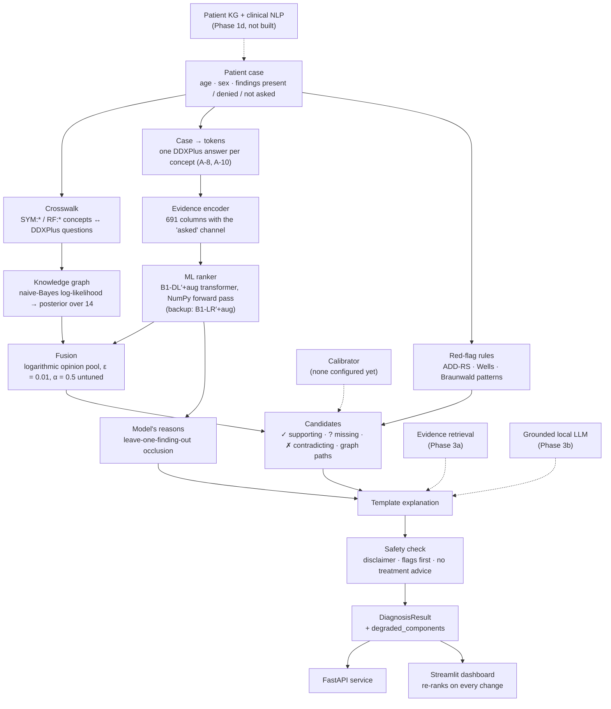

# 4 · The system as built

> **Draft 1, 2026-10-14.** This chapter describes what exists in the repository on 2026-10-14.
> Components that are planned but not built are listed in §4.18 and marked
> `[pending: …]` where they appear.

## 4.1 Overview and design principles

Nightingale takes a patient case (age, sex, findings marked present or denied, risk factors,
vitals) and returns a ranked differential over 14 conditions, with red flags, the evidence for and
against each candidate, an explanation, the list of any degraded components, and the disclaimer.
Five principles govern the design (`docs/02` §1):

1. **Every module is replaceable behind an interface.** Neo4j may become NetworkX, the model may
   become a degraded stub, and nothing downstream notices.
2. **Degrade, never crash.** If a component fails, the system still returns a ranking and says
   what is missing.
3. **Safety is not downstream of the model.** Red-flag rules run independently and can raise a
   condition the model scored near zero.
4. **Explanations are derived, not generated.** Supporting, missing and contradicting findings come
   from graph operations; a language model, when added, may only phrase them.
5. **Typed boundaries.** All data between modules uses the Pydantic models in `src/contracts.py`,
   which change only with the agreement of all four team members.

Figure 4.1 shows the request path as built.

**Figure 4.1 — The request path as built** (solid: built; dashed: planned).



## 4.2 Contracts, pipeline and stubs

`src/contracts.py` defines the shared models: `Finding` (a concept id with an assertion of
**present**, **absent** or **unknown**, because "denies leg swelling" and "leg swelling not asked"
are different facts, FR-1.3), `PatientCase`, `Candidate`, `Explanation` and `DiagnosisResult`
(`docs/02` §4). Four protocols define the components: `ConditionRanker`, `GraphStore`,
`EvidenceRetriever` and `Explainer`. Every protocol had a trivial stub in week 1, so the pipeline
ran end to end before any real component existed; the real graph and model replaced the stubs one
at a time, and the week-3 "walking skeleton" milestone (a real model and a real graph, end to end)
was reached on 2026-09-24 (PROGRESS §5).

`src/pipeline.py` runs the steps in the order of `docs/02` §3: score with the model and the graph
independently, fuse, analyse the findings, evaluate the red flags, explain, and finally run the
safety check. A contracts change agreed by the team on 2026-10-02 (C-1) requires a ranker's scores
to be finite, non-negative and to have a positive sum, and makes `fused_score` a log-probability
whose default is the lowest one, `LOG_FLOOR` (`docs/02` §4.4).

## 4.3 The cardiac knowledge graph

`build_cardiac_kg()` merges the three sources of §3.3 into one backend-neutral graph
(`src/medical_kg/cardiac_kg.py`). **Table 4.1** gives its size (`docs/02` §5.1).

**Table 4.1 — The knowledge graph.**

| Measure | Value |
|---|---|
| Nodes | 129: 14 conditions, 66 symptoms, 49 risk factors. These are the 84 DDXPlus questions, 2 more that BODHI-S uses, and 29 answer-level concept nodes (18 from the hand-authored facts, 11 from BODHI-S) |
| Edges | 321: 245 `ddxplus` (weight 1.0), 56 `bodhi_s` and 20 `hand_authored` (weighted by likelihood band) |
| Questions unique to one condition | 49 of 84 |
| Questions shared by ≥ 75% of conditions | 9: the seven pain questions, breathlessness and travel |

**Two vocabularies.** DDXPlus links conditions to evidence *questions* (`DDX:E_nn`, for example
"characterise your pain"), not to answers, so its part of the graph cannot tell tearing pain from
burning pain. The hand-authored and BODHI-S edges are answer-level: they point at concepts such as
`SYM:pain_character_tearing`. The crosswalk (§4.4) links the two.

**Provenance.** The store is a multigraph keyed by source, so a fact two sources state is kept
twice but counted once, and `only_sources()` keeps a subset for ablations (`docs/02` §5.1).

**Two stores, one graph.** `NetworkXGraphStore` serves the graph from memory. `Neo4jGraphStore`
reads the team's copy on Neo4j AuraDB Free (decision D-6) once at start-up and scores it in memory
exactly as NetworkX does, so a paused cloud instance cannot stall a consultation. A fingerprint over
every node and edge shows the two copies are the same graph and catches a hand edit in Neo4j. When
Aura is paused, offline or refuses the login, `open_graph_store()` falls back to NetworkX and
reports `graph_backend` as degraded (§4.16). Scripts open Aura read-only; only the loader writes it.

## 4.4 The crosswalk

The red-flag rules and the golden cases use hand-authored concepts (`SYM:*`, `RF:*`); the graph
and the model use DDXPlus's codes. `CROSSWALK` (`src/medical_kg/crosswalk.py`) maps each of the 67
hand-authored concepts to the DDXPlus answers that express it, and a test fails if any concept the
code uses lacks an entry (`docs/02` §5.2). Each entry carries a SKOS match type, read as "the
DDXPlus answer is ___ the concept", and each type allows only the sound inferences (Table 4.2).

**Table 4.2 — What each match type allows** (`docs/02` §5.2).

| Match | Concept present ⇒ answer | Answer ⇒ concept | Concept denied ⇒ question denied |
|---|---|---|---|
| exact, close | yes | yes | yes, for a yes/no question |
| broader | yes | — | — |
| narrower | — | yes | yes, for a yes/no question |
| related, none | — | — | — |

A denial carries over only to a yes/no question: denying radiation to the jaw or arm says nothing
about radiation to the back, so it cannot deny "does the pain radiate?". A concept that means the
same as a yes/no DDXPlus question sits on that question's node (`canonical_concept_id`), so the
same fact from two sources is one node with two edges.

The crosswalk translates both ways. `expand_case` adds to a hand-authored case the DDXPlus
questions it implies, for the graph; a derived finding carries its *question's* label, never the
finding's, so a reasoning path cannot claim that GERD presents with pressure-type pain when the
graph only links GERD to "characterise your pain". `concepts_from_evidences` turns a DDXPlus
patient's tokens into concepts, so the red-flag rules can run on DDXPlus patients; a question the
row does not list stays unknown, not denied.

## 4.5 The graph score

The graph scores a case by a **naive-Bayes log-likelihood** (`src/medical_kg/scoring.py`; 2a,
EXP-005). For each condition c, with a uniform prior,

```
score(c) = Σ over present findings k of log P(k | c)  +  Σ over denied findings k of log(1 − P(k | c))
```

- A present finding counts for the conditions that explain it and against those that cannot
  (probability `LEAK` = 0.01).
- A denied finding counts against the conditions that expect it.
- **A finding the case does not mention counts for nothing.** Not mentioned is not denied.
- DDXPlus's weight 1.0 ("listed, frequency unknown") is capped at `CAP` = 0.9.
- Both constants were fixed before any measurement. On the hand-written checks, every verdict held
  at all twelve settings of LEAK 0.001–0.03 and CAP 0.8–0.95 (EXP-005); no constant was chosen on
  validation.

**The graph is first closed under the crosswalk.** Without that, every chest-pain patient's
`SYM:chest_pain` would count against the nine conditions DDXPlus describes only by questions, and
hand the case to aortic dissection, the one condition that names the answer. Two rules close it:

- **Upward:** an answer implies its question. A condition with answer-level edges of weights w₁,
  w₂, … implying question q lists q with 1 − Π(1 − wᵢ), the probability of giving at least one of
  those answers (noisy-OR).
- **Downward:** a condition that asks q but whose answer the graph does not state gets each
  answer at the **mean** of the conditions that do state it. Ignorance is "average", neither
  "impossible" nor "certain".

Each fact is counted once: an answer and the questions it entails are scored as the answer alone
(a defect found in review, EXP-005 point 4). The scores are log-likelihoods, at most 0, comparable
only within a case; the fusion reads them as a posterior, a softmax over the conditions.
`contributions()` gives each finding's exact part in a score, and a reasoning path cites only
edges the graph holds, never implied or imputed ones.

**Two limitations, by design** (EXP-005, `docs/02` §5.1):

1. **An answer only one condition states cannot discriminate.** Tearing pain is stated only for
   dissection, so it is imputed at dissection's own value for every other condition that asks
   about pain character. The red-flag rule and the ML ranker carry that knowledge instead.
2. **Stable and unstable angina tie when nothing is denied.** Stable angina's 20 questions are all
   among unstable angina's 24. Rest pain present puts unstable angina first by a likelihood ratio
   of about 90; rest pain denied puts stable first; with neither, the two tie, and the tie rule
   (registry order) puts unstable angina, the must-not-miss one, first. Telling them apart is the
   ML ranker's job.

Personalised PageRank was measured against naive Bayes and not chosen: with the same closure the
two rank validation identically, but naive Bayes holds the angina decision by a factor of about 90
where PageRank holds it by 8%, and its per-finding contributions are exact (EXP-005).

## 4.6 Feature encoding and the "asked" channel

`EvidenceEncoder` (`src/ml/features.py`) turns age, sex and the evidence tokens into numbers. It
reads nothing else, so no label can leak in (`docs/03` §2.2).

- **The columns come from the release files, never from patients:** 607 of them, the same on every
  machine, named by a fingerprint (`3a0d5a5e01d7f427`). A trained model records the fingerprint and
  refuses rows encoded with another.
- Binary evidences are 0/1; a categorical or multi-choice question has one column for "answered
  with something other than the default" and one per non-default answer; an ordinal 0–10 scale is
  kept as its value, ordered, plus an "answered" flag, because 0 can be a real answer; the NA
  sentinel is handled explicitly.
- **A default answer gets no column**, so it reads exactly like an unlisted question.

That last property is the defect EXP-017 exposed (R-18, §6.3): a question answered "no" and a
question never asked were the same row, so a short history read as a long list of denials.
**The "asked" channel** (2026-09-24) appends one column per question, `E_nn=unasked`, for 691
columns in all (fingerprint `ddd14019c66eff10`); with the channel off, the encoder is exactly the
original one, which a test pins.

| Patient | Questions counted as asked |
|---|---|
| DDXPlus, full history | All of them: an unlisted DDXPlus question means "no" |
| DDXPlus, masked (§5.4) | The questions the mask kept, plus unlisted ones drawn at the same share (decision A-9) |
| Hand-written case | The questions its tokens answer, plus the yes/no questions its denials answer |

"Asked" is **never** read from the default answers DDXPlus lists (such as "did not travel"):
DDXPlus lists them only for conditions whose definition includes the question, so they would leak
the label. At full evidence the channel is constant, so only a model trained on masked copies
(`+aug`, §4.7) learns anything from it; the training script refuses the channel without
augmentation.

## 4.7 The classical rankers

All models are trained on a cloud runtime, never on the owner's laptop (decision D-7), and no model
is tuned beyond early stopping on a 10% patient-level holdout of the training split (decision
T-6).

- **B0**, the floor: every patient gets the same ranking, the training split's class frequencies
  (EXP-003).
- **B1-LR**, multinomial logistic regression: C = 1, max-abs scaling, converged in 17 iterations
  (EXP-004).
- **B1-XGB**, XGBoost with fixed defaults: learning rate 0.1, depth 6, row and column subsampling
  0.8, at most 1,000 rounds with 50 rounds of patience (best round 117) (EXP-004). XGBoost reads a
  sparse matrix's absent entries as missing but a dense array's zeros as values, so the wrapper
  always hands it a sparse (CSR) matrix.
- **`+aug` variants** (EXP-018) train on every training patient plus one masked copy of each,
  keeping a share of its questions drawn uniformly from [0.1, 0.9], with masks drawn from the
  training seed, never the evaluation masks (`src/ml/evidence_masks.py`; 511,800 rows in all).
- **′ (prime) variants** use the encoder with the "asked" channel. B1-LR′+aug was the configured
  ranker from 2026-09-25 to 2026-10-13 (EXP-019) and is now the backup.

`ModelRanker` (`src/ml/ranker.py`) wraps any model with labels and probabilities. `open_ranker()`
returns a degraded ranker with flat scores when the release files, the model or a matching
fingerprint are missing, which is the ordinary state of CI and a fresh clone; flat scores abstain
in the fusion, so the ranking is provably the graph's own, and `ml` is reported as degraded.

## 4.8 From a hand-written case to model input

A clinician's case is written in concepts (`SYM:chest_pain`), and the model needs DDXPlus tokens
(`E_55_@_V_101`). `expand_case` stops at the question, deliberately, so a separate module,
`src/ml/case_tokens.py`, chooses the **answer** a patient with that concept would have given.

- Two hand-curated tables choose one representative answer per concept (17 entries, each with the
  DDXPlus French). Taking the lowest answer id would be wrong: it gives *forearm* for radiation to
  the jaw or arm, which no validation patient gives.
- **Narrower matches are admitted** (decision A-8, kept by the team on 2026-10-02). Without them
  sudden onset, exertional pain and relief by rest produce nothing, and those are the
  discriminators for pulmonary embolism, pneumothorax, dissection and the anginas. Every token so
  derived is listed.
- **A denial is never a token.** It marks its question asked only when it answers a whole yes/no
  question, and only a model with the "asked" channel can see it.
- Every finding that yields nothing is kept with a reason, and the tests round-trip each concept
  back through `concepts_from_evidences`.

The 17 answers were reviewed and approved as they were on 2026-10-12. **On 2026-10-13 one was
changed (decision A-10):** `SYM:radiation_jaw_arm` had stood for `E_57_@_V_121` (*mâchoire*, the
jaw), which in DDXPlus only acute pulmonary edema patients give; it now stands for
`E_57_@_V_163` (*sous la mâchoire*, under the jaw), the jaw answer of DDXPlus's MI and angina
patients. The model's reasons (§4.13) found it (EXP-021). The inversion still has no ground truth
(R-17, §7.4).

## 4.9 The deep ranker B1-DL

**Choice.** Asked by the supervisor (2026-10-04) for the deep model best suited to the approach and
for its complexity, the owner chose one small transformer (decision D-12); no other architecture was
trained, so none was selected on data (EXP-021).

**Architecture** (`src/ml/deep.py`), an FT-Transformer (Gorishniy et al. 2021) at a smaller size,
fixed before training:

- **Tokens:** one per DDXPlus question (84), plus age and sex, plus a [CLS] token: 87 tokens for
  every patient, with no positions. A token is its bias plus the sum of its columns' scaled values
  times their embeddings, so an unasked question adds its `unasked` embedding.
- **Blocks:** 2 blocks, width 96, 4 heads (24 per head); pre-normalisation; a ReGLU feed-forward
  of width 128; dropout 0.2 on attention and 0.1 in the feed-forward. The last block computes the
  [CLS] row only. **Head:** LayerNorm, ReLU, linear.
- **Size:** 225,645 parameters and 9,610,752 multiply-adds per patient with the "asked" channel
  (B1-DL′+aug); 217,581 and 9,602,688 without (B1-DL+aug). The cost is the same for every patient.

**Training** (`scripts/train_deep.py`), identical across arms and seeds: the comparators' own
training rows at each seed (511,800: 460,620 fitted, 51,180 held out by patient for early
stopping); AdamW, learning rate 1e-4, weight decay 1e-5; batch 1,024 in FP32; at most 50 epochs,
patience 5, best epoch kept (18 to 43 across runs). Both arms, seeds 42–46, ten networks in all,
trained on Kaggle (two Tesla T4 GPUs) in 2 h 10 min (EXP-021). Logistic regression fits on all rows
and the transformer on 90%, an asymmetry that can only disadvantage the transformer.

**Two implementations, one model.** Training uses PyTorch on the cloud. The laptop, the pipeline
and CI run a **NumPy forward pass**, with nothing to install. The weights are plain JSON, each array
base64-encoded float32 with its SHA-256, never a pickle, and the loader checks every hash and the
encoder fingerprint. On 2,000 validation rows the two implementations differ by at most 4.3 × 10⁻⁷
in probability, with no top-1 disagreement, in every run; the laptop reproduces seed 42's
validation metrics to within 7 × 10⁻¹¹ (EXP-021).

**Adoption: safety first** (decision D-13, 2026-10-12, fixed before training as code in
`src/eval/safety_floor.py`). The transformer could replace B1-LR′+aug only if, on validation, it
met the safety targets at 100% and 25% of the history, was non-inferior to the logistic regression
trained like it at 25% on must-not-miss recall@3 and MRR (paired 95% lower bound above −0.005), and
passed every golden case with red flags on and off. **It passed on 2026-10-13** (§6.8), so the
configured ranker is now **B1-DL′+aug, seed 42**, with B1-LR′+aug as the backup (two keys in
`configs/config.yaml` switch back).

## 4.10 Fusion: a logarithmic opinion pool

The model and the graph each give a distribution over the conditions; the fusion pools them
(`src/fusion/pool.py`; `docs/02` §6). Over the 13 conditions the model knows,

```
log q(c) = (1 − α) · log max(p_ml(c), ε) + α · log P_kg(c),   normalised over the 13
```

where `P_kg` is the graph's posterior and α is the graph's weight. Three choices were fixed on
2026-09-25, before any fused ranking of a validation patient was scored:

1. **A condition the model cannot score takes its probability from the graph alone.** Aortic
   dissection gets P(dissection) = P_kg(dissection), and the 13 share the rest in the pool's
   proportions. The first design, a min-max weighted sum, capped dissection at the graph's weight,
   so it could never rank first however strongly the graph supported it (EXP-005 point 7).
2. **No model probability below ε = 0.01 is taken at face value.** A pool multiplies, so one
   near-certain expert would otherwise veto what the other supports. At α = 0.5 the graph must
   prefer a condition about 100 times over the model's answer to put it first. The value was
   chosen with GC-001 in view, where the retrained models give unstable angina 0.98–1.00 and MI
   almost 0, and no other value was tried; it is not tuned.
3. **An absent signal abstains.** A degraded model leaves the graph's order exactly; a failed
   graph leaves the model's; a model whose scores are not finite, non-negative probabilities is
   treated as failed.

**One consequence, found in review:** P(dissection) is the same at every α, and α moves only its
rank. With a near-certain model, presentations that score 0 on the ADD-RS but involve back pain or
hypertension can put dissection 2nd or 3rd, above where the graph alone ranks it. The team kept the
design on 2026-10-02 (A-2) but did not answer whether that is clinically wanted, so the question
stays open for a clinician (`docs/02` §6, §9).

`fused_score` is a log-probability, not a calibrated probability. **The one tuned quantity, α,
is still an untuned 0.5.** It will be chosen by EXP-006's pre-registered sweep on validation
[pending: EXP-006 fusion sweep], which waits for the team's answer to E-2 (§5.9) and the owner's
choice of where it runs.

## 4.11 Red-flag rules and the safety layer

**Red flags** (`src/reasoning/red_flags.py`) run on every case, independently of the ranker
(FR-6.1). Each rule follows a published pattern rather than any single suggestive finding, because
a flag on half of all patients teaches users to ignore flags (R-15). Every must-not-miss condition
has a rule (EXP-008).

**Table 4.3 — The red-flag rules** (`docs/04` §3).

| Condition | Pattern |
|---|---|
| Possible NSTEMI / STEMI | Chest pain with two of: exertional, pressure character, radiation to jaw or arm, sweating |
| Unstable angina (Braunwald) | A crescendo pattern, or chest pain at rest with an ischaemic character |
| Pulmonary embolism (Wells) | Pleuritic pain or breathlessness **and** a Wells risk: one swollen leg or calf pain, immobilisation, recent surgery, previous DVT |
| Spontaneous pneumothorax | Sudden pleuritic pain with breathlessness (sudden: onset speed ≥ 8 of 10, decision A-5) |
| Myocarditis | Chest pain after a viral illness, with breathlessness or palpitations |
| Acute pulmonary edema | Breathlessness with orthopnoea, paroxysmal nocturnal dyspnoea or known heart failure |
| Boerhaave | Chest pain after forceful vomiting |
| Aortic dissection (ADD-RS) | Chest, back or abdominal pain with tearing character, a pulse deficit or an inter-arm blood-pressure difference; or findings from two of the ADD-RS's three categories. Back radiation is in none of them |

A rule's reason says what fired it and what must be excluded, and never recommends a treatment.
The pipeline lists every flagged candidate before every unflagged one, whatever its score
(FR-6.2). That ordering means a golden case with a flag cannot detect a ranking regression, so the
ranking is also tested with red flags off (`tests/test_ranker.py`).

**Which flags are appropriate** (decision A-7, for red-flag precision only): the ischaemic flags
are also appropriate for the cardiac conditions on the same ECG-and-troponin pathway, and the
flags for dissection, embolism, pneumothorax and Boerhaave for their own condition only. Three
independent judges decided all 104 flag–condition pairs, and their majority was adopted unchanged
by the project's AI assistant, to which the owner had delegated the decision; the judges were told
not to read results but were not fully blind to firing rates (`docs/04` §3).

**The safety layer v1** (`src/reasoning/safety.py`) checks every result last and repairs rather
than fails: the disclaimer is exactly the text of `docs/04` §2 (FR-6.4); every flagged candidate
comes before every unflagged one and is named in the red flags (FR-6.2); and a sentence that
recommends a treatment, names a drug or gives a dose is removed and listed among the explanation's
unsupported claims (FR-6.5), while investigations such as an ECG are kept. It is deterministic and
lexical (§7.8) [pending: 3c guardrails]. On 3,000 validation patients it found nothing to repair
(EXP-008).

## 4.12 Calibration

No raw score is shown as a probability until it passes calibration (`docs/05` §3.3, `docs/04`
F-2). `src/fusion/calibration.py` implements the four methods of EXP-007 (§5.10) under two rules: a
condition with no patient in the fitting data keeps its raw probability (otherwise a one-vs-rest fit
would give aortic dissection 0 whatever the findings), and calibration never changes the ranking. A
calibrator records the system it was fitted for, and the pipeline refuses one fitted for another,
reporting `calibration` as degraded. **No calibrator is configured yet:** the one A0's fused score
needs waits for EXP-006's α [pending: EXP-007 stage 2]. Stage 1's findings are in §6.9.

## 4.13 The model's reasons

The graph explains itself through its paths and the ✓ / ? / ✗ analysis; the model does not. So the
system asks the model directly, by **leave-one-finding-out occlusion** (`src/ml/reasons.py`): it
removes each recorded finding in turn, rescores, and measures how each condition's log-odds move.
A finding whose removal lowers a condition's odds is a reason for it. A denial is a finding too.

- The case and each case-without-one-finding are scored in one batch (0.4–6.5 ms a case,
  PROGRESS §8).
- The explanation names reasons, strongest first, and **never shows a number**, because the models
  are near-certain on hand-written cases (§6.4) and no calibration method fixes that (§6.9).
- **Limits, stated wherever reasons are shown:** each finding is judged alone, so two findings that
  matter only together (most red-flag patterns) can each look weak; a finding the inversion cannot
  turn into a token is invisible to the model; and aortic dissection, which the model was not
  trained on, has no model reasons.

## 4.14 Explanations

The **template explainer** writes the explanation from the graph and the model, so it cannot state
a fact the system does not hold. For each candidate it keeps every supporting *question* the graph
matched, with the recorded finding that answered it beside it; it names five of the expected
findings not recorded and counts the rest; and it names the top candidate's model reasons
(`docs/02` §7). The grounded language-model explainer, which may only phrase retrieved evidence and
graph facts, is Phase 3b [pending: LLM baselines B3/B4, EXP-009/010].

## 4.15 The API and the dashboard

**The API** (`src/api/app.py`, FastAPI, served on 127.0.0.1): `POST /diagnose` takes a case and
returns a result, with the time taken in an `X-Elapsed-Ms` header; `GET /conditions` lists the 14
conditions, all the system can rank; `GET /concepts` lists the findings it understands; `GET
/health` says which ranker and graph answer and what is degraded, and repeats the disclaimer. A
malformed case is refused with HTTP 422.

**The dashboard** (`app/streamlit_app.py`, Streamlit, on 127.0.0.1 only):

- each finding can be marked present, denied or not asked (FR-1.3), and the golden cases load as
  examples (FR-1.5);
- red flags come first and prominently (FR-6.2);
- it shows **ranks, not raw scores**: the fused order, with the model's and the graph's own ranks
  beside it;
- ✓ supporting, ? missing and ✗ contradicting findings, with the graph's paths (FR-9.3, FR-5.4),
  and each candidate's model reasons;
- what is degraded, and the disclaimer on every screen (FR-6.4);
- **it re-ranks on every change to the form** (decision D-14, "real time" as live re-ranking),
  because a whole ranking takes milliseconds (§6.10).

Calibrated confidence and evidence with citations are still to come [pending: EXP-007 stage 2]
[pending: retrieval EXP-011].

## 4.16 Degradation

**Table 4.4 — Failures and how they surface** (`docs/02` §7).

| Failure | Behaviour | Reported as |
|---|---|---|
| Neo4j unavailable | Fall back to the NetworkX graph | `graph_backend` |
| Model missing, or trained on other features | Graph-only ranking, flat model scores | `ml` |
| A case the feature space cannot hold (sex "other") | Graph-only ranking | `ml` |
| Graph store fails outright | Model-only ranking | `graph_backend` |
| Calibrator unusable or fitted for another system | Ranks only, no probability | `calibration` |
| Retrieval fails *(Phase 3)* | Graph-only explanation | `rag` |
| Language model unavailable *(Phase 3)* | Template explanation | `llm` |
| Empty or invalid case | HTTP 422 with field errors | — |

The dashboard always shows `degraded_components`: a silently degraded medical tool is a safety
problem (`docs/04` F-8).

## 4.17 Engineering and reproducibility

- **Tests:** 871 tests on 2026-10-13, of which 856 passed and 15 skipped locally (PROGRESS §1)
  [to update at submission], including the four golden cases run with every model, red flags on
  and off; GitHub Actions runs them, with formatting and linting, on every push. CI has no `data/` or `models/`, so the data-gated tests skip there
  and run locally.
- **Compute placement** (decision D-7): every training or tuning run, and any job over about five
  minutes, runs where the owner decides, normally a free cloud tier (Colab, then Kaggle); the
  owner's laptop GPU is used only for short tests, each after the owner's yes (D-9). Everything the
  prototype runs is CPU-only.
- **Reproducibility:** fixed seeds; each run records its commit, library versions and encoder
  fingerprint; models trained on the cloud reproduce their validation metrics on the laptop to
  within 3 × 10⁻¹² (B0/B1, EXP-004), 5 × 10⁻¹² (EXP-018) and 7 × 10⁻¹¹ (B1-DL, EXP-021); the
  seed-42 refit of B1 reproduces EXP-004's model files byte for byte (EXP-020).
- **Records:** every run that produces a number is logged in `docs/08`, including failures and
  corrections, which are struck through rather than deleted.

## 4.18 Not yet built

- **The patient knowledge graph and Synthea patients** (Phase 1d) [pending: 1d].
- **Clinical NLP for free text** (FR-2.*): the packages `src/nlp` and `src/patient_kg` are empty;
  cases are entered as structured findings.
- **Evidence retrieval** (3a) [pending: retrieval EXP-011], **the grounded language-model
  explainer** and baselines B3/B4 (3b) [pending: LLM baselines B3/B4, EXP-009/010], **claim-support
  guardrails** (3c), **"what to ask next"** (3d) and reliability diagrams with per-condition error
  analysis (3e).
- **The audit log** (FR-6.6): repairs are logged, but the audit log itself is not built
  (`src/reasoning/safety.py`).
