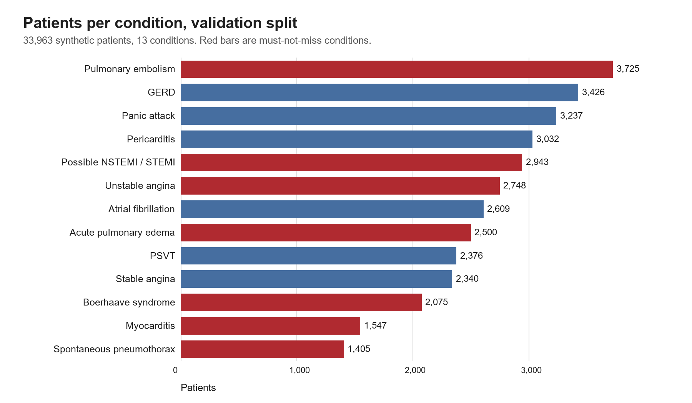
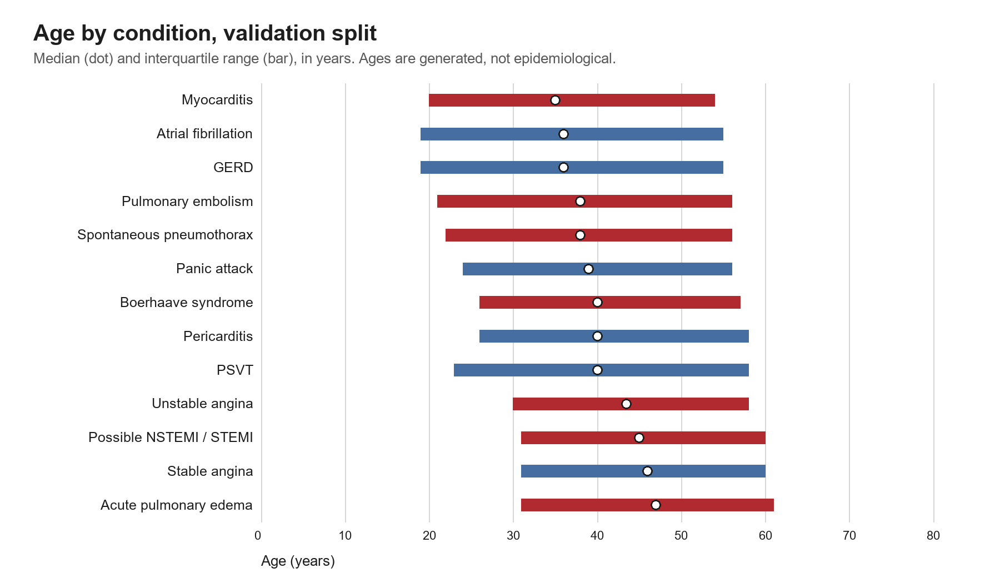
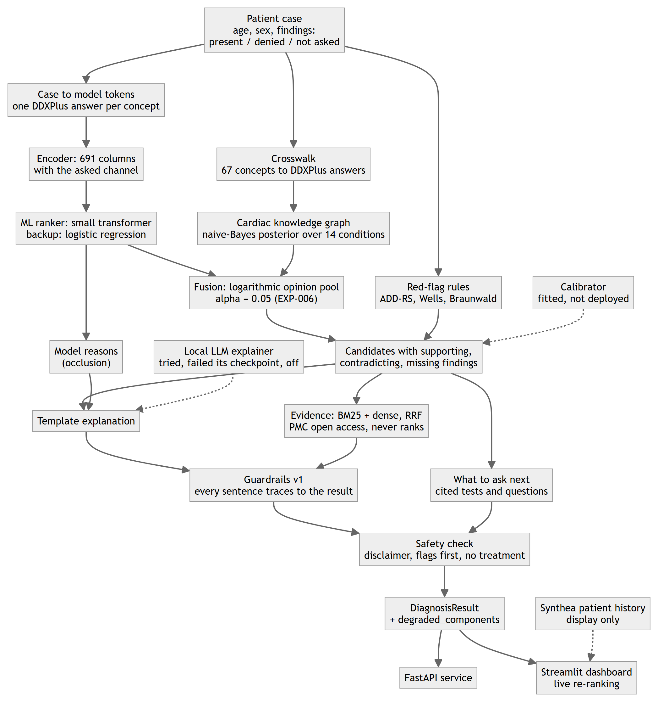
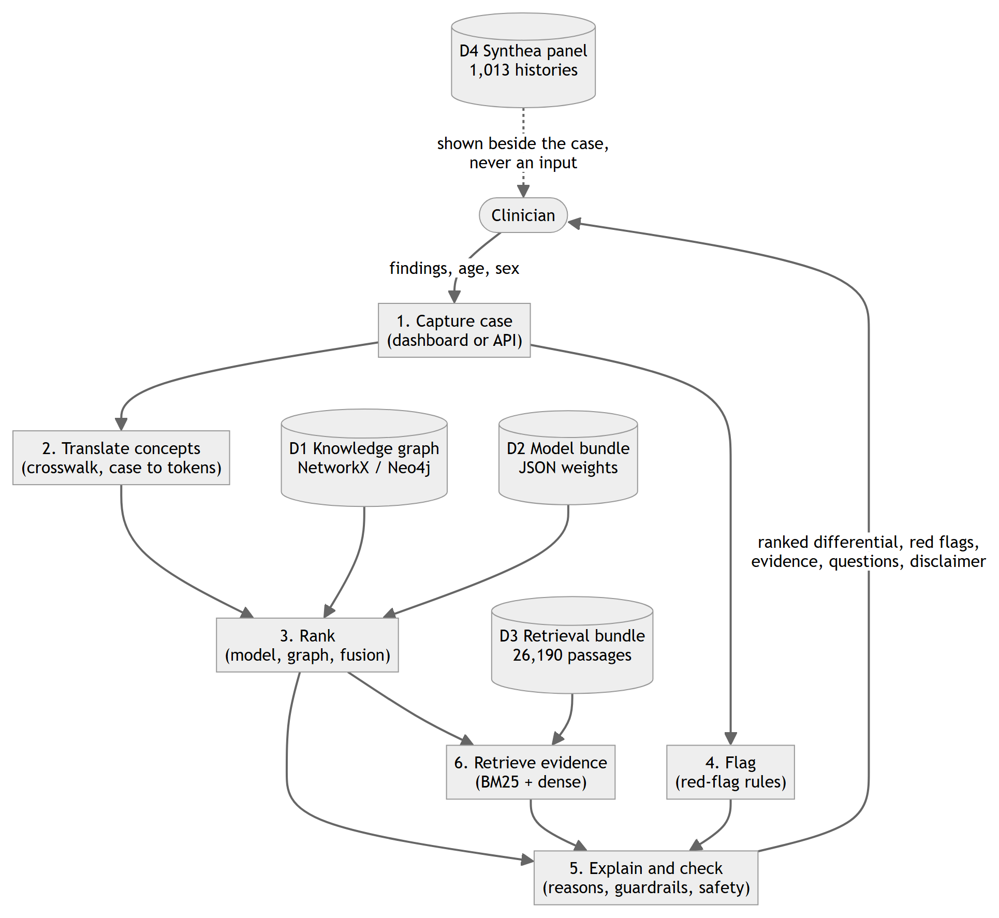
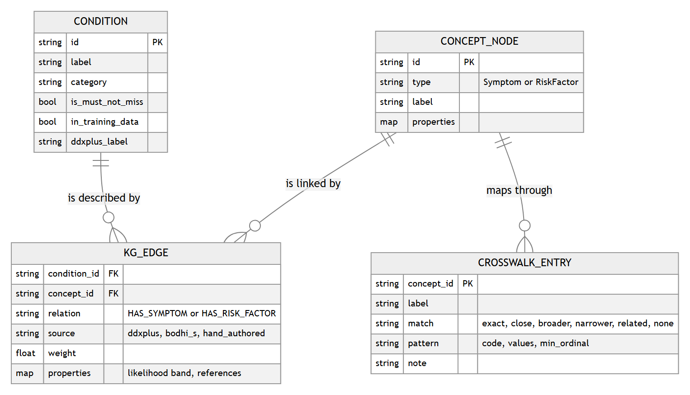
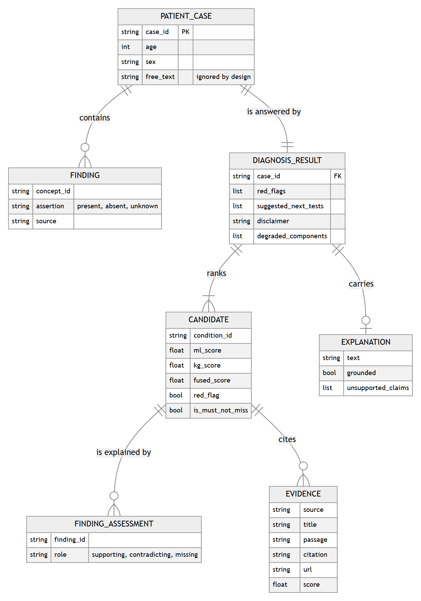

# Exploratory Data Analysis

## 3.1 Dataset

Every dataset is synthetic, openly licensed, or both; no real patient record enters the system, the evaluation or this report. Identifiers such as EXP-004, R-12, D-13 and A-8 point to the project's experiment log, risk register, decisions and assumptions.

**Table 3.1.** Data and knowledge sources (licences as read on 2026-11-10).

| Source | Licence | Size | Role (status) |
|---|---|---|---|
| DDXPlus | CC-BY-4.0 | 49 pathologies; 1,025,602 training, 132,448 validation and 134,529 test patients, of whom 255,900, 33,963 and 34,657 are in scope | Patients and true conditions; backbone of the knowledge graph (test split opened once) |
| BODHI-S | CC-BY-NC-4.0 (non-commercial) | 555 conditions; two files of 13,204 rows | Enriches four conditions of the graph |
| Hand-authored aortic dissection; four golden cases | Our own work, synthetic | 20 graph edges; 4 cases | The only knowledge of a condition DDXPlus lacks; executable clinical expectations |
| PubMed Central Open Access articles | Per article, 15 Creative Commons strings; 844 of 2,067 non-commercial | 2,067 articles, 26,190 passages | Evidence excerpts (relevance never judged) |
| Synthea | Apache-2.0 | 1,359 patients, 1,013 alive on 2026-01-01 | Patient-history card (display only) |
| S-PubMedBert-MS-MARCO | CC-BY-NC-2.0 (non-commercial) | 768-dimensional passage vectors | Passage vectors, computed once on Kaggle |
| Llama 3.1 8B | Meta's community licence (gated page not re-verified) | One model | Language-model trial only (not shipped) |

DDXPlus [@tchango2022], the main source, was drawn by a simulator from a knowledge base of 49 pathologies; each record holds age, sex, coded evidence tokens (answers to questions), the true pathology and a ranked differential. We keep 13 chest-pain conditions, seven must-not-miss (a missed one risks death). A fourteenth, aortic dissection, is absent, so we hand-wrote 20 graph edges for it from the Aortic Dissection Detection Risk Score (ADD-RS) markers [@rogers2011; @hiratzka2010], weighted by registry frequencies [@hagan2000; @evangelista2016]. The test split opened once, on 2026-11-09, after the tag `v0.9-freeze` fixed the code (EXP-012); it must not be scored again, and its figures carry the tag `[TEST]`.

BODHI-S [@bodhis_card] matched only 4 of our 13 conditions (EXP-001), so DDXPlus's condition file became the graph's backbone, which created the circularity risk R-12 (Section 3.2). Four hand-written golden cases (Appendix B) run in the test suite; when one fails we fix the component, never the expectation. Synthea [@walonoski2018] histories are display only and never feed the ranking, so the ablation that removes them (A6) equals the full system by construction.

## 3.2 Exploratory Data Analysis and Visualisations

We audited DDXPlus before building on it; counts are from the validation split unless stated.

{width=10}

{width=10}

- **Class balance (Figure 3.1).** The largest training class is 2.70 times the smallest, which has 10,162 patients (EXP-003), so none is too rare to learn. Only 25.6% of validation patients fall inside our 13 conditions, so the system is closed-world (R-13): it knows 14 causes of chest pain, and a patient with pneumonia is forced into one of them. Of 33,963 validation patients, 16,943 have a must-not-miss condition.
- **Synthetic demographics (Figure 3.2).** Every condition is 49% to 54% female and median ages run from 35 to 47; myocardial infarction has a median age of 45 and pneumothorax is 52% female, unlike real epidemiology [[citation needed: real age and sex distributions]]. A near-equal result by sex or age is an artefact of the generator, never evidence of fairness.
- **Four token forms.** Evidence tokens are binary, categorical (`E_54_@_V_161`), numeric ordinal (`E_56_@_4`, 12.6% of tokens, encoded as ordered numbers) or the "NA" sentinel.
- **Three traps.** A listed token can mean "no": `E_204_@_V_10`, "did not travel abroad", is listed for 89.6% of validation patients, so every component uses `positive_codes` (EXP-013). The English is machine-translated from French: `déchirante` (tearing, the dissection descriptor) appears as "heartbreaking", so components use evidence codes. The ground-truth differential is open-world: 33.3% of its probability mass lies on conditions the system cannot output, so Recall@5 on the full differential cannot exceed 0.434; decision D-8 (2026-09-19, before any model was trained) restricts the headline Precision@3 and Recall@5 to the in-scope part (a ceiling of 0.753) and reports the full-differential Recall@5 beside it. The label is never an input.

**Saturation.** DDXPlus draws each patient's evidence only from their own condition's list, so for 91.7% of patients no other condition's list holds their positive answers (EXP-004). On complete histories the baselines that use machine learning alone (B1) are near-perfect (Table 3.2), with a must-not-miss recall@3 of 1.0000 [1.0000, 1.0000]: the data, not skill or leakage (risk R-16). So the hypotheses that the full system beats them cannot be supported at 100% evidence; on the test split every machine-learning model and the full systems A0 and A0′ miss none of 34,657 patients in the top 3, while the graph alone (B2) misses 27, 4 of them must-not-miss (`[TEST]`, EXP-012). The graph is built from the knowledge base that generated the patients, so its near-perfect score is circularity (R-12), not evidence that it knows medicine. On a quarter of the history XGBoost's must-not-miss recall@3 is 0.9346 [0.9305, 0.9383], below the 0.95 target (R-18), and given no evidence it answers atrial fibrillation with probability 1.000, because the encoder could not tell a short row from an unfinished interview.

**Table 3.2.** B1-XGB and B1-LR on complete and partial histories (validation, seed 42, EXP-017's diagnostic masks).

| Evidence kept | Model | Top-1 | Top-3 |
|---|---|---|---|
| 100% | B1-XGB | 0.9985 [0.9980, 0.9989] | 1.0000 [1.0000, 1.0000] |
| 100% | B1-LR | 0.9983 [0.9978, 0.9987] | 1.0000 [1.0000, 1.0000] |
| 25% | B1-XGB | 0.2671 [0.2625, 0.2718] | 0.9463 [0.9438, 0.9488] |
| 25% | B1-LR | 0.8558 [0.8522, 0.8597] | 0.9818 [0.9804, 0.9832] |

**The encoder and the masks.** `EvidenceEncoder` turns age, sex and tokens into 607 columns, or 691 with the "asked" channel (one `E_nn=unasked` column per question, so a model can tell a denial from silence); it reads no label. Every system is scored at 100%, 50% and 25% of each patient's history, with masks whose digests were recorded before any scoring (Appendix C); they measure robustness to missing answers, not history-taking. Models trained on masked copies carry the suffix `+aug`, and ′ marks the "asked" channel.

## 3.3 Related Sections

**Privacy and data.** Nothing under `data/` or `models/` is committed, and free text in a case is ignored by every component. The project is non-commercial in three independent ways (Appendix A).

**The test split.** The protocol was frozen on 2026-09-17, before any model was trained. The single opening needed the tag `v0.9-freeze`, unchanged `configs/`, `src/` (outside `src/eval/`) and `tests/fixtures/`, and both mask digests recorded first; a second opening needs a stated reason and is disclosed. The fusion weight and calibrators were chosen on validation, so fused and calibrated validation figures are optimistic.

**Ethics.** Nightingale is a research prototype, not a medical device, with no clinical validation; the breakdowns by sex and age (Section 5.6) show only that the safety result does not depend on them in this generator.

# Methodology

## 4.1 Introduction to Languages (Front End and Back End)

We wrote the whole system, from back end and front end to scripts, tests and notebooks, in Python 3.11.9 (decision D-2). The reasoning pipeline is a chain of Python modules, each behind an interface in `src/contracts.py`; a FastAPI web service wraps it, and a Streamlit dashboard redraws the result on every change to the form. A ranking takes about 10 to 25 ms on the laptop CPU, so the dashboard re-ranks live (D-14); the pipeline's p95 response time (the time within which 95% of requests finish) is 13.6 to 16.9 ms (EXP-022 and EXP-011).

## 4.2 Any Other Supporting Languages and Packages

The knowledge graph lives in Neo4j, a graph database, on AuraDB Free; when Aura is paused the system falls back to NetworkX and reports `graph_backend` as degraded. The transformer trains with PyTorch on a Kaggle GPU, but the laptop runs a NumPy forward pass over JSON weights, so inference needs neither PyTorch nor a GPU.

**Table 4.1.** Languages and packages by layer ("series" is the release the requirements files pin).

| Layer | Technology | Role |
|---|---|---|
| Language | Python 3.11.9 | Everything |
| Contracts, configuration | Pydantic 2.9 series, PyYAML 6.0 series | Typed data classes; settings |
| Service | FastAPI 0.143, uvicorn 0.54 | The API on 127.0.0.1:8000 |
| Front end | Streamlit 1.65 | The dashboard on 127.0.0.1:8501 |
| Graph | Neo4j AuraDB Free (Neo4j 5.27), driver 5.28; NetworkX 3.6 | Graph store; local fallback |
| Data | NumPy 1.26 series, pandas 2.2 series, PyArrow 17 series | Arrays, tables, Parquet |
| Models | scikit-learn 1.9.1, XGBoost 2.1.4; PyTorch (Kaggle only) | Baselines; training the transformer |
| Engineering | pytest 8.3 series, black and ruff, GitHub Actions; Kaggle T4 x2 | 1,494 tests passed and 15 skipped on 2026-11-19; training and long jobs |

## 4.3 User Characteristics

The primary user is a clinician evaluating an acute chest-pain presentation, skilled in clinical reasoning, with little machine-learning knowledge and an incomplete history, wanting an answer that updates as findings are entered (under 5 s required). The output is a ranking, never a diagnosis; red flags come first and the disclaimer is on every screen. The system is not for patients, autonomous use, treatment or dosing advice, other presentations or real care; the 2021 AHA/ACC guideline [@gulati2021] remains the clinician's reference. No user study is recorded.

## 4.4 Constraints

The laptop has a CPU and a small GPU for short tests only (D-4, D-7, D-9), so training runs on Kaggle. The data are synthetic and closed-world (R-13), so no clinical claim is made, and the non-commercial licences (BODHI-S, the embedding model, 844 articles) keep the project academic. A last safety layer enforces no treatment, drug or dose advice and the disclaimer on every result. Four people had 8 to 10 weeks and no buffer before the presentation on 2026-11-15, so components that failed their checkpoints were cut and reported.

## 4.5 Use Case Model, Flow Chart and DFDs

The clinician has no "diagnose" use case; the decision stays with the clinician (Table 4.2). In the flow chart (Figure 4.1) a case goes three ways: through the crosswalk to the graph, through a second translation that picks one DDXPlus answer per concept for the ranker, and to the red-flag rules, which run on their own path. The fusion pools the ranker and the graph, guardrails check the explanation and the safety check runs last; dashed boxes are not part of the ranking. In Figure 4.2 the Synthea store feeds only the display.

**Table 4.2.** The use cases.

| Use case | Actor | What happens |
|---|---|---|
| Enter a case or load an example | Clinician | Age, sex, findings (present, denied or not asked) and risk factors are entered, or a golden case fills the form; an invalid case is refused |
| View the ranked differential and red flags | Clinician | The 14 conditions are ranked, red-flagged ones first, each with the published rule that fired |
| See why, what to ask next and the evidence | Clinician | Supporting, contradicting and missing findings, graph paths, the model's reasons, cited tests, questions that would most narrow the differential, excerpts with citation and licence |
| Run the ablation; score the test split once | Evaluator | Every configuration is scored at three evidence levels with intervals; the freeze gate opens the test split once |

{width=10}

{width=11}

## 4.6 Database Design

The system has no relational database; its data lives in five stores: the knowledge graph (Neo4j AuraDB, with a local NetworkX copy), one Parquet file per patient split, JSON model bundles (never pickles, which can run code when loaded), the retrieval bundle and the patient-display file, each with an integrity check. The graph has 129 nodes and 321 edges: 245 from DDXPlus, 56 from BODHI-S and 20 hand-authored, each recording its source, so results can separate the 76 independent edges from those shared with the patients (R-12).

## 4.7 Table Structure

Tables 4.3 and 4.4 give the graph's records and the contract types: Python data classes, not SQL tables; the contracts change only with the agreement of all four team members. BODHI-S publishes no numeric bands, so the band weights are an assumption. A crosswalk match type is a Simple Knowledge Organization System (SKOS) relation that allows only sound inferences: denying radiation to the jaw or arm says nothing about radiation to the back.

**Table 4.3.** The graph records and the likelihood bands (`src/medical_kg/`).

| Record | Fields | Meaning |
|---|---|---|
| KGNode | `id`, `type`, `label`, `properties` | `id` is `COND:*` (condition), `DDX:E_nn` (DDXPlus question) or `SYM:*` and `RF:*` (hand-authored concept); `type` is Condition, Symptom or RiskFactor |
| KGEdge | `condition_id`, `concept_id`, `relation`, `source` | The condition, the symptom or risk-factor node, `HAS_SYMPTOM` or `HAS_RISK_FACTOR`, and `ddxplus`, `bodhi_s` or `hand_authored`, kept so that circularity can be measured |
| KGEdge | `weight`, `properties` | P(finding given condition) as the middle of a likelihood band (A-6): zero 0.0, rare (under 5%) 0.03, low (5% to 19%) 0.12, medium (20% to 49%) 0.35, high (50% to 79%) 0.65, very high (80% or more) 0.9; DDXPlus edges keep 1.0, because DDXPlus lists a finding without its frequency |
| CrosswalkEntry | `concept_id`, `label`, `match`, `pattern`, `note` | Links one of 67 hand-authored concepts to a DDXPlus question (`code`) and the answers that count (`values`, `min_ordinal`, `side`); `match` is exact, close, broader, narrower, related or none |

**Table 4.4.** The main contract types (`src/contracts.py`).

| Type | Main fields | Role |
|---|---|---|
| Finding | `concept_id`, `label`, `assertion` (present, absent or unknown), `source` | One clinical fact; absent and unknown differ |
| PatientCase | `case_id`, `age`, `sex`, `findings`, `risk_factors`, `free_text` (ignored by design) | The request |
| Candidate | `condition_id`, `ml_score`, `kg_score`, `fused_score`, `calibrated_probability`, `red_flag`, `assessments`, `paths`, `evidence` | One condition in the differential |
| Evidence | `source`, `title`, `passage`, `citation`, `url`, `score` | A retrieved passage; no licence field |
| Explanation | `text`, `grounded`, `unsupported_claims`, `citations` | The explanation and its claim check |
| DiagnosisResult | `candidates`, `red_flags`, `suggested_next_tests`, `explanation`, `disclaimer`, `degraded_components` | The response |

## 4.8 ER Diagrams

In Figure 4.3 each edge links one condition to one concept, so the edge table is a many-to-many link; a fact that two sources state leaves two edges and counts once. In Figure 4.4 one `PATIENT_CASE` is answered by one `DIAGNOSIS_RESULT`, which ranks one or more candidates (in practice 14). `Evidence` has no licence field and a contracts change needs all four members, so the dashboard reads each excerpt's licence from the retriever's record.

{width=12}

{width=8.5}

## 4.9 Assumptions and Dependencies

The data could not settle some judgement calls (Table 4.5); the team or the owner decided each, and none was tuned on the test split. The hand-written cases reach the model through an inversion with no ground truth (R-17), and the models are near-certain on them, so no raw score is shown as a probability. Each missing component degrades visibly: `graph_backend`, `ml` or `rag` is reported.

**Table 4.5.** Assumptions and their settings.

| Assumption | Setting (record) |
|---|---|
| A-5: sudden onset on DDXPlus's 0 to 10 onset-speed scale | 8 or more; a lower cut-off reaches more pneumothorax patients only because of how DDXPlus draws onset values (EXP-008) |
| A-6: the weight of each likelihood band | The middle of the band (Table 4.3) |
| A-8 and A-10: narrower crosswalk matches for hand-written cases; one DDXPlus answer for each of 17 concepts | Admitted; the owner approved the 17 answers on 2026-10-12 (the reviewer is not recorded); on 2026-10-13 the jaw-or-arm radiation answer moved from the jaw, which only acute pulmonary edema patients give in DDXPlus, to under the jaw (EXP-021; R-17) |
| A-9: how a mask treats unlisted questions | They count as asked at the same share as the listed ones, so "asked" does not leak the label (EXP-019) |
| Constants fixed in advance | The fusion's floor of 0.01 (A-2); the graph score's leak of 0.01 and cap of 0.9 (EXP-005) |
| The patients are synthetic | No claim about real patients; parity by sex or age is an artefact (EXP-002) |

## 4.10 Algorithm Discussion

**The graph score.** Over the graph closed under the crosswalk (so that an answer implies its question), each condition is scored by naive Bayes, which treats findings as independent: a present finding adds log P(k | c), a denied one log(1 − P(k | c)), and an unmentioned one nothing, because not mentioned is not denied. P(k | c) is the edge weight; a missing edge gets a leak of 0.01 and DDXPlus's 1.0 is capped at 0.9, both fixed before measuring. Stable and unstable angina tie when nothing is denied, so the must-not-miss one goes first.

**The case-to-token step.** A hand-written case's concepts (`SYM:chest_pain`) become DDXPlus tokens through two hand-curated tables of 17 answers (`src/ml/case_tokens.py`); a denial is never a token.

**The transformer and the safety floor.** The ranker is a small FT-Transformer [@gorishniy2021], a neural network for tables in which every token attends to every other (87 tokens, width 96, 2 blocks, 4 heads, 225,645 parameters). Decision D-13, fixed before training, let it replace the logistic regression only if on validation it met the safety targets at 100% and 25% evidence (must-not-miss recall@3 of at least 0.95), was non-inferior to the logistic regression trained like it and passed every golden case. It did, on 2026-10-13: at 25% its mean reciprocal rank (MRR, the average of one over the true condition's rank) is 0.9728 [0.9715, 0.9740], its must-not-miss recall@3 is 0.9981 [0.9973, 0.9987], and its MRR exceeds B1-LR′+aug's by +0.0018 [+0.0009, +0.0026] (B1-DL′+aug, validation, EXP-021).

**The logarithmic opinion pool.** The fusion is a weighted geometric mean of the model's and the graph's distributions [@genest1986; @hinton2002]:

```
log q(c) = (1 - α) · log max(p_model(c), ε) + α · log P_graph(c),  normalised
```

Here α = 0.05 is the graph's weight and ε = 0.01 a floor, so that a near-certain model cannot veto the graph. A condition the model cannot score (aortic dissection) takes the graph's posterior. α, the one tuned quantity, came from a pre-registered sweep on validation (EXP-006). The fusion adds nothing measurable on DDXPlus: at 25% evidence the fused MRR is 0.9727 [0.9715, 0.9739] against 0.9728 [0.9715, 0.9740] for the model alone (validation; R-12, R-16).

**The red-flag rules.** Rules run independently of the ranker, so one can raise a condition the model scored near zero. Each follows a published pattern (the ADD-RS for dissection [@rogers2011], Braunwald's classification for unstable angina [@braunwald1989], the Wells criteria for embolism [[citation needed: Wells criteria]]). Red-flag sensitivity, the share of a must-not-miss condition's own patients whose flag reaches them, is 0.823 [0.818, 0.829] at 100% on validation, below the 0.95 target because DDXPlus often omits the defining finding; we do not loosen a rule to chase it (EXP-008). No clinician reviewed the rules. The safety layer runs last: it enforces the exact disclaimer and flag ordering and removes any sentence that recommends a treatment, names a drug or gives a dose.

**Calibration.** We implemented temperature scaling [@guo2017], Platt scaling and isotonic regression [@zadrozny2002]. The logistic regressions and transformers were already calibrated and stay raw. For A0′ (the full system with the primed transformer), temperature scaling cut the top-label expected calibration error (ECE) at 25% evidence from 0.0773 [0.0757, 0.0793] to 0.0176 [0.0156, 0.0195] (validation, EXP-007), yet no calibrator is deployed, because a short hand-written case is near-certain under any calibration (R-17): the system shows ranks, never a probability.

**Evidence retrieval.** Retrieval [@lewis2020] shows passages beside a candidate and never changes the ranking, which a test checks. BM25 (a word-matching score) and a dense search over vectors computed once on Kaggle are merged by reciprocal rank fusion; on the laptop the query vector is a mix of precomputed vectors. Excerpts with treatment language are never shown. Relevance was never judged, and the mix's dense top 10 overlaps the full-sentence embedding's by a median of only 0.400, below our 0.5 threshold, so it is a poor stand-in.

**The reasons and what to ask next.** The model's reasons come from leave-one-finding-out occlusion: remove each recorded finding, rescore and read how each condition's log-odds move. It found the A-10 problem: on GC-001 the transformer alone answered acute pulmonary edema, because the jaw answer used is one only pulmonary-edema patients give in DDXPlus. "What to ask next" ranks unrecorded findings by expected information gain, the reduction in the entropy (uncertainty) of the graph's posterior. Tests to consider come from a cited table of investigations only, never treatment [@roberts2023; @chirica2019].

**Explanations and guardrails.** The template explainer writes only what the graph and the model hold, and it ships. Guardrails v1 list in `unsupported_claims` any sentence that traces to no candidate, red flag, reason, test or cited passage (a lexical check). A language-model explainer (`llama3.1:8b`) had its checkpoint fixed in advance by decision D-5: an unsupported-claim rate under 0.20. In the trial (EXP-009 and EXP-010: 50 validation patients and the four golden cases) its rate was 0.741 [0.663, 0.803]. The checkpoint failed, so the template stays and `llm.enabled` is false.

## 4.11 Implementation of Algorithm with Screen Shots and Figures

The dashboard (`app/streamlit_app.py`) re-ranks live as each finding is marked present, denied or not asked, and four golden cases load as examples. Figure 4.5 shows GC-001: the ischaemic red flag fires and possible NSTEMI / STEMI is listed first, with the model's and the graph's ranks beside the fused order; the model's own first answer, unstable angina, is second only because flagged candidates come first.

{width=14}

Listing 4.1 is the console demo's real output for GC-003 (ml is the model's score, kg the graph's). The local graph answered because AuraDB was unavailable; the model has never seen a dissection patient (a dash), yet dissection ranks first, marked `!` for its red flag. The API serves POST `/diagnose` and `/next-questions` and GET `/conditions`, `/concepts` and `/health`.

**Listing 4.1.** Console demo, `scripts/demo.py --case GC-003`.

```
  Case: GC-003
  DIFFERENTIAL (ranked)
   1. ! Aortic dissection                  score -0.390  (ml   —  / kg -4.57)
   2.   Spontaneous pneumothorax           score -1.895  (ml 0.56 / kg -11.34)
   3.   Acute pulmonary edema              score -2.068  (ml 0.37 / kg -6.84)
  Degraded components: graph_backend

    Clinical decision support — not a diagnosis. Nightingale is a
    research prototype. Its output is generated from synthetic training
    data and must not be used for real patient care. Rankings are not
    certainties and confidence values are estimates. A qualified
    clinician is responsible for all diagnostic and treatment decisions.
```

```abbreviations
A0 = The full system: the ranker fused with the graph, plus the red-flag layer (A0′ uses the primed transformer)
ADD-RS = Aortic Dissection Detection Risk Score
AHA/ACC = American Heart Association / American College of Cardiology
API = Application Programming Interface
B1 = The baseline that uses machine learning alone (B1-XGB, B1-LR and B1-DL are its XGBoost, logistic-regression and deep-learning forms)
B2 = The baseline that uses the knowledge graph alone
BM25 = Best Matching 25 (a word-matching ranking function)
CPU = Central Processing Unit
DFD = Data-Flow Diagram
ECE = Expected Calibration Error
ER = Entity-Relationship
EXP = Experiment (an entry in the experiment log)
FT-Transformer = Feature-Tokenizer Transformer
GPU = Graphics Processing Unit
JSON = JavaScript Object Notation
LR = Logistic Regression
MRR = Mean Reciprocal Rank
NA = Not Applicable (the sentinel answer)
NSTEMI = Non-ST-Elevation Myocardial Infarction
SKOS = Simple Knowledge Organization System
SQL = Structured Query Language
STEMI = ST-Elevation Myocardial Infarction
XGBoost = eXtreme Gradient Boosting
```
