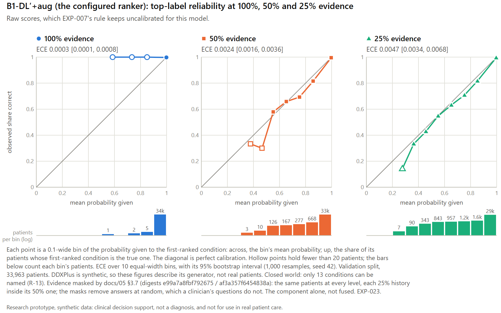

# Results

This chapter reports what we measured. Section 5.2 holds development results on the validation split, which are not verdicts; Section 5.3 holds the verdicts, from the test split, opened once on 2026-11-09 after the code was frozen and marked `[TEST]`. Every figure carries its 95% bootstrap interval, evidence level (100%, 50% or 25% of a patient's history) and model label. Four caveats travel with every figure: the patients are synthetic; the system is closed-world (R-13); the graph's figures on DDXPlus are circular (R-12); reduced-evidence results measure robustness to random missing answers, not history-taking.

## 5.1 Experimental Set-up

The evaluation protocol was frozen on 2026-09-17, before any model was trained. Later changes were dated amendments; amendments 3 and 3a came after the baselines B0 and B1 were scored. **The reading in force is amendment 3b (2026-11-07): H1-R, H2-R, H6 and the reduced-evidence Target and Stretch are judged at 25% evidence only, with 50% reported beside them.** The project owner [[name]] took that recommendation; **the other team members' agreement is not recorded**, and the choice was made after validation figures were known.

We use DDXPlus [@tchango2022], synthetic data filtered to 13 chest-pain conditions: validation has 33,963 patients (16,943 with a must-not-miss condition, one whose omission risks death) and test has 34,657 (16,972). Everything was tuned on validation. The system ranks 14 conditions, the 13 plus aortic dissection, which only the graph and the rules can rank.

Every model is near-perfect on complete histories (R-16), so systems are also scored at 50% and 25% of a patient's evidence, with random masks whose digests were recorded before any scoring (Appendix C). The suffix `+aug` marks training on masked histories; a prime (′) marks an "asked" channel that separates a denied question from one never asked. B1 comes as XGBoost (B1-XGB) and logistic regression (B1-LR). A0 is the full system with a small transformer (B1-DL+aug); A0′, the shipped system, uses B1-DL′+aug.

Ratio metrics carry a 95% bootstrap interval (1,000 resamples); [1.000, 1.000] means no error was observed. A hypothesis is supported only if every paired comparison passes. The primary metric is must-not-miss recall@3 (target at least 0.95); the others are top-3 accuracy, mean reciprocal rank (MRR) and expected calibration error (ECE, target below 0.10).

## 5.2 Development Results on the Validation Split

Every figure here is a validation figure.

- **Complete histories are saturated (R-16).** B1-XGB and B1-LR rank the true condition in the top 3 for every validation patient (top-3 and must-not-miss recall@3 both 1.0000 [1.0000, 1.0000]), because for 91.7% of patients no other condition's evidence list holds their positive answers.
- **Short histories broke the original B1; masked training repaired it (R-18).** Given no evidence, B1-XGB answered atrial fibrillation with probability 1.000, because its encoding made a question answered "no" and one never asked the same row. At 25% the original B1 fails both safety targets and every model trained on masked copies meets them (Table 5.1).
- **The transformer passed its safety floor (D-13).** A small transformer in the style of the FT-Transformer [@gorishniy2021] could replace logistic regression only under a rule fixed before training. Against B1-LR′+aug at 25% the paired difference is +0.0006 [−0.0001, +0.0013] on must-not-miss recall@3 and +0.0018 [+0.0009, +0.0026] on MRR, so B1-DL′+aug became the ranker.
- **Fusion adds nothing measurable (EXP-006).** The graph's weight α in a logarithmic opinion pool [@genest1986] was set by a pre-fixed rule (α = 0.05). At 25% (flags off) the fused and model-alone MRR are 0.9727 [0.9715, 0.9739] and 0.9728 [0.9715, 0.9740]. The graph alone reaches top-1 0.9234 [0.9206, 0.9259] at 100% with no training: circularity (R-12), not skill.

**Table 5.1.** B1 at 25% evidence, original and retrained (validation; seed 42; targets: recall at least 0.95, dangerous false-negative rate at most 0.02).

| Model (25%) | Top-1 | Must-not-miss recall@3 | Dangerous false-negative rate |
|---|---|---|---|
| B1-XGB | 0.245 [0.240, 0.250] | 0.877 [0.872, 0.882] | 0.059 [0.056, 0.062] |
| B1-LR | 0.766 [0.761, 0.770] | 0.925 [0.921, 0.929] | 0.024 [0.021, 0.026] |
| B1-XGB′+aug | 0.948 [0.946, 0.950] | 0.998 [0.997, 0.998] | 0.000 [0.000, 0.000] |
| B1-LR′+aug | 0.946 [0.944, 0.948] | 0.997 [0.997, 0.998] | 0.000 [0.000, 0.001] |

## 5.3 Results on the Test Split

**Every figure in this section is `[TEST]`.** We opened the test split once, on 2026-11-09, in one run of the frozen code (commit `f644faa`). Both mask digests reproduced before any label was read, one opening was recorded, nothing was re-run, and the split must not be scored again. Of the seven hypotheses judged on it, **five are not supported**.

**Table 5.2.** Verdicts (`[TEST]`; seed 42; seeds out of 5; reduced-evidence claims at 25%), as on validation.

| Claim | A0 | A0′ | Seeds | What stands behind it |
|---|---|---|---|---|
| H1, H2 at 100%: fusion beats the model alone on top-3, MRR and must-not-miss recall | not supported | not supported | 0 | Every machine-learning comparator misses 0 of 34,657; A0's MRR is lower |
| H1-R, H2-R at 25%: the same, against every B1 variant | not supported | not supported | 0 | Models trained on masked copies are level on top-3 and ahead on MRR |
| H3: a grounded explanation beats a language model alone | not supported | n/a | n/a | Validation, 50 patients (Section 5.5); not on the test split |
| H4: removing the graph hurts recall more than top-1 | supported, hollow | supported, hollow | 5 | The flags lower top-1; the graph contributes nothing measurable |
| H5: ECE below 0.10 | supported | supported | 5 | Raw ECE at 100%: A0 0.0099 [0.0094, 0.0103]; A0′ 0.0398 [0.0394, 0.0402] |
| H6: the deep ranker beats each classical model trained like it, at 25% | not supported | not supported | 0 | Beats B1-LR+aug, level with B1-XGB+aug |
| Minimum: runs end to end; A0 beats B0 | met | met | 5 | Top-3 at 100%: A0 1.0000 [1.0000, 1.0000]; B0 0.3061 [0.3013, 0.3109] |
| Target and Stretch at 100% | not met | not met | 0 | Machine-learning comparators tie at 1.000; the template explainer's unsupported-claim rate and clinician-reviewed explainability are not assessed |
| Target at 25% | not met | **met** | 0 (A0), 5 (A0′) | A0′ misses 40 of 34,657 patients in the top 3 |
| Stretch at 25% | not met | not met | 0 | Neither arm passes every test |

**Table 5.3.** Ranking and safety by level (`[TEST]`; seed 42; 34,657 patients, 16,972 must-not-miss). Missed: outside the top 3, must-not-miss in brackets.

| Level | System | Top-3 | Must-not-miss recall@3 | Missed |
|---|---|---|---|---|
| 100% | B1-XGB, B1-LR, B1-DL′+aug, A0, A0′ | 1.0000 [1.0000, 1.0000] | 1.0000 [1.0000, 1.0000] | 0 (0) |
| 50% | B1-XGB | 0.9899 [0.9887, 0.9909] | 0.9858 [0.9840, 0.9875] | 351 (241) |
| 50% | B1-LR | 0.9958 [0.9951, 0.9964] | 0.9930 [0.9917, 0.9942] | 147 (119) |
| 50% | B1-DL′+aug | 1.0000 [0.9999, 1.0000] | 0.9999 [0.9998, 1.0000] | 1 (1) |
| 50% | A0 | 0.9999 [0.9999, 1.0000] | 0.9999 [0.9998, 1.0000] | 2 (1) |
| 50% | A0′ | 1.0000 [0.9999, 1.0000] | 0.9999 [0.9998, 1.0000] | 1 (1) |
| 25% | B1-XGB | 0.9035 [0.9003, 0.9068] | 0.8710 [0.8659, 0.8764] | 3,346 (2,190) |
| 25% | B1-LR | 0.9436 [0.9412, 0.9461] | 0.9198 [0.9156, 0.9238] | 1,954 (1,361) |
| 25% | B1-DL′+aug | 0.9988 [0.9985, 0.9991] | 0.9986 [0.9980, 0.9991] | 41 (24) |
| 25% | A0 | 0.9979 [0.9974, 0.9983] | 0.9981 [0.9974, 0.9987] | 73 (32) |
| 25% | A0′ | 0.9988 [0.9985, 0.9992] | 0.9986 [0.9980, 0.9991] | 40 (24) |

Four points stand behind the verdicts.

- **H4's support is hollow.** Removing the graph and the flags (A1) leaves must-not-miss recall@3 unchanged (degradation 0.0000) while top-1 rises by 0.1642 [0.1606, 0.1685], from 0.8346 (A0) to 0.9987, because the flags no longer push their conditions first. Against A1b, which keeps the flags and drops only the graph, the contrast is 0. H4 is not evidence that the graph helps.
- **The reduced-evidence Target is met by A0′ only, on a handful of patients.** At 25% A0′ misses 40 of 34,657 patients in the top 3 (24 of 16,972 must-not-miss) and B1-XGB′+aug 56 (33), but A0 misses 73 (32) against B1-XGB+aug's 71 (36), and B1-DL′+aug misses 41: the fused system equals its own component to within a patient, so this is not a robust win.
- **At 100% the machine-learning comparators are at a ceiling (R-16).** They miss nobody, so no test can pass against them; the graph alone (B2, circular) misses 27 patients (4 must-not-miss). A0's MRR is lower than B1-XGB's, 0.9157 [0.9135, 0.9175] against 0.9994 [0.9992, 0.9996] (−0.0837 [−0.0859, −0.0819]), because the flags rank a flagged condition first even when it is wrong. At 25% A0 trails B1-XGB+aug by −0.0052 on MRR [−0.0062, −0.0044].
- **H6 fails.** At 25% the transformer beats B1-LR+aug on every metric (MRR +0.0022 [+0.0015, +0.0028]) but is level with B1-XGB+aug (MRR +0.0002 [−0.0005, +0.0009]), and H6 needs every comparator.

## 5.4 Safety, Red Flags and Calibration

The models trained on masked copies meet both safety targets at 25% evidence on the test split and the original B1 does not (Table 5.3). **The value is in training on masked copies, not in the fusion**: at 25% A4 (A0 without the flags) equals A1 (the transformer alone) on MRR, 0.9639 [0.9623, 0.9652] for both `[TEST]`.

Each red-flag rule follows a published pattern [@rogers2011]. Sensitivity is below its 0.95 target at every level and collapses as histories shorten (Table 5.4). We did not loosen a rule to chase the target, because DDXPlus often omits the defining finding and a looser rule would fit the generator, not medicine. Most rules need two or three findings together, so **on partial histories, must-not-miss safety is carried by the ranker, not by the rules.**

**Table 5.4.** The red-flag layer at three evidence levels (A0 and A0′ are identical).

| Measure | 100% | 50% | 25% |
|---|---|---|---|
| Sensitivity, `[TEST]` | 0.8285 [0.8229, 0.8344] | 0.3318 [0.3245, 0.3386] | 0.1369 [0.1317, 0.1420] |
| Sensitivity, validation | 0.823 [0.818, 0.829] | 0.327 [0.320, 0.334] | 0.135 [0.130, 0.140] |
| Strict precision, `[TEST]` | 0.5089 [0.5047, 0.5128] | 0.6469 [0.6379, 0.6550] | 0.8220 [0.8084, 0.8352] |
| Patients without a must-not-miss condition flagged, validation | 0.246 [0.240, 0.253] | 0.050 [0.046, 0.053] | 0.007 [0.006, 0.008] |

Calibration asks whether a probability matches how often it is right [@guo2017]; A0's and A0′'s raw ECE at 100% is under the 0.10 target (Table 5.2). The pre-registered rule kept the machine-learning components' raw scores (ECE at most 0.011 at every level); calibrators fitted on full histories over-sharpen short ones. For A0′'s fused score it chose temperature scaling, and **we did not deploy it**: on hand-written cases it makes the near-certainty worse (GC-002's first condition goes from 0.936 to 0.998; R-17), so the project owner decided on 2026-11-09 to show ranks only. Two experiments disagree slightly on A0′'s raw validation ECE at 100% (0.040 against 0.0327 [0.0324, 0.0329]); the cause is unknown and the verdict is the same.

{width=12}

## 5.5 Evidence Retrieval and the Language-Model Trial

Neither measurement is a success; neither affects the ranking.

**Evidence retrieval was built and costed, but its relevance was never judged.** It is retrieval-augmented [@lewis2020]: word-matching search (BM25) and dense search fused by rank, over 2,067 open-access PubMed Central articles (26,190 passages). The two team members who were to judge the passages blind had no time, so **no filled sheet exists and the evidence's relevance is unjudged**; the dashboard says so. The laptop's query vector overlaps the full-sentence embedding's dense top 10 with a median of 0.400, under the pre-registered 0.5, so it is a poor stand-in.

**The language-model explainer failed its checkpoint and does not ship.** The trial (EXP-009 and EXP-010) gave one local model, `llama3.1:8b`, 50 validation patients in four arms (Table 5.5): B3 (the model alone), B3r (told to use only the facts given), B4 (retrieval plus the model) and A0+LLM (the pipeline's result, explained). An unsupported claim is a sentence tracing to no source the arm was given [@ji2023] (a lexical check). The rule, fixed before any call, was that A0+LLM's rate must be under 0.20; it is 0.741 [0.663, 0.803], so the template explainer stays, B3 and B4 are not carried forward and **H3 is not supported**. The guardrails stopped all 50 grounded answers, so the model's prose never reached a user.

**Table 5.5.** Unsupported-claim rates (validation; 50 patients; 100% evidence).

| Arm | Claims | Unsupported | Rate |
|---|---|---|---|
| B3 | 247 | 247 | 1.000 [1.000, 1.000] |
| B3r | 248 | 248 | 1.000 [1.000, 1.000] |
| B4 | 244 | 243 | 0.996 [0.984, 1.000] |
| A0+LLM, raw answer | 220 | 163 | **0.741 [0.663, 0.803]** |

## 5.6 Breakdowns by Condition, Sex and Age

**Near-equal results across sex or age are an artifact of DDXPlus's synthetic demographics, not evidence of fairness.** By condition (`[TEST]`), A0′ at 25% ranks the true condition in the top 3 for at least 0.993 of the patients of each condition, and top-1 is lowest for unstable angina, 0.6896 [0.6726, 0.7059], the confusion with stable angina. By sex (`[TEST]`), A0′'s top-1 at 25% is 0.9375 [0.9338, 0.9410] for women and 0.9368 [0.9330, 0.9408] for men. By age (validation only, as a test breakdown would need a second opening), A0′ keeps must-not-miss recall@3 at 0.9971 or above at 25% in all five bands where B1-XGB is below 0.95 in all five; the youngest band's higher top-1 is a property of the generator, not a finding about children.

## 5.7 Discussion

Most comparative claims we pre-registered are not supported, and we report them so. Masked training produces the safety result; the full system is not better than its own machine-learning component. The graph's argument, an explanation and a condition the model has never seen (aortic dissection, GC-003), is a design argument shown on one hand-written case, not a measured gain. Threats to validity:

- **Synthetic data:** the test split is a second sample from the same generator, so it shows that nothing was fitted to validation, not real-world performance.
- **Circularity (R-12) and closed world (R-13):** the graph is built from the definitions that generated the data, and a patient with pneumonia is forced into one of 14 conditions.
- **Saturation (R-16) and random masks:** at 100% the comparisons could not be won, and masks measure robustness to missing answers, not history-taking.
- **Case translation (R-17):** 17 hand-chosen answers have no ground truth; one was wrong (A-10) and 16 are unchecked.
- **Reading and weight:** the reading was chosen after validation figures were known; the fusion weight, on validation.
- **Not assessed:** retrieval relevance, the template explainer's unsupported-claim rate, clinician review.

# Conclusion and Future Scope

## 6.1 Conclusion

Each verdict is the pre-registered rule's, applied once to the test split; failures first.

- **RQ1, does fusion improve accuracy? No** (H1, H1-R; 0 of 5 seeds): at 100% every machine-learning comparator misses 0 of 34,657, and A0's MRR is lower (−0.0837 [−0.0859, −0.0819]) `[TEST]`.
- **RQ2, does it improve safety? No** (H2, H2-R; 0 of 5 seeds): the safety result belongs to masked training.
- **RQ3, does grounding reduce unsupported claims? Not supported** (H3): 0.741 [0.663, 0.803] against under 0.20, so the template explainer ships (validation).
- **RQ6, does a deep ranker hold up on short histories? Not supported** (H6; 0 of 5 seeds): it beats logistic regression and is level with XGBoost.
- **RQ4, which components contribute? H4 holds, hollowly:** removing the graph changes must-not-miss recall by 0.0000; the contrast is the flags lowering top-1 by 0.1642 [0.1606, 0.1685] `[TEST]`.
- **RQ5, are the scores calibrated? Yes, raw** (H5; 5 of 5 seeds; ECE under 0.10 `[TEST]`); only ranks are shown.

The Minimum is met. The Target and Stretch at 100% are not, because the machine-learning comparators tie at 1.000; the reduced-evidence Target is met by A0′ only, on a handful of patients, and the reduced-evidence Stretch is not. On synthetic data, a small transformer trained on masked copies keeps must-not-miss recall@3 above 0.99 at a quarter of a history, while the graph and the rules add explanations and a safety net, not measurable accuracy. Nightingale is a research prototype with no clinical validation: it provides decision support only, never a diagnosis, and a qualified clinician makes every decision.

## 6.2 Future Scope

- An independent test set of clinical vignettes, escaping the graph's circularity (R-12).
- An abstention signal for the closed world (R-13).
- Blind relevance judging of the retrieved passages, and clinician review of the explanations and golden cases.
- Red-flag rules that survive short histories, and a check of the other 16 representative answers (R-17).
- Interactive history-taking, and real de-identified data under proper approvals.

## Appendix A. Data Sources, Licences and Attribution

No real patient data enters the project, and `data/` is never committed. **The project is non-commercial in three independent ways**: BODHI-S, the embedding model and 844 of the corpus's 2,067 articles allow non-commercial use only. Commercial use would need all three replaced, and the graph built from BODHI-S stays private.

**Table 6.1.** Data sources, licences (re-verified 2026-11-10) and status.

| Source | Used for | Licence | Status |
|---|---|---|---|
| DDXPlus [@tchango2022; @ddxplus_card] | Training and test data, the graph's backbone | CC-BY-4.0 | Verified |
| BODHI-S [@bodhis_card] (Eka Care) | Enrichment of four conditions in the graph | CC-BY-NC-4.0, non-commercial | Verified; no BODHI-S text is committed |
| Synthea [@walonoski2018] (MITRE) | Synthetic patient histories, display only | Apache-2.0 | Verified |
| PubMed Central Open Access (NCBI) | The evidence corpus, 2,067 articles | Per article; 844 non-commercial | From the corpus manifest; each excerpt shows its licence |
| S-PubMedBert-MS-MARCO (`pritamdeka`) | Passage vectors | CC-BY-NC-2.0, non-commercial | Verified; missing from the register of 2026-09-17 |
| Llama 3.1 8B (Meta) | The language-model trial only; not shipped | Llama 3.1 Community Licence | **Not re-verified: the licence page is gated** |

## Appendix B. Golden Clinical Cases

The four golden cases are hand-written, synthetic and executable; no expectation has been changed, and all four pass with every model, red flags on and off. They reach the model through a hand-curated translation with no ground truth (R-17).

**Table 6.2.** The golden cases and how the system behaves on each.

| Case | Presentation | Expectation and behaviour |
|---|---|---|
| GC-001 | A 58-year-old man, a diabetic smoker, with exertional, pressure-type chest pain radiating to the jaw and arm, with sweating | Possible myocardial infarction in the top 3, flagged. The graph ranks it first; the model alone answers unstable angina, which a history cannot separate from it |
| GC-002 | A 42-year-old woman with sudden pleuritic pain, breathlessness and a swollen leg after immobilisation | Pulmonary embolism in the top 3, flagged; first by the graph and by the model |
| GC-003 | A 64-year-old hypertensive man with sudden tearing pain to the back and an arm blood-pressure difference | Aortic dissection in the top 5, flagged. No model can score it (DDXPlus has none); the graph ranks it first, and the fusion keeps it first with flags off. This case justifies the graph |
| GC-004 | A 35-year-old woman with burning pain after meals, worse lying flat; exertional onset, jaw or arm radiation and sweating all denied | Gastro-oesophageal reflux disease (GERD) in the top 3, with no red flag: a benign presentation must not raise a cardiac flag |

## Appendix C. Reproducibility

Code, configuration and records are in the repository; data and trained models are not. The validation rehearsal reproduced 1,944 of 1,944 earlier recorded figures exactly. The test split must not be scored again.

**Table 6.3.** Tags, digests and the single opening record.

| Item | Value |
|---|---|
| `0f47d67` (2026-09-25) | Validation mask digests recorded before any system was scored on them |
| `v0.9-freeze` (`808bceb`, 2026-11-09) | `configs/`, `src/` (outside `src/eval/`) and `tests/fixtures/` frozen before the test split |
| `f644faa` (2026-11-09) | Test-scoring notebook and test mask digests; the single opening ran on this commit |
| `04b5eb7` (2026-11-10) | The test results recorded in the experiment log |
| Validation mask digest; asked-set digest | `e99a7a8fbf792675`; `af3a357f6454838a` |
| Test mask digest; asked-set digest | `0136f67f1ca6542f`; `795acf2689f1415e` |
| Knowledge graph fingerprint | `de349201157a` |
| The single opening of the test split | 2026-11-09T08:07:22Z, at `f644faa`, no reopening reason; result file hash begins `f4100057ef462b94` |

## Appendix D. How to Run the System

From the repository root on Windows (data and trained models in place; `--graph stub` runs the demo without data). Every screen carries the disclaimer: "Clinical decision support — not a diagnosis. Nightingale is a research prototype. Its output is generated from synthetic training data and must not be used for real patient care. Rankings are not certainties and confidence values are estimates. A qualified clinician is responsible for all diagnostic and treatment decisions."

```
./.venv/Scripts/python.exe -m pytest
./.venv/Scripts/python.exe -m streamlit run app/streamlit_app.py
./.venv/Scripts/python.exe scripts/serve_api.py
./.venv/Scripts/python.exe scripts/demo.py --case GC-003
```

```abbreviations
A0 = The full system with B1-DL+aug as its machine-learning component (A0′: with B1-DL′+aug)
A1, A1b, A4 = Ablations of the full system (no graph and no flags; no graph; no flags)
A-10 = Decision A-10 (the answer used for radiation to the jaw or arm)
B0, B1, B2, B3, B4 = Baselines (prevalence, machine learning, graph alone, language model alone, retrieval plus language model)
B1-DL = The small transformer used as the deep ranker
B1-LR = Logistic-regression form of B1
B1-XGB = XGBoost form of B1
BM25 = Best Matching 25 (a word-matching search function)
CC-BY = Creative Commons Attribution licence
CC-BY-NC = Creative Commons Attribution-NonCommercial licence
D-13 = Decision D-13 (the transformer's safety floor)
DDXPlus = A synthetic differential-diagnosis dataset
ECE = Expected Calibration Error
EXP = Experiment (a numbered entry of the experiment log)
GC = Golden Case
GERD = Gastro-Oesophageal Reflux Disease
H1 to H6 = Hypotheses 1 to 6 (H1-R, H2-R, H6: judged at 25% evidence)
LLM = Large Language Model
MRR = Mean Reciprocal Rank
NCBI = National Center for Biotechnology Information
R-12, R-13, R-16, R-17, R-18 = Risks in the risk register (circularity, closed world, saturation, case-to-token translation, not-asked read as no)
RQ = Research Question
```
